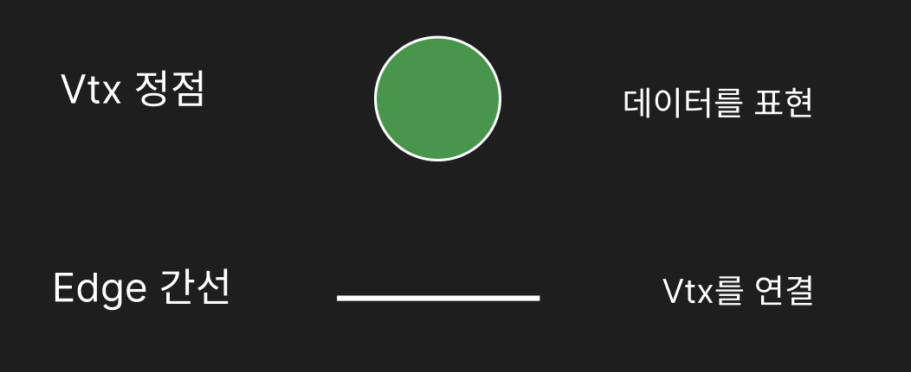
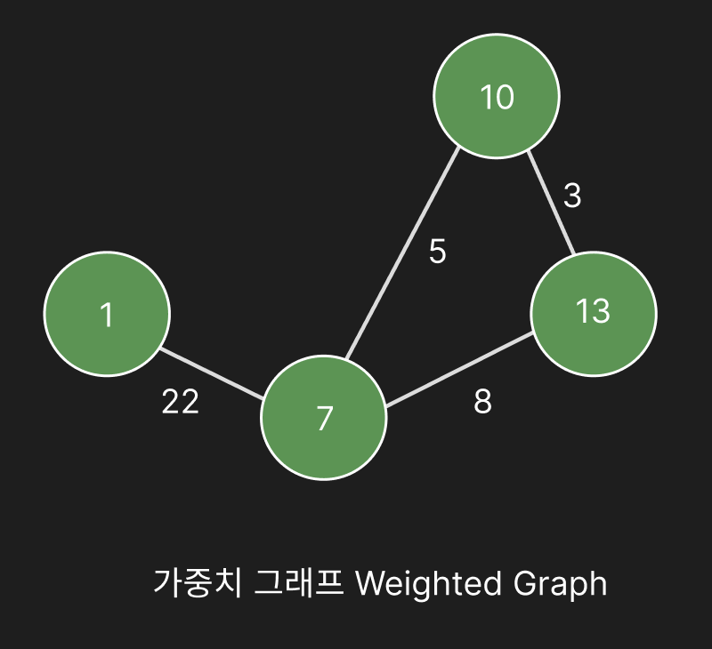
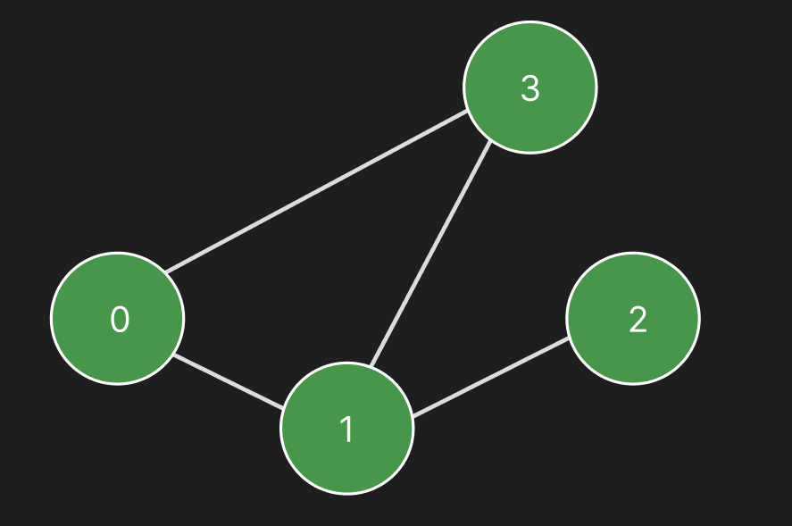
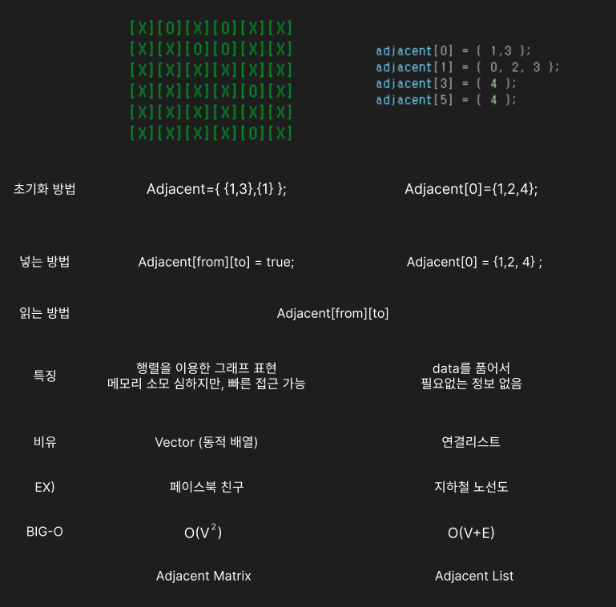

### 그래프와 인접 행렬, 인접 리스트

Graph를 표현하는 방법은 크게 두 가지가 있다.

- **인접 행렬 (Adjacent Matrix)**
- **인접 리스트 (Adjacent List)**

먼저 그 전에, Graph가 무엇인지부터 알아보자.

---

### 1. Graph 기초

그래프의 기본 구성 요소는 **Vtx(정점)** 와 **Edge(간선)** 이다.

<table width="90%" style="table-layout: fixed; border-collapse: collapse; border: none;"> <tr style="border: none;"> <td width="100%" style="text-align: center; border: none; padding: 15px;">  <br><strong>GraphBasic</strong> </td>  </tr> </table>

| 구성 요소     | 의미      |
| --------- | ------- |
| Vtx (정점)  | 데이터를 표현 |
| Edge (간선) | Vtx를 연결 |


### 2. 가중치 그래프 Weight Graph
<table width="90%" style="table-layout: fixed; border-collapse: collapse; border: none;"> <tr style="border: none;"> <td width="100%" style="text-align: center; border: none; padding: 15px;">  <br><strong>WeightGraph</strong> </td>  </tr> </table>
- 간선에 가중치(비용)가 붙어있는 그래프다
- 방향이 없다면 양방향 그래프이다.


---
### 3. 예제 그래프 구현


<table width="90%" style="table-layout: fixed; border-collapse: collapse; border: none;"> <tr style="border: none;"> <td width="100%" style="text-align: center; border: none; padding: 15px;">  <br><strong>Graph01</strong> </td>  </tr> </table>

위 그래프는 `0-1`, `0-3`, `1-2`, `1-3` 이 연결된 양방향 그래프이다. 이를 C++로 구현해보자.

#### 3-1. 포인터로 직접 연결
```cpp
#include <iostream>
using namespace std;
#include <queue> //vector가 안에 차피 들어가있음
void graph01()
{
    struct vtx {
        vector<vtx*> edges;
    };

    vector<vtx> weightGraph(4);

    weightGraph[0].edges.push_back(&weightGraph[1]);
    weightGraph[0].edges.push_back(&weightGraph[3]);

    weightGraph[1].edges.push_back(&weightGraph[0]);
    weightGraph[1].edges.push_back(&weightGraph[0]);
    weightGraph[1].edges.push_back(&weightGraph[0]);

    weightGraph[2].edges.push_back(&weightGraph[1]);

    weightGraph[3].edges.push_back(&weightGraph[0]);

}

int main()
{
    graph01();
}
```

#### 3-2. 벡터로 간선 목록 관리

```cpp
2차원 배열로 활용
vector<vector<int>> adjacent;

//struct정의를 활용한 
struct Mystruct { vector<int> vt};
vector<Mystruct> adjacent2;


//사용법
adjacent[0][1];
adjacent2[0].vt[1];
```

| |`vector<vector<int>>`|`vector<Mystruct>`|
|---|---|---|
|접근|`adjacent[i][j]`|`ad[i].vt[j]`|
|추가|`adjacent[i].push_back(3)`|`ad[i].vt.push_back(3)`|
|크기|`adjacent[i].size()`|`ad[i].vt.size()`|
|선언|한 줄|struct 정의 필요|

- 사용법에 차이가 있을 뿐 메모리 구조는 같다. 

---
### 4. 인접 리스트 (Adjacent List)
연결된 정점만 리스트로 저장하는 방식이다.

``` cpp
void AdjacentList()
{
    struct Vertex
    {
        int Edges;
    };
    vector<Vertex> v(4);
    vector<vector<int>> adjacent(4, vector<int>>(4, 0));
    
    adjacent[0] = { 1 };
    adjacent[1] = { 2 };
    adjacent[2] = { 1, 3 };
    adjacent[3] = { 0, 1 };
}
```

- 데이터를 풀어서 저장하기 때문에 **필요 없는 정보가 없다.**
- 비유: **연결 리스트**
- 예시: **지하철 노선도**
- 시간 복잡도(공간): **O(V+E)**

---

### 5. 인접 행렬(Adjacent Matrix)

행렬을 이용해 정점간 연결 여부를 표현하는 방식이다.

``` cpp

void AdjacentMatrix()
{
	struct Vertex{
	int data;
	};
	
	vector<Vertex> v(4);
	
	//이거 확인
	vector<vector<bool>> adjacentMatrix(4, vector<bool>(4, false));
	adjacentMatrix = {
		{0 , 1, 0 , 0 },
		{0 , 0, 1 , 0 },
		{0 , 1, 0 , 1 },
		{1 , 1, 0 , 0 },
	};
		
		//1-3연결?
	bool connected = adjacentMatrix[0][3];

}
```
[Vector](https://piusai.github.io/c++/2026/09/16/Container.html) 이중 벡터로 초기화 해서 넣어줌.


- 행렬을 이용한 그래프 표현이다.
- 메모리 소모가 심하지만, **빠른 접근**이 가능하다.
- 비유: **Vector (동적 배열)**
- 예시: **페이스북 친구**
- 시간 복잡도(공간): **O(V²)**

---
### 6. 인접 행렬 vs 인접 리스트
<table width="90%" style="table-layout: fixed; border-collapse: collapse; border: none;"> <tr style="border: none;"> <td width="100%" style="text-align: center; border: none; padding: 15px;">  <br><strong>Adjacent</strong> </td>  </tr> </table>


---
### Future Study
대학원 수업 중 뉴럴 네트워크 수업에있어서, `연결 노드 / 그래프`를 활용하여 연구 주제를 잡아 논문을 쓰는 과제가 있는데 언리얼 엔진에서의 RDG관련해서 작성 할 계획이다.