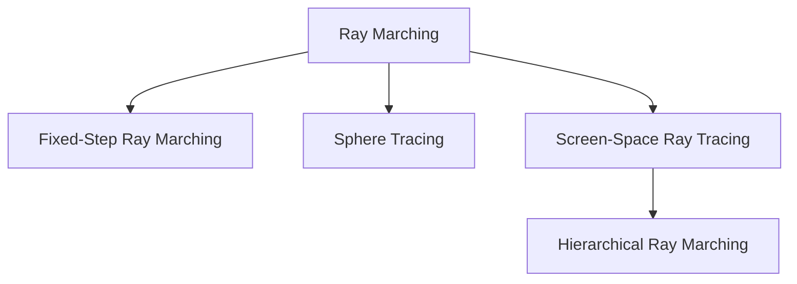
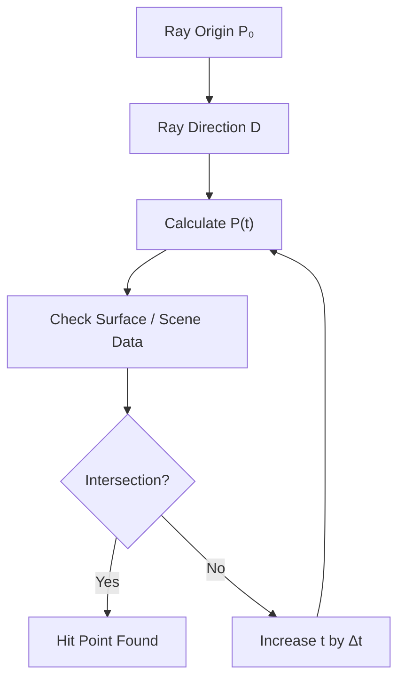
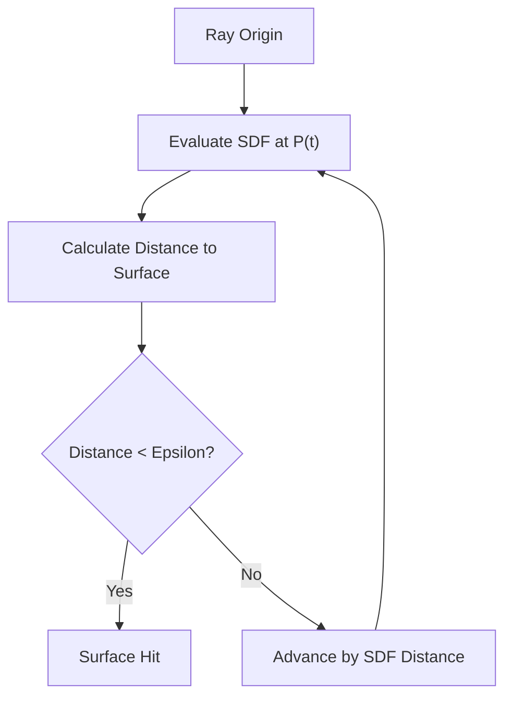
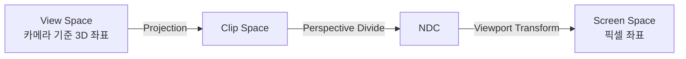
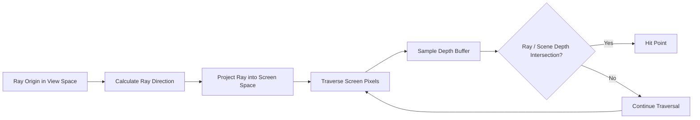
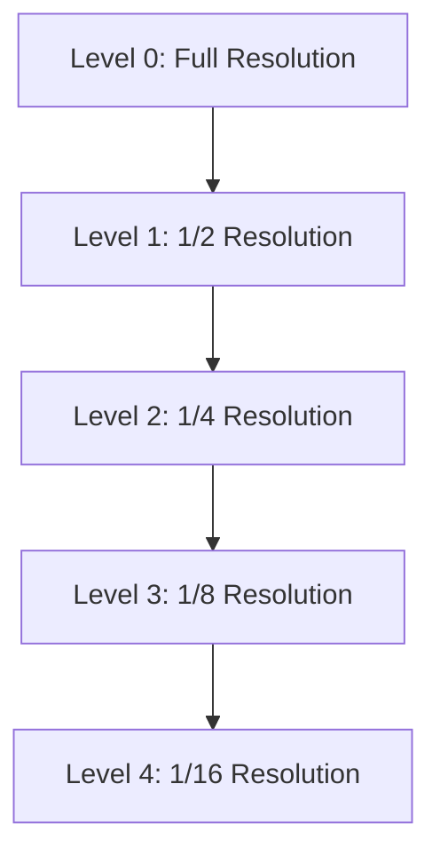

Ray Tracing에서 자주 등장하는 개념 중 하나인 **Ray Marching**을 알아보자.

Ray Marching의 기본원리는 Ray를 일정한 방향으로 조금씩 Marching(전진)시키며,  
매 위치에서 공간(또는 화면) 정보를 검사하는 기법이다.

광선의 시작점에서 진행 방향을 따라 이동하고, 각 위치에서 표면이나 물체와 교차하는지 확인한다. 이러한 과정을 반복하여 광선이 물체와 만나는 위치를 찾거나, 공간 내부의 정보를 Sampling한다.

RayMarching은 사용하는 데이터와 탐색 방식에 따라 3D공간의 SDF(Signed Distance Function) 기반 탐색 부터, Depth Buffer를 활용하는 Screen-Space Ray Tracing까지 다양하게 활용된다.

---




- Fixed-Step / Sphere Tracing : 3D 공간에서 Marching( SDF, volume 등)
- Screen - space /Hierarchical : 화면공간(Depth Buffer)에서 Marching


### 1. Ray Marching의 기본 원리

#### 1.1 Ray Equation

광선 위의 한 점은 시작점과 진행방향, 이동거리를 이용하여 다음과 같이 표현한다.  

$$P(t)=P_0+tD$$

- $P_o$ : 광선의 시작점(Origin)
- $\mathbf D$: 광선의 진행 방향(Direction)
- $\mathbf p(t)$ : 현재 광선의 위치
- $t$ : 광선의 진행 거리 또는 매개변수

> $\mathbf{D}$가 단위 벡터(Normalize된 상태)이면 $t$가 곧 **실제 이동 거리**로 해석 가능하다.

#### 1.2 Marching Process

가장 기본적인 Ray Marching은 시작점에서 일정한 간격으로 광선을 이동시키면서 각 위치를 검사한다.

$$t_{i+1}=t_i+\Delta t$$

$$P_i=P_0+t_i\mathbf{D}$$
- $\Delta t$ : 한 번의 이동에서 사용하는 Step Size
- $t_i$ : 현재 반복 단계의 진행 거리
- $P_i$ : 현재 검사 위치
예를들어 Step size가 1이라면 다음과 같이 이동

$$t=0,\ 1,\ 2,\ 3,\ 4,\ldots$$
각 위치에서 표면과의 교차 여부를 검사하고, 교차가 확인되면 탐색을 종료한다.

```
  P0 ●──────●──────●──────●──────●──────●──▶ D
     t0     t1     t2     t3     t4     t5
     └─Δt──┘
     각 점(●)에서 "지금 위치가 물체 안/표면인가?"를 검사
```


이 과정을 반복하면서 물체의 표면과 교차 지점을 찾는다.



핵심은 광선을 한 번에 이동시키는 것이 아니라, 여러 위치에서 **반복적으로 정보를 검사한다는 것이다.**

---
### 2. Marching 방식에 따른 차이

Ray Marching에서 중요한 부분 중 하나는 광선을 얼마나 이동시킬 것인지 결정하는 방법이다.
대표적으로 Fixed-Step과 Sphere Tracing이 있다.

#### 2.1 Fixed-Step Ray Marching

가장 단순한 형태의 Ray Marching이다.

광선의 진행방향을 따라 일정한 간격 $\Delta t$으로 이동하며, 각 위치에서 표면과의 교차 여부를 검사한다.

$$
t_{i+1}=t_i+\Delta t
$$

| 장점                  | 단점                                        |
| ------------------- | ----------------------------------------- |
| 구현이 매우 단순           | $\Delta t$가 크면 **얇은 물체를 건너뜀 (tunneling)** |
| 볼륨(구름/연기) 적분에 자연스러움 | $\Delta t$를 줄이면 **비용 급증**                 |

<table width="100%" style="table-layout: fixed; border-collapse: collapse; border: none;"> <tr style="border: none;"> <td width="100%" style="text-align: center; border: none; padding: 15px;">  <br><strong>Fixed-Step Ray Marching</strong> </td>  </tr> </table>

이처럼 Fixed-Step 방식은 매번 동일한 거리만큼 이동하기 때문에 현재 위치와 표면 사이의 실제 거리를 고려하지 않는다. 따라서 공간 거리 정보를 이용하여 이동 거리를 조절하는 방식이 필요하다.
> 보완책 : Hit 직전 /직후 구간에서 이진탐색(Bisection)으로 교차점을 정밀화

### 3. Sphere Tracing
Sphere Tracing은 **Signed Distance Function(SDF)** 을 이용하여 현재 위치에서 표면까지 안전하게 이동할 수 있는 거리를 계산하는 방식이다.

Fixed-Step 방식은 매번 동일한 거리만큼 이동하지만, Sphere Tracing은 현재 위치에서 가장 가까운 표면까지의 거리를 다음 이동 거리로 사용한다.

$$
d=\operatorname{SDF}(P)
$$
- $d>0$ : Surface 바깥쪽
- $d=0$ : Surface 위
- $d<0$ : Surface 내부

Houdini의 Sample값과 동일하다 : [VolumeSample VEX Function](https://www.sidefx.com/docs/houdini/vex/functions/volumesample.html)

현재 위치에서 계산한 SDF 값을 다음 이동 거리로 사용한다.

$$
t_{i+1}=t_i+d(P_i)
$$




이러한 방식은 표면에 가까워질수록 자연스럽게 이동거리가 줄어들기 때문에, 고정 간격 방식보다 효율적으로 intersaction 지점을 탐색 할 수있다.


<table width="100%" style="table-layout: fixed; border-collapse: collapse; border: none;"> <tr style="border: none;"> <td width="100%" style="text-align: center; border: none; padding: 15px;">  <br><strong>SphereTrace Ray Marching</strong> </td>  </tr> </table>


단, 안전한 이동 보장을하려면, SDF가 정확한 거리 함수이거나, 적어도 실제 Surface까지의 안전한 거리 하한을 제공해야한다.

#### 3.1 Houdini에서의 VDB SDF
Houdini에서도 SDF를 활용한 다양한 작업을 수행 할 수있다.

특히 VDB SDF는 공간 Voxel 기반으로 표현하면서, 각 위치의surface 까지의 부호있는 거리 정보를 저장한다.

이를 활용하면 다음과 같은 작업이 가능하다.

- Boolean 연산
- 표면 충돌 및 거리 검사
- SDF 기반 Ray Marching
- Volume to Polygon을 통한 표면 메쉬 생성
    
여기서 Volume to Polygon은 SDF의 등위면(Isosurface)을 추출하여 Polygon Mesh로 변환하는 작업이다.

  Sphere Tracing과 동일한 작업은 아니지만, 두 방식 모두 $f(P)$, SDF를 활용한다는 공통점이 있따.


#### Fixed Step vs Sphere Tracing
<table width="100%" style="table-layout: fixed; border-collapse: collapse; border: none;"> <tr style="border: none;"> <td width="100%" style="text-align: center; border: none; padding: 15px;">  <br><strong>FixedStep vs SphereTrace</strong> </td>  </tr> </table>


---
### 4. Screen-Space RayTracing
앞서 살펴본 Fixed-Step과 Sphere Tracing은 광선이 이동할때 사용하는 거리 정보를 기준으로 구분하는 방식이다. 이번에는 탐색하는 공간과 사용하는 Data가 달라지는 Screen-Sapce Ray Tracing을 알아본다.  
Screen-Space RayTracing은 실제 3D Scene 전체를 탐색하는대신, 화면에 **렌더링된 정보를 이용**하여 Ray와 Scene의 교차 여부를 판단하는 방식이다.

대표적으로 Depth Buffer를 활용한다.
#### 4.1 Depth Buffer
- 각 픽셀에 해당하는 Surface의 Depth 정보를 저장한다.
렌더링 과정에서 Camera - Surface 사이의 Depth 관계를 기록하기 때문에, 화면에 보이는 Surface 위치를 추정할 수 있다.

<table width="100%" style="table-layout: fixed; border-collapse: collapse; border: none;"> <tr style="border: none;"> <td width="100%" style="text-align: center; border: none; padding: 15px;">  <br><strong>DepthBuffer</strong> </td>  </tr> </table>

다만, 화면에 보이는 surface만 기록하므로, 실제 3D Scene 전체를 표현하지는 못한다.

#### 4.2 View space ↔ Screen Space 변환

광선의 위치는 일반적으로 View Space에서 계산할 수 있지만, Depth Buffer는 화면의 픽셀 좌표를 기반으로 저장된다.

따라서 Ray의 위치를 View Space로 Projection하는 과정이 필요하다.





<table width="100%" style="table-layout: fixed; border-collapse: collapse; border: none;"> <tr style="border: none;"> <td width="100%" style="text-align: center; border: none; padding: 15px;">  <br><strong>Vray Zdepth</strong> </td>  </tr> </table>
위와 같이 Z-depth를 활용해 Renderpass에서도 Blur를 처리하기도 했었음.
요게 게임엔진에서는 depth buffer로 활용

#### 4.3 Screen-Space Ray Tracing Process

일반적인 SSR Tracing은 다음과 같은 과정으로 진행된다.

1. 현재 Pixel의 Depth Buffer - Camera 정보 이용해 View-Space 위치를 복원
2. Surface normal vector, View Dir를 이용해, 반사/굴절 방향 계산 : 
   $R = reflect(V,N)$ 
3. 광선의 시작점과 진행 방향을 Screen Space로 Projection
4. 화면 공간에서 Ray를 따라 Pixel Permutation(순회)
5. 각 위치에서 Depth Buffer 샘플링, Ray Depth와 비교하며 교차 여부 판단




#### 4.4 주요 문제점

**①** Self-InterSection
광선이 출발한 surface와 다시 교차하는 것처럼 잘못 판단하는 문제
-> 일반적으로 Ray Origin Bias등을 활용해 시작 위치 조금 이동시키거나 교차 판정에 오차 범위 적용

**②** Miss
Screen-Space 방식은 화면에 보이는 정보만을 활용하기에 한계가 있다.
- 화면 밖 존재 물체 찾을 수 없음
- 다른 물체에 가려진 표면의 정보 알 수 없다
- Depth Buffer의 해상도와 Depth 불연속성으로인해, 교차점을 놓칠 수도 있음.


---

### 5. Hierachical Ray Marching

Screen Space RT는 Depth Buffer를 이용하여 교차점을 탐색한다. 모든 픽셀을 동일한 Resolution으로 세밀히 검사하면 반복적인 Depth Sampling으로 인해 연산량 크게 증가 할 수 있음.

그래서 Hierarchical Ray Marching이 나왔다.

#### 5.1 Depth Pyramid
Depth Pyramid(또는 Hi-Z)는 원본 Depth Buffer를 여러 해상도로 축소하면서, 계층적으로 저장한 구조이다.

각 단계는 이전 단계보다 낮은 Resolution을 가지며, 일정 영역에 대한 depth 정보를 요약한다.



원본 Depth Buffer가 1k라면 다음과 같이 구성할 수 있다.

|Level|Resolution|
|---|---|
|Level 0|1024 × 1024|
|Level 1|512 × 512|
|Level 2|256 × 256|
|Level 3|128 × 128|
|Level 4|64 × 64|

#### 5.2 Hierarchical Traversal

Ray가 화면 공간을 이동할때, 처음부터 모든 pixel을 세밀하게 검사하지않고, 낮은 Res의 Depth 정보를 먼저 활용해 탐색 영역 판단한다.

교차 가능성이 없는 영역은 건너뛰고, 교차 가능성이 있는 영역은 더 높은 Res의 Depth Level로 이동하여 세밀히 검사.

<table width="100%" style="table-layout: fixed; border-collapse: collapse; border: none;"> <tr style="border: none;"> <td width="100%" style="text-align: center; border: none; padding: 15px;">  <br><strong>Hierarchical RM</strong> </td>  </tr> </table>

이러한 Hierarchical한 탐색은 불필요한 pixel 검사를 줄이는데 도움을 준다.

다만, Depth Pyramid의 구성방식(Min/Max Depth 등)과 교차 판정 규칙에 따라 탐색 결과와 정확도가 달라질 수 있다.

#### Screen-SPace RM vs Hierarchical RM
<table width="100%" style="table-layout: fixed; border-collapse: collapse; border: none;"> <tr style="border: none;"> <td width="100%" style="text-align: center; border: none; padding: 15px;">  <br><strong>ScreenSpace vs Hierarchical</strong> </td>  </tr> </table>


---

## 6. 정리

Ray Marching은 광선을 따라 공간 또는 화면상의 정보를 반복적으로 검사하여 표면이나 교차점을 탐색하는 기법이다.

이번에 살펴본 주요 방식은 다음과 같다.

1. **Fixed-Step Ray Marching**: 일정한 간격으로 이동하며 공간을 검사한다.
2. **Sphere Tracing**: SDF를 이용해 표면까지의 거리에 따라 이동한다.
3. **Screen-Space Ray Tracing**: Depth Buffer를 이용해 화면 공간에서 교차점을 탐색한다.
4. **Hierarchical Ray Marching**: Depth Pyramid 등의 계층 구조를 이용해 불필요한 탐색을 줄인다.

이러한 방식은 모두 광선을 탐색한다는 공통점이 있지만, 사용하는 공간 정보와 이동 방식, 교차 판정 방법에서 차이가 있다.

특히 실시간 굴절 렌더링을 이해하기 위해서는 Screen-Space Ray Tracing의 Depth 기반 교차 판정과 Hierarchical Traversal을 중점적으로 이해할 필요가 있다.


|구분|Fixed-Step|Sphere Tracing|Screen-Space|Hierarchical|
|---|---|---|---|---|
|분류 기준|이동 방식|이동 방식|탐색 공간|탐색 최적화|
|탐색 정보|공간 정보|SDF|Depth Buffer|Depth Hierarchy|
|이동 방식|고정 간격|거리 기반|화면 픽셀 순회|계층적 탐색|
|주요 특징|단순한 구현|적응형 이동|화면 정보 활용|탐색 효율 개선|
|주요 한계|교차 누락|SDF 품질 의존|화면 공간 한계|계층 구조 및 판정 복잡성|

※ Fixed-Step과 Sphere Tracing은 이동 거리를 결정하는 방식이고, Screen-Space와 Hierarchical은 탐색 공간 및 탐색 구조에 대한 분류로, 서로 완전 배타적인 방식은 아님


#### 한 줄 요약

- **Ray Marching** = 광선을 조금씩 전진시키며 교차를 _탐색_
- **Fixed-Step** → 단순하지만 놓치거나 느림
- **Sphere Tracing** → SDF 거리만큼 안전하게 점프
- **Screen-Space** → Depth Buffer로 3D 장면 대신 화면 정보로 검사
- **Hierarchical** → Depth Pyramid로 빈 공간을 크게 건너뜀

