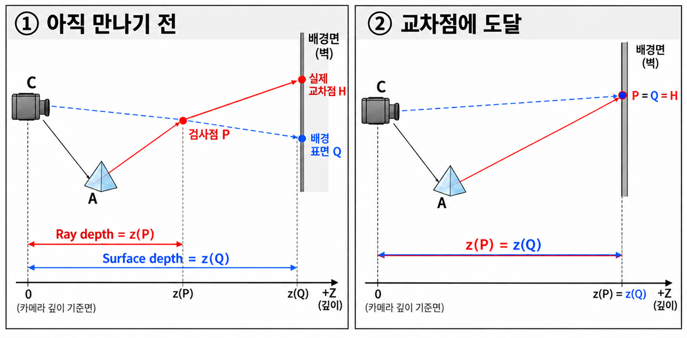
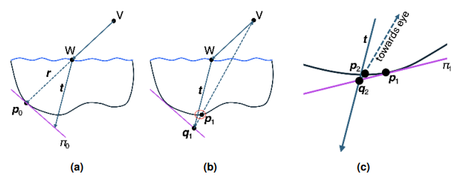

Ray-Marching을 대체하는 새로운 Screen-Space 굴절 방식인 Newton방법을 사용하는 굴절 방식이다.

참고 : [Ultrafast Screen-Space Refractions and Caustics via Newton's Method](https://jcgt.org/published/0015/01/03/paper-lowres.pdf?utm_source=chatgpt.com)

---
### Abstract
- **핵심 방법** : Refraction된 Ray depth와 G-Buffer depth의 차이를 Fcuntion으로 정의하고, 현재의 G-buffer point의 Tangent plane을 이용해, intersection을 반복적으로 개선한다.
- **실패 사례 대응** : Depth Discontinuities나, 잘못된 초기 추즉핱은 실패 사례분석, 감지하고, 완화, 해결하기위한 실용적인 전략 제안한다.
- **Caustic 가속** : Refraction Ray에대한 이 접근 방식으로 Screen-space Caustic의 계산 속도를 향상 시킨다.

---
### 1. Introduction
유리/물같은 투명재질을 사실적으로 Rendering하려면 Refraction, Caustic을 시뮬레이션 하는것이 중요한데, Offline Ray Tracing은 이러한 효과를 매우 정확히 모델링할 수 있겠지만, 실시간에서는 시각적 품질과 성능 사이의 균형을 위해 근사법이 필요하다.

- 일반적인 해결법 : Screen space에서 작업하는 DepthBuffer와 Normal buffer를 이용해 화면에 보이는 Geometry만을 고려한다. 전체 Scene Geometry 몰라도 interfactive한 굴절 효과, 근사적 Caustic 구현이 가능하다. [Efficient GPU Scree-Space Raytracing](https://piusai.github.io/graphics/2026/10/31/Efficient-GPU-Screen-spaceRT.html)
- Hierarchical Search : RayMarching을 계층적으로 진행하는 방법도 있지만, 단계별로 진행해야해서 bottle-neck현상이 남는다.
- 이 논문의 아이디어 : 잠재적인 해가 1차원 공간에 존재한다는 점을 활용하여 근 찾기 괴정을 최적화한다. Newton's iterative root-finding mothd(뉴턴 반복적 근 찾기 방법)은 **이차 수렴** 특성이 있어 Screen-space 환경에서도 효율성을 높일 수 있다.

#### 문제 정의
광선 위의 점:

$$
\mathbf r(t)=\mathbf o+t\mathbf d
$$

- 질문:  **"어떤 $t$에서 광선이 표면과 만나는가?"** 
- 광선의 시작점 $o$에서 방향 $d$로  $t$만큼 진행한 3D 위치이다.

화면 투영 :

$$
\pi(\mathbf r(t))=(u,v)
$$

- 3D 위치를 화면에 Projection해서 **어느 Pixel에 해당하는지**를 구함($\pi$ : projection)

목적 함수:

$$
\boxed{ f(t)= \underbrace{z_{\mathrm{ray}}(t)}_{\text{광선 위 점의 깊이}} - \underbrace{z_{\mathrm{surface}}(u,v)}_{\text{그 픽셀의 표면 깊이}} }
$$

$$
\boxed{f(t)=0 \Rightarrow \text{화면 공간에서의 교차 후보}}
$$

<table width="100%" style="table-layout: fixed; border-collapse: collapse; border: none;"> <tr style="border: none;"> <td width="100%" style="text-align: center; border: none; padding: 15px;">   <strong>SurfaceDepth와 RayDepth</strong> </td>  </tr> </table>
이렇게 $f(t)=0$ 라면, Ray Depth buffer의 표면이 같은 깊이에 있다는 뜻으로 교차점 후보가 된다.

Newton 방법의 기본 식 :

$$
t_{n+1} = t_n-\frac{f(t_n)}{f'(t_n)}
$$

현재 추정한 위치 $t_n$에서 오차 $f(t_n)$와 기울기 $f'(t_n)$를 보고 다음 위치를 정하는 것.

> 목표 : Hierarchical RayMarching을 Newton법으로 대채해, Ray 다음 단계 결정하는 실시간 Screen space 알고리즘을 만든다.

---
#### 알고리즘 구체적인 형태

<table width="100%" style="table-layout: fixed; border-collapse: collapse; border: none;"> <tr style="border: none;"> <td width="100%" style="text-align: center; border: none; padding: 15px;">   <strong>NewtonFigure</strong> </td>  </tr> </table>
- $W$ : 굴절 광선이 출발하는 투명체의 Surface 지점
- $t$ : 굴절 광선 방향
- $p_i$ : G-buffer에서 Sampling해 얻은 실제 기록된 표면의 위치
- $\pi_i$ : $p_i$의 위치와 Normal로 만든 접평면
- $q_i$ : 굴절 광선과 접평면의 교차점

**(a) 초기화** : 배경 표면을 평면으로 근사
> G-buffer에서 $p_0$를 sampling하고, 굴절 Fragment $W$뒤에 접평면 $\pi_0$를 구성

**(b)** 교차 후보 계산 : 광선과 평면을 교차시켜 다음 후보를 얻는다
> 굴절 광선 $\pi_o$의 교차점 $q_1$을 구한다. $q_1$을 화면에 투영하고, 그 화면 좌표에서 G-bbufer를 다시 샘플링하여 $p_1$를 얻는다. 표면이 휘어있거나 다른 물체가 있으면 $p_1$은 $q_0$과 다를 수있으므로,  $p_1$은 Ray위에 있다는 보장은 없다.

**(c)** While(convergence) : 두점이 충분히 가까워 질때까지 반복한다
> $p_1$이 굴절 광선에 충분히 가까우면 수렴으로 판단한다. 아니라면 $p_1$에서 새 접평면 $\pi_1$을 만들고, $p_i\approx q_i$ 가 되거나, 최대 반복횟수에 도달할때까지 반복한다.

반복과정 요약:
1. $P_0$의 접평면과 광선을 교차시켜 $q_1$계산
2. $q_1$의 화면 좌표에서 실제 표면 $p_1$확인 
3. 아직 차이가 크다면 $p_1$의 접평면으로 $q_2$계산
4. 다시 표면 $p_2$확인후 반복

→ 광선위 후보와 Buffer의 surface 위치가 일치하도록 계속 갱신한다

---
### 2. Our Method

- 굴절 광선과 G-Buffer에 저장된 Scene Geometry의 **교차점 탐색을 NewTon기반 반복으로 수행한다.**
- 투명체와 같은 화면 좌표로 있는 배경의 위치와 Normal을 샘플링하여 초기 추정값을 얻는다.
- 고정된 segment씩 이동하는 Raymarching과 달리, 현재 샘플의 위치와 normal로 배경 표면을 Tangent Plane으로 근사한다.

절차 : 
1. 굴절 광선과 접평면의 교점을 구하고, Screen Space로 Projection한다.
2. 새로운 화면 좌표에서 G-buffer를 다시 샘플링해 다음 표면 위치와 Normal을 얻고 다음 접평면을 구성한다.
3. 샘플링한 표면의 위치가 굴절 광선에 충분히 가까워지거나, 최대 반복 횟수에 도달할때까지 반복

- 이 반복 계산(알고리즘)이 단일 FragmentShader(PS) pass내에서 수행된다.

$$
(p_i,\mathbf n_i) \rightarrow \pi_i \rightarrow q_{i+1} \rightarrow (u_{i+1},v_{i+1}) \xrightarrow{\text{G-buffer sampling}} (p_{i+1},\mathbf n_{i+1}) \rightarrow \pi_{i+1}
$$

- 수렴하지 않았다면, 선택적으로 대체 방법(fallback method)을 사용한다.  
- 최종적으로 결정된 화면 좌표에서 Color buffer를 Sampling하여 굴절 색상을 얻는다.
- 테스트 장면에서 대부분 픽셀이 2~6회 반복만으로 수렴(Converge)함.

#### 2.1 Newton's Method
- 수렴하기위해, 초기 추정값이 실제 해에 충분히 가까워야하는데, 일반적인 굴절률은 조건 충족되는 경우가 많다.
- 수렴을 위해서는 local Smoothness가 필요하며, mipmap filtering을 통해 개선할 수있다.
- Filter의 크기는 G-buffer 샘플과 굴절 광선 사이의 거리에 따라 결정

##### G-buffer Normal 을 쓸 수 없는 경우 : Normal 추정 !

###### 1.이웃 픽셀을 조회해 3D 위치를 복원

$$
\begin{aligned} \mathbf p&=\operatorname{Unproject}(u,v,D(u,v))\\ \mathbf p_x&=\operatorname{Unproject}(u+\Delta u,v,D(u+\Delta u,v))\\ \mathbf p_y&=\operatorname{Unproject}(u,v+\Delta v,D(u,v+\Delta v)) \end{aligned}
$$

Screen Projection의 옆 pixel 조회한뒤, 그 Pixel surface 3d position을 새로 구하기

###### 2. Cross product로 Normal 계산

$$
\mathbf a=\mathbf p_x-\mathbf p, \qquad \mathbf b=\mathbf p_y-\mathbf p
$$

$$
\mathbf n = \frac{\mathbf a\times\mathbf b} {\|\mathbf a\times\mathbf b\|}
$$

##### Normal 추정이 어려운 경우

| 화면에서 읽은 세 픽셀                                   | 복원된 위치들의 관계         | Normal 추정       |
| ---------------------------------------------- | ------------------- | --------------- |
| 모두 같은 평평한 벽 (Depth Continuous)                 | 같은 평면 위의 세 점        | 잘 맞음            |
| 모두 매끄러운 곡면의 이웃 영역                              | 작은 범위에서 거의 같은 접평면 위 | 근사 가능           |
| 중심은 바위, 바로 다음 픽셀은 쪽은 먼 배경(Depth Discontinuous) | 서로 다른 표면의 점         | 잘못된 방향이 나올 수 있음 |

→ Depth Discontinuity가 있는 곳에서는 Normal 추정도 쉽지 않다.

### 2.2 Failure Cases
1. Occlusion, Offscreen Geometry
2. Depth Discontinuities
3. Highly Curved Surface
4. Poor Initilaization

---
### 3. Concolusion, Limiataion

- **Screen space 의존** : 카메라에 보이지 않는 Geometry는 추가 작업 없이 굴절에 포함 불가.
- **평면 근사의 한계** : 불투명한 형상을 평면으로 근사하므로, curvature 높은 surface에서 수렴 못할 수있음,
- 확장 가능성 : 이후 Refelction ray로 확장할 수도있다.

---
### 4. Proof to Newton's Method

> 굴절 광선과 접평면의 교자첨으로 다음 위치를 구하는 연산이 Newton갱신식과 같음을 보인다.

#### 4.1 표면을 $F(x)=0$ 으로 표현

$$
\mathbf x=(x,y,z)\in\mathbb R^3
$$

$$
F(\mathbf x) = z_{\mathbf x} - z_{\mathrm{G-buffer}}\!\left(\operatorname{Project}(\mathbf x)\right)
$$

$$ F(\mathbf x)=0 $$
- 위 figure에서 뉴턴 방식의 접평면 찾는 방식에서 보았던 함수
- 0인 점들의 집합으로 표면을 정의하는 방식 : Implicit surface ; **음함수 표면**이라고 함.

#### 4.2 3D 함수를 광선위의 1차원 함수로 제한한다.

굴절 광선 : 

$$
\mathbf x(s)=\mathbf W+s\hat{\mathbf r}
$$
- $\mathbf W$ : 굴절 광선의 시작점
- $\hat{\mathbf r}$ : 정규화된 굴절 방향
- $s$ : 광선위 진행 거리

미지수를 거리 $s$하나로 줄인다.

$$
\boxed{g(s)=F(\mathbf W+s\hat{\mathbf r})}
$$

#### 4.3 Gradient, Normal의 연결
음함수 표면에서 Gradient는 표면에 수직

$$
\nabla F= \left( \frac{\partial F}{\partial x}, \frac{\partial F}{\partial y}, \frac{\partial F}{\partial z} \right)
$$

 $\nabla F$로 접평면을 구하며, 정규화 이후 표면 Normal 방향이 된다.

$$
\mathbf n=\frac{\nabla F}{\|\nabla F\|}
$$

- Normal은 보통 Unit Vector, Gradient에는 함수값이 변하는 크기도 들어있다 → 둘이 항상 같은 벡터는 아님
- $F = 1$인 표면은 카메라쪽으로 이동한 같은 모양의 표면이지만, Perspective Projection에서 이를 World공간의 단순한 평행이동이라 생각하면 안된다.

#### 4.4 Newton식 유도

이제 $g(s)$에 Newton의 미분 점화식을 적용:

$$
 s_{i+1}=s_i-\frac{g(s_i)}{g'(s_i)}
$$
연쇄 법칙으로 $g'(s_i) = \nabla F(\mathbf x_i)\cdot\hat{\mathbf r}$ 이므로 :

$$
\boxed{ s_{i+1} = s_i- \frac{F(\mathbf x_i)} {\nabla F(\mathbf x_i)\cdot\hat{\mathbf r}} }
$$

기하학적 의미 : $F$를 1차 근사하면

$$
F(\mathbf x) \approx F(\mathbf x_i) + \nabla F(\mathbf x_i)\cdot(\mathbf x-\mathbf x_i)
$$

다음 광선 위치는 $\mathbf x_{i+1}-\mathbf x_i =(s_{i+1}-s_i)\hat{\mathbf r}$ 이므로  , 함수 값을 0으로 둔다면,

$$
0= F(\mathbf x_i) + (s_{i+1}-s_i) \nabla F(\mathbf x_i)\cdot\hat{\mathbf r}
$$

이를 $S_{i+1}$에 대해 정리하면 위의 Newton식이 딘다.

> 결론 : 국소적인 평면 근사와 광선 교차를 푸는 것이 곧 Newton 갱신식이다.