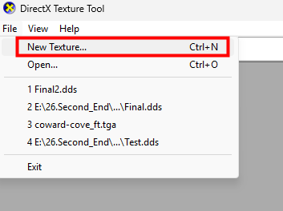
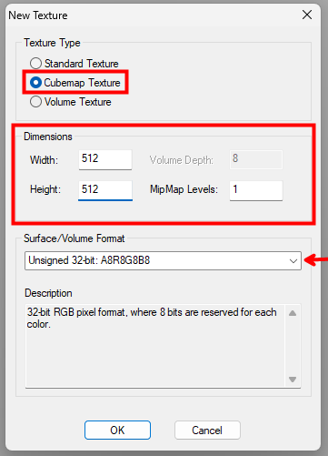
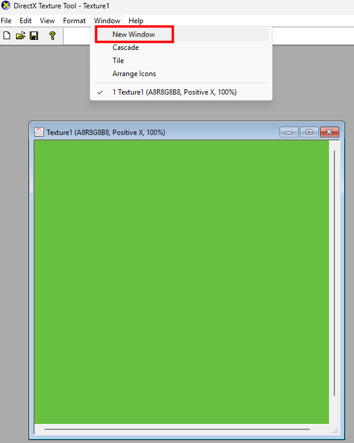
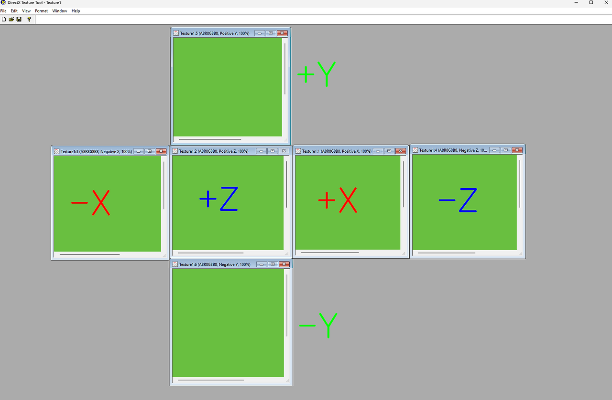
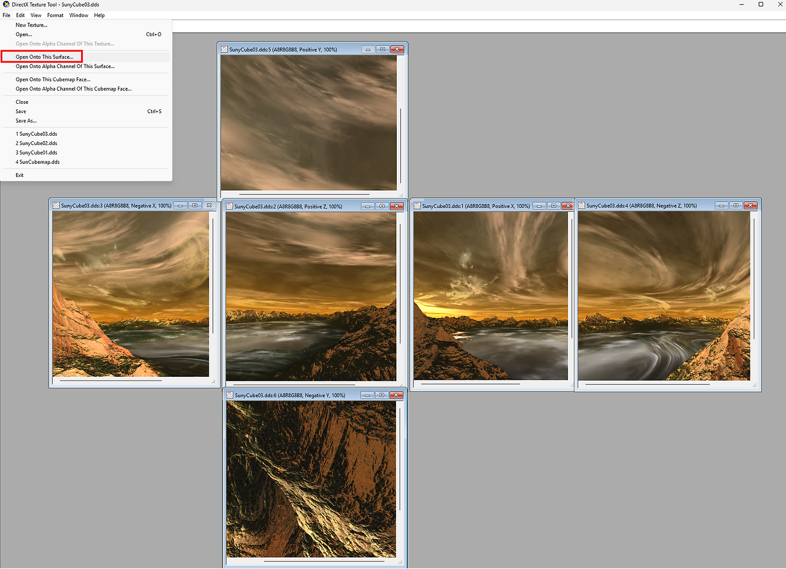
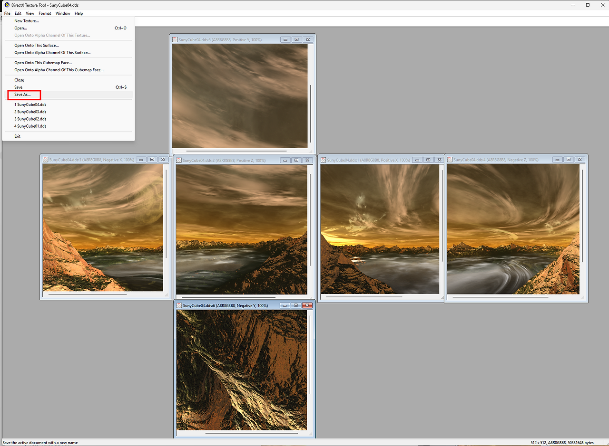
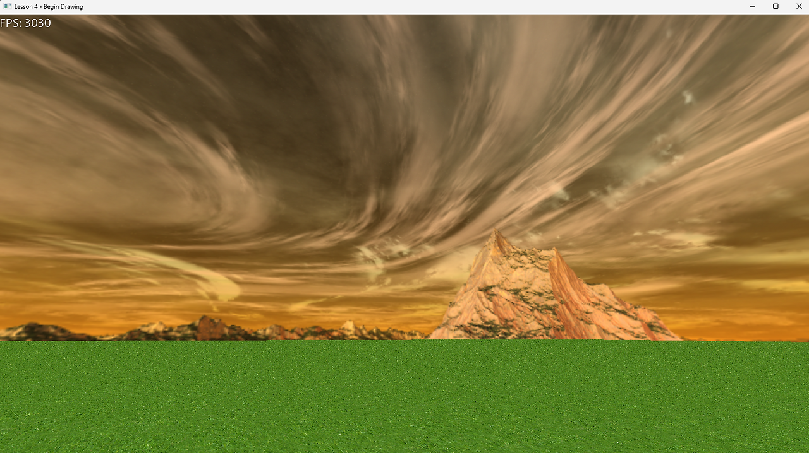
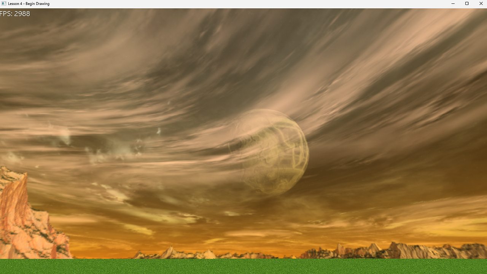
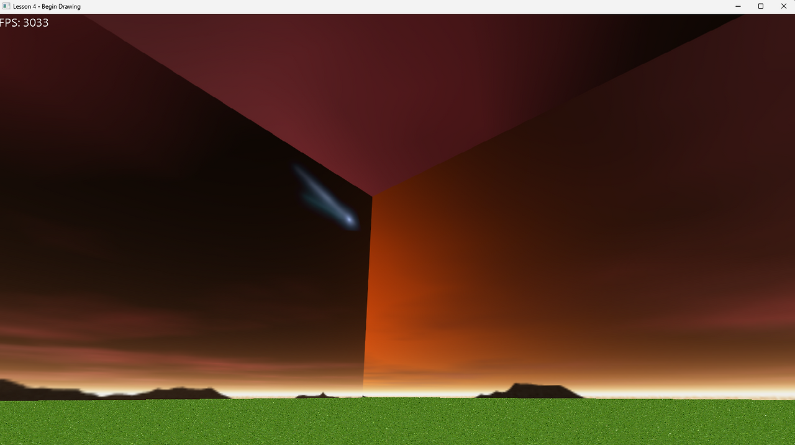

DDS로 CubeMap을 만드는 툴을 정리한다.

### 1. New Texture
Texture를 처음 가져온다.

<table width="100%" style="table-layout: fixed; border-collapse: collapse; border: none;"> <tr style="border: none;"> <td width="50%" style="text-align: center; border: none; padding: 5px;">   <strong>CubeMap_01</strong> </td> <td width="27%" style="text-align: center; border: none; padding: 5px;">   <strong>CubeMap_02</strong> </td> </tr> </table>

512 dds 여섯개로 Cubemap Texture를 제작한다.

### 2. New Window

<table width="90%" style="table-layout: fixed; border-collapse: collapse; border: none;"> <tr style="border: none;"> <td width="100%" style="text-align: center; border: none; padding: 15px;">   <strong>New Window</strong> </td>  </tr> </table>
New Window로 이전에 만들어 놓은 Texture와 같은 설정의 Window를 총 6개 만들어 놓는다.

### 3. CubeMap 위치 설정

<table width="90%" style="table-layout: fixed; border-collapse: collapse; border: none;"> <tr style="border: none;"> <td width="100%" style="text-align: center; border: none; padding: 15px;">   <strong>CubeMap 위치</strong> </td>  </tr> </table>

XYZ 값을 각 면에 맞게 각각 넣어준다.

### 4. Open Onto This Surface

<table width="90%" style="table-layout: fixed; border-collapse: collapse; border: none;"> <tr style="border: none;"> <td width="100%" style="text-align: center; border: none; padding: 15px;">   <strong>CubeMap Open</strong> </td>  </tr> </table>

**Open Onto This Surface**로 Texture를 개별적으로 하나씩 각 Window에 넣어준다.

### 5. DDS Export

<table width="90%" style="table-layout: fixed; border-collapse: collapse; border: none;"> <tr style="border: none;"> <td width="100%" style="text-align: center; border: none; padding: 15px;">   <strong>CubeMap Export - SaveAs</strong> </td>  </tr> </table>

이렇게 dds로 export를 Save As로 한다.

### 6. 결과 확인

<table width="100%" style="table-layout: fixed; border-collapse: collapse; border: none;"> <tr style="border: none;"> <td width="50%" style="text-align: center; border: none; padding: 5px;">   <strong></strong> </td> <td width="50%" style="text-align: center; border: none; padding: 5px;">   <strong></strong> </td> </tr> </table>

최종 CubeMap을 마무리해서 보면 테두리가 깔끔하게 들어간 것을 확인할 수 있다.

### 7. 주의 : 방향 오류
<table width="100%" style="table-layout: fixed; border-collapse: collapse; border: none;"> <tr style="border: none;"> <td width="100%" style="text-align: center; border: none; padding: 15px;">   <strong>CubeMap Issue</strong> </td>  </tr> </table>

방향을 잘 못잡아 넣으면 이렇게 짤린다.

### 참고

[Cube Mapping](https://piusai.github.io/graphics/2026/10/29/CubeMapping.html) 에서 DX에서의 Projection을 알아볼 수있다.