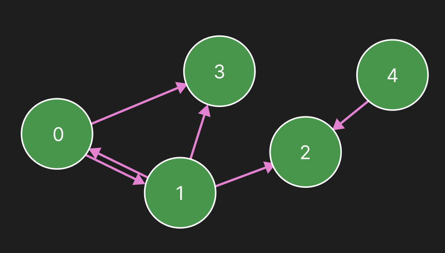

DFS, BFS, Dijkstra 알고리즘에 대해 알아보자.

모두 **인접한 정보**를 갖고 있어야 탐색할 수 있기 때문에, 인접 행렬 / 인접 리스트에 대한 이해가 꼭 필요하다.

[그래프의 이해와 인접 행렬, 인접 리스트](https://piusai.github.io/c++/2026/10/07/GraphWithAdjacent.html)


### 1. DFS
- 깊이 우선 탐색 Depth-First Search
- 처음 찾는 것의 깊숙하게 들어가기
- Tree 형태이니, 재귀함수로 들어감!!


<table width="100%" style="table-layout: fixed; border-collapse: collapse; border: none;"> <tr style="border: none;"> <td width="100%" style="text-align: center; border: none; padding: 15px;">  <br><strong>Graph01</strong> </td>  </tr> </table>

위 그래프를 cpp로 구현 해보자.

#### 1-1. 인접 리스트를 활용한 DFS 

``` cpp
#include <iostream>
#include <stack>
using namespace std;
#include <vector>

struct Vertex{ int _data; };

vector<Vertex*> verties;
vector<bool> visited(4, false);

vector<vector<int>> adjacentList(5); 
void CreateAdjacentList() {
	adjacentList[0] = { 1, 3 };
	adjacentList[1] = { 0, 2, 3 };
	adjacentList[4] = { 2 };

}

void DFSList(int here)
{
	visited[here] = true;
	cout << " visit ! : " << here << endl;
	int _size = adjacentList[here].size();
	for (int v = 0; v < _size; v++)
	{
		int there = adjacentList[here][v];
		if (!visited[there]) DFSList(there);
	}
}


int main()
{
	verties.resize(5);
	CreateAdjacentList();
	DFSList(0);

}
```


#### 1-2. 인접 행렬을 활용한 DFS 

``` cpp
#include <iostream>
#include <stack>
using namespace std;
#include <vector>

struct Vertex{ int _data; };

vector<Vertex*> verties;
vector<bool> visited(5, false);
vector<vector<int>> AdjacentMatrix(5, vector<int>(0));

void CreateAdjacentMatrix(){

	AdjacentMatrix = {
		{0, 1, 0, 1, 0},
		{1, 0, 1, 1, 0},
		{0, 0, 0, 0, 0},
		{1, 0, 0, 0, 0},
		{0, 0, 1, 0, 0}
	};
}

void DFSMatrix(int here)
{
	visited[here] = true;
	cout << "visited : " << here<<endl;

	int _size = AdjacentMatrix.size();
	for (int v = 0; v < _size; v++)
	{
		if (AdjacentMatrix[here][v] == 1 && !visited[v])
			DFSMatrix(v);
	}
}

int main()
{
	verties.resize(5);
	CreateAdjacentMatrix();
	DFSMatrix(0);
}
```

인접 리스트 방식과 다를것 없고, **방문(이웃을 찾는) 하는 방법**만 다르다

> Visit 순서 0-> 1->2-> 3


#### 인접 리스트 vs 인접 행렬 in DFS


|        | 인접 행렬                                                            | 인접 리스트                   |
| ------ | ---------------------------------------------------------------- | ------------------------ |
| 시간 복잡도 | **O(V²)**                                                        | **O(V+E)**               |
| 이유     | 정점 V개를 방문하고(`for`), 각 정점마다 V번 더 `if (Adjacent[here][v] == 1)` 확인 | 정점 V개를 방문하고, 간선 E개만큼만 확인 |


---
### 2. BFS
- 너비 우선 탐색 Breadth-First Search
- Queue를 활용해서 방문 순서를 저장해놓고 탐색한다!   ->Unweight graph에서의 최단 경로 탐색!

#### 2-1. 인접 리스트을 활용한 BFS 

```cpp
#include <iostream>
#include <stack>
using namespace std;
#include <vector>
#include <queue>

struct Vertex{ int _data; };

vector<Vertex*> verties;
vector<vector<int>> adjacentList(5);
vector<bool> discovered(5, false);


void CreateAdjacentList() {
	adjacentList[0] = { 1, 3 };
	adjacentList[1] = { 0, 2, 3 };
	adjacentList[4] = { 2 };

}

void BFSList(int here)
{
	discovered = vector<bool>(6, false);
	queue<int> q;
	q.push(here);
	discovered[here] = true;

	while (!q.empty())
	{
		here = q.front();
		q.pop();

		cout << "visit! :" << here << endl;
		int size = adjacentList[here].size();
		for (int i = 0; i < size; i++)
		{
			int there = adjacentList[here][i];
			if (!discovered[there])
			{
				q.push(there);
				discovered[there] = true;
			}
		}
	}
}

int main()
{
	verties.resize(5);
	CreateAdjacentList();
	BFSList(0);
}
```


#### 2-2. 인접 행렬을 활용한 BFS 


```cpp
#include <iostream>
#include <stack>
using namespace std;
#include <vector>
#include <queue>

struct Vertex{ int _data; };

vector<Vertex*> verties;
vector<vector<int>> AdjacentMatrix(5, vector<int>(0));
vector<bool> discovered(5, false);

void CreateAdjacentMatrix(){
	AdjacentMatrix = {
		{0, 1, 0, 1, 0},
		{1, 0, 1, 1, 0},
		{0, 0, 0, 0, 0},
		{1, 0, 0, 0, 0},
		{0, 0, 1, 0, 0}
	};
}

void BFSMatrix(int here)
{
	vector<int> parent(5, -1);
	vector<int> dist(5, -1);

	queue<int> q;
	q.push(here);
	discovered[here] = true;

	parent[here] = here;
	dist[here] = 0;

	while (!q.empty())
	{
		here = q.front();

		q.pop();
		cout << "visit : " << here << endl;

		for (int there = 0; there < verties.size(); there++)
		{
			if (AdjacentMatrix[here][there] == 1)
			{
				if (discovered[there]) continue;
				parent[there] = here; //여기서 부모 지정
				dist[there] = dist[here] + 1; //dist 지정(here+1)
				q.push(there);
				discovered[there] = true;
			}

		}
	}
}

int main()
{
	verties.resize(5);

	CreateAdjacentMatrix();
	BFSMatrix(0);
```


> Visit순서 0-> 1->3-> 2

parent, height도 넣어주어서 정보 추가!

- `parent`, `dist`도 넣어주어서 **경로 정보와 거리 정보**를 추가했다.

	- `parent[there]` : there에 어디서 왔는지 (경로 복원용)
	- `dist[there]` : 시작점에서 there까지의 간선 개수


### 3. 다익스트라(Dikstra) - A* 의 기반

- **가중치가 있는 그래프**에서의 최단 경로 탐색.
- BFS가 Queue를 썼다면, 다익스트라는 **우선순위 큐(Priority Queue)** 로 **현재까지 비용이 가장 적은 정점**부터 꺼낸다.
- `best[]` 배열에 시작점에서 각 정점까지의 **최소 비용**을 갱신해 나간다.
- `parent[]` 배열로 **경로를 복원**할 수 있다.

> A*는 여기에 **휴리스틱(목표까지의 예상 비용 h)** 을 더해서, `f = g(현재까지 비용) + h(예상 비용)` 이 낮은 정점부터 탐색하는 방식이다.


``` cpp

struct Vertex {
	int data;
};

struct VertexCost {
	VertexCost(int vertexnum, int cost) :_vertex(vertexnum), _cost(cost) {}
	bool operator >(const VertexCost& other) const { return _cost > other._cost;  }

	int _vertex;
	int _cost;

};

vector<Vertex*> verties;
vector<vector<int>> AdjacentMatrix(6, vector<int>(6, -1));


void CreateAdjacentMatrix()
{
	AdjacentMatrix[0][1] = AdjacentMatrix[1][0] = 15;
	AdjacentMatrix[0][3] = AdjacentMatrix[3][0] = 35;
	AdjacentMatrix[1][2] = AdjacentMatrix[2][1] = 5;
	AdjacentMatrix[1][3] = AdjacentMatrix[3][1] = 10;
	AdjacentMatrix[3][4] = AdjacentMatrix[4][3] = 5;
	AdjacentMatrix[4][5] = AdjacentMatrix[5][4] = 5;

}

void Djickstra(int here)
{
	int vecsize = verties.size();
	priority_queue<VertexCost, vector<VertexCost>, greater<VertexCost>> vc;
	vector<int> parent(vecsize, -1);
	vector<int> best(vecsize, INT32_MAX);
	parent[here] = here;
	best[here] = 0;

	vc.push(VertexCost(here, 0));

	while (!vc.empty())
	{
		VertexCost vertexnow= vc.top();
		vc.pop();
		int now = vertexnow._vertex;
		int cost = vertexnow._cost;
		
		if (best[now] < cost) continue;
		cout << "visit : " << now << endl;
		for (int there = 0; there < vecsize; there++)
		{

			if (AdjacentMatrix[now][there] == -1) continue;
			int nextcost = AdjacentMatrix[now][there] + cost;
			if (nextcost >= best[there]) continue;
			vc.push(VertexCost(there, nextcost));
			best[there] = nextcost;
			parent[there] = now;
		}
	}
	for (int i = 0; i < vecsize; i++)
	{
		cout << "best" <<i<<" : " << best[i] << endl;
	}
}
int main()
{
	verties.resize(6);
	CreateAdjacentMatrix();
	Djickstra(0);
}
```


#### 동작 포인트

|코드|의미|
|---|---|
|`greater<VertexCost>` + `operator>`|비용이 작은 정점이 먼저 나오는 **최소 힙**|
|`best[]`|시작점에서 각 정점까지의 현재 최소 비용 (초기값 `INT32_MAX`)|
|`if (best[now] < cost) continue;`|큐에 남아 있던 **오래된(더 비싼) 정보 스킵**|
|`if (nextcost >= best[there]) continue;`|더 좋은 경로일 때만 갱신|
|`parent[there] = now`|경로 복원용|

#### 실행 결과 (시작점 0)

- 방문 순서: `0 → 1 → 2 → 3 → 4 → 5`
- 최소 비용: `best0 : 0`, `best1 : 15`, `best2 : 20`, `best3 : 25`, `best4 : 30`, `best5 : 35`
- 0 → 3은 직접 연결(35)보다 `0 → 1 → 3`(15 + 10 = 25)이 더 싸다.