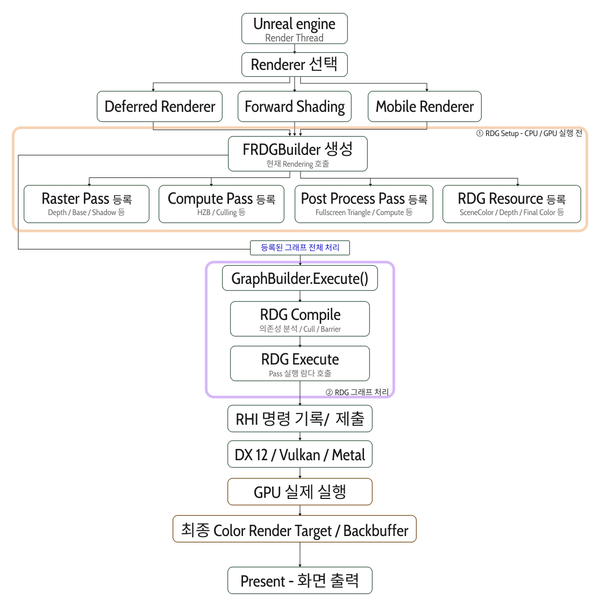
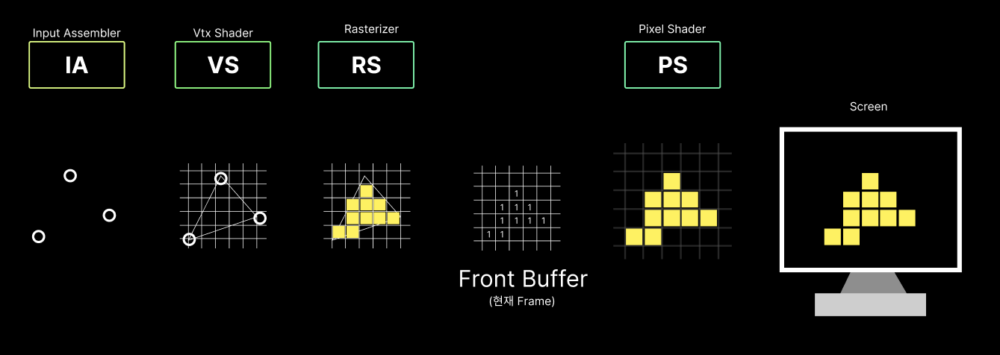
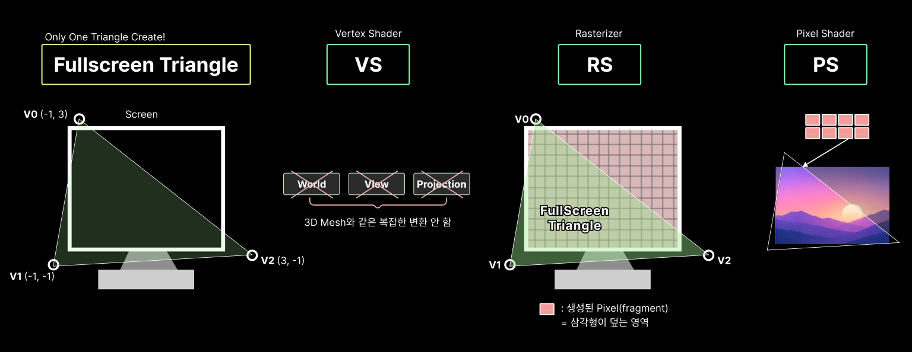
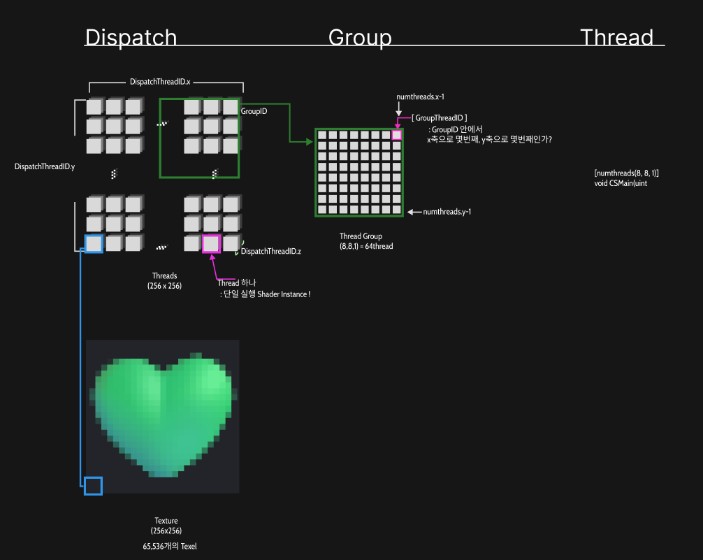

## Unreal Engine 렌더링 파이프라인

Unreal Engine의 렌더링은 [RenderPipeline](https://piusai.github.io/graphics/2026/05/29/RenderPipeline.html)에서 다룬 Rasterizer 파이프라인(IA → VS → RS → PS → OM)과는 층위가 다르다.  
Rasterizer 파이프라인이 **GPU 하드웨어 안에서 정점이 픽셀이 되는 과정**이라면, 이 글은 **엔진이 한 프레임 동안 어떤 Pass를 어떤 순서로 GPU에 맡기는지**에 대한 이야기다.

또, DirectX 같은 특정 그래픽스 API에 맞춰 엔진을 만들면 여러 플랫폼을 지원할 수가 없다.  
그래서 언리얼은 **RHI(Render Hardware Interface)** 로 그래픽스 API를 추상화해서 감싼다.

----
### 01. Unreal Engine RenderPipeline 톺아보기

<table width="100%" style="table-layout: fixed; border-collapse: collapse; border: none;"> <tr style="border: none;"> <td width="100%" style="text-align: center; border: none; padding: 15px;">  <br><strong>UERendering</strong> </td>  </tr> </table>

전체 흐름은 크게 두 단계로 나뉜다.

#### ① RDG Setup — CPU / GPU 실행 전

1. **Render Thread**에서 사용할 Renderer를 선택한다. (Deferred / Forward Shading / Mobile)
2. 어떤 Renderer든 **`FRDGBuilder`** 를 생성한다.
3. 이 Builder에 이번 프레임에 필요한 것들을 **등록**만 한다.
   - **Raster Pass** : Depth / Base / Shadow 등
   - **Compute Pass** : HZB(Hierarchical Z-Buffer) / Culling 등
   - **Post Process Pass** : Fullscreen Triangle / Compute 등
   - **RDG Resource** : SceneColor / Depth / Final Color 등

이 단계에서는 **아무것도 실행되지 않는다.** Pass는 "무엇을 읽고 무엇을 쓰는지"와 "나중에 실행할 람다"만 기록된다.

```cpp
FRDGBuilder GraphBuilder(RHICmdList);

FRDGTextureRef SceneColor = GraphBuilder.CreateTexture(Desc, TEXT("SceneColor"));

auto* PassParameters = GraphBuilder.AllocParameters<FMyPassParameters>();
PassParameters->RenderTargets[0] = FRenderTargetBinding(SceneColor, ERenderTargetLoadAction::EClear);

GraphBuilder.AddPass(
    RDG_EVENT_NAME("MyPass"),
    PassParameters,
    ERDGPassFlags::Raster,
    [](FRHICommandList& RHICmdList)
    {
        // 요기는 Execute 단계에서 호출
    });

GraphBuilder.Execute(); // ② 로 넘어가는 지점
```

#### ② RDG 그래프 처리 — `GraphBuilder.Execute()`

등록이 끝나면 `Execute()`가 **등록된 그래프 전체를 한 번에 처리**한다.

- **RDG Compile** : 의존성 분석 / Pass Culling / Barrier 계산
  - Pass와 Resource의 읽기·쓰기 관계로 **DAG(방향 비순환 그래프)** 를 만든다.
  - 최종 결과에 기여하지 않는 Pass와 사용되지 않는 Resource는 제거한다.
  - 리소스 상태 전환(Barrier)이 필요한 위치를 계산한다.
- **RDG Execute** : 살아남은 Pass의 람다를 순서대로 호출한다.

#### ③ RHI → GPU

1. 호출된 람다 안에서 **RHI 명령이 기록되고 제출**된다.
2. RHI가 플랫폼에 맞는 API(**DX12 / Vulkan / Metal**)로 변환한다.
3. **GPU가 실제로 실행**한다.
4. 결과가 **최종 Color Render Target / Backbuffer** 에 쓰인다.
5. **Present**로 화면에 출력된다.

---
### 02. RDG Pass의 네가지 종류
1. Raster Pass - 그래픽스 파이프라인
2. Compute Pass - Dispatch 실행
3. Async Compute Pass - 비동기 컴퓨트
4. Copy Pass - 리소스 복사 해상도 변환, ReadBack 등

|구분|주요 역할|예시|
|---|---|---|
|Raster Pass|Graphics Pipeline에서 Draw|Mesh Rendering, Shadow Map, Fullscreen Triangle|
|Compute Pass|Graphics Queue에서 Dispatch|Blur, HZB 생성, Culling|
|Async Compute Pass|Async Compute Queue에서 Dispatch|독립적인 병렬 계산 작업|
|Copy Pass|텍스처·버퍼 복사 및 전송|Texture Copy, Readback|

#### 02.1-A. Raster Shader 방식
Raster Pass방식중 Mesh를 Rendering할떄 쓰는 방식이다.
<table width="100%" style="table-layout: fixed; border-collapse: collapse; border: none;"> <tr style="border: none;"> <td width="100%" style="text-align: center; border: none; padding: 15px;">  <br><strong>RasterShader</strong> </td>  </tr> </table>
이렇게 Custom Mesh를 Rendering할때 RDG에서는 아래처럼 Pass를 등록한다.

```cpp
GraphBuilder.AddPass(
	RDG_EVENT_NAME("MyRasterPass"),
	Parameters,
	ERDGPassFlags::Raster,
	[Parameters](FRHICommandList& RHICmdList)
	{
		// Graphics Pipeline 설정
		// Vertex Buffer / Index Buffer 바인딩
		// Vertex Shader / Pixel Shader 사용
		// Draw Indexed 실행
	}
});	
```


#### 02.1-B. Fullscreen Raster 방식
Post Process Pass를 등록하는 방식이다.
<table width="100%" style="table-layout: fixed; border-collapse: collapse; border: none;"> <tr style="border: none;"> <td width="100%" style="text-align: center; border: none; padding: 15px;">  <br><strong>FullScreenRaster</strong> </td>  </tr> </table>

메시 직접 그리는것이 아니라, 화면 전체를 덮는 삼각형을 그리는 방식  
→ 화면 전체를 대상으로하는 후처리 작업

1. 화면 전체를 덮는 FullScreen Triangle 단 한개만 생성
2. VS에서 삼각형의 정점 위치 설정
3. RS에서 화면 전체에 해당하는 픽셀 생성
4. PS에서 각 픽셀의 SceneColor, Depth등의 Texture를 읽음
5. 계산한 결과를 Output Render Target에 출력
   


- VS 역할 : 정점 3개의 화면 (Clip Space)위치를 직접 지정 : Fullscreen Triangle을 생성
```cpp
AddDrawScreenPass(GraphBuilder, RDG_EVENT_NAME("MyFullscreenPass"),
View, OutputViewport, InputTexture, OutputTexture, PixelShader
);
```


Ex) Blur, Bloom, Refraction 처리할때 많이 활용한다.

|구분|A. 일반 Raster|B. Fullscreen Raster|
|---|---|---|
|그리는 대상|3D 메시|화면 전체 삼각형|
|Vertex|메시 정점|보통 3개|
|VS|메시 정점 변환|화면 좌표 생성|
|RS|메시의 픽셀 생성|화면 전체 픽셀 생성|
|PS|메시 표면 셰이딩|화면 Texture 후처리|
|대표 용도|캐릭터, 배경, 오브젝트|Blur, Bloom, Refraction|

Rasterizer와 비교했을때, 일반 Raster Pass는 메시가 투영된 영역에서만 PS가 실행된다. 반면 Fullscreen Raster는 삼각형이 화면 전체를 덮기 때문에 **출력 Render Target의 모든 픽셀에서 PS가 실행**된다.  
그래서 "화면의 어디를 그릴까"가 아니라 "화면의 모든 픽셀에 무슨 계산을 할까"를 다루는 후처리에 어울린다.

#### 02.2. Compute Shader

<table width="100%" style="table-layout: fixed; border-collapse: collapse; border: none;"> <tr style="border: none;"> <td width="100%" style="text-align: center; border: none; padding: 15px;">  <br><strong>ComputeShader</strong> </td>  </tr> </table>

Compute Pass는 Rasterizer 파이프라인(IA → VS → RS → PS → OM)을 **거치지 않는다.**  
정점도 삼각형도 없이, 스레드 그룹을 **Dispatch**해서 Texture나 Buffer를 직접 읽고 쓴다.

- Draw 대신 **Dispatch(X, Y, Z)** 로 실행한다.
- 결과는 **UAV(Unordered Access View)** 로 출력한다.
- Render Target / Blend / Depth Test 같은 고정 기능은 없다.
- HZB 생성, Culling, Blur처럼 "그리는 것"이 아니라 "계산하는 것"에 쓴다.

```cpp
FMyCS::FParameters* Parameters = GraphBuilder.AllocParameters<FMyCS::FParameters>();
Parameters->InputTexture  = SceneColor;      // SRV
Parameters->OutputTexture = GraphBuilder.CreateUAV(OutputTexture);

FComputeShaderUtils::AddPass(
    GraphBuilder,
    RDG_EVENT_NAME("MyComputePass"),
    ComputeShader,
    Parameters,
    FComputeShaderUtils::GetGroupCount(Size, FIntPoint(8, 8)));
    
```

`FComputeShaderUtils::AddPass`는 내부에서 `ERDGPassFlags::Compute`로 Pass를 등록하고 Dispatch까지 처리해준다.  
`GetGroupCount`는 전체 크기를 스레드 그룹 크기(예: 8×8)로 나눠 올림한 그룹 수를 계산한다.

|구분|Fullscreen Raster|Compute|
|---|---|---|
|실행 단위|픽셀 (PS)|스레드 (CS)|
|실행 명령|Draw|Dispatch|
|출력|Render Target|UAV (Texture / Buffer)|
|고정 기능 (Blend, Depth 등)|사용 가능|사용 불가|
|스레드 간 협업|불가|Group Shared Memory로 가능|

같은 후처리라도 Blend나 Depth Test가 필요하면 Fullscreen Raster, 임의의 위치에 쓰거나 Group Shared Memory로 스레드끼리 협업해야 하면 Compute가 유리하다.

#### 02.3. Async Compute Pass

Compute Pass를 **Graphics Queue가 아닌 별도의 Async Compute Queue**에서 실행하는 방식이다.  
Graphics Queue가 Raster 작업을 하는 동안 Compute 작업을 **동시에** 돌려서 GPU 유휴 시간을 줄인다.

```cpp
GraphBuilder.AddPass(
    RDG_EVENT_NAME("MyAsyncComputePass"),
    Parameters,
    ERDGPassFlags::AsyncCompute,
    [Parameters](FRHIComputeCommandList& RHICmdList)
    {
        // Dispatch 실행
    });
```

- 일반 Compute Pass와 코드는 거의 같고 **Pass Flag만 `AsyncCompute`로 바뀐다.**
- 두 Queue 사이의 **동기화(Fence)와 리소스 전환은 RDG가 의존성 그래프를 보고 자동으로** 처리한다.
- Graphics Queue에서 쓰는 리소스와 겹치지 않는, **독립적인 계산**일수록 효과가 크다.
- Draw는 못 하고 Dispatch만 가능하다.

#### 02.4. Copy Pass

Texture나 Buffer를 **복사·전송**하는 Pass이다.  
Shader는 쓰지 않고 `ERDGPassFlags::Copy`로 등록하며, 보통 헬퍼 함수를 쓴다.

```cpp
// Texture → Texture 복사
FRHICopyTextureInfo CopyInfo;
AddCopyTexturePass(GraphBuilder, SrcTexture, DstTexture, CopyInfo);

// GPU → CPU Readback
AddEnqueueCopyPass(GraphBuilder, &GPUTextureReadback, SrcTexture);
```

- **Texture Copy** : 해상도가 같은 리소스끼리 복사
- **Readback** : GPU 결과를 CPU에서 읽을 때 사용한다. GPU 작업이 끝난 뒤 읽을 수 있어서 **몇 프레임 지연**이 생긴다.
- Raster나 Compute처럼 Pass로 등록되므로 **의존성 분석과 Culling 대상에 똑같이 포함**된다.


----
### 정리

이렇듯 언리얼 엔진은 Pass와 Resource를 **RDG Graph에 DAG로 먼저 등록**해두고, 실행 직전에 그래프 전체를 분석해서 처리한다.

| 단계 | 하는 일 | 실제 GPU 작업 |
|---|---|---|
| Setup | Pass / Resource 등록 | 없음 |
| Compile | 의존성 분석, Culling, Barrier | 없음 |
| Execute | Pass 람다 호출, RHI 명령 기록 | 이때부터 |

등록과 실행을 분리하기 때문에 얻는 이점은 다음과 같다.
- 쓰이지 않는 Pass / Resource를 **미리 제거**할 수 있다.
- Barrier와 리소스 상태 전환을 **자동으로** 처리한다.
- 수명이 겹치지 않는 리소스는 **메모리를 재사용(Aliasing)** 할 수 있다.