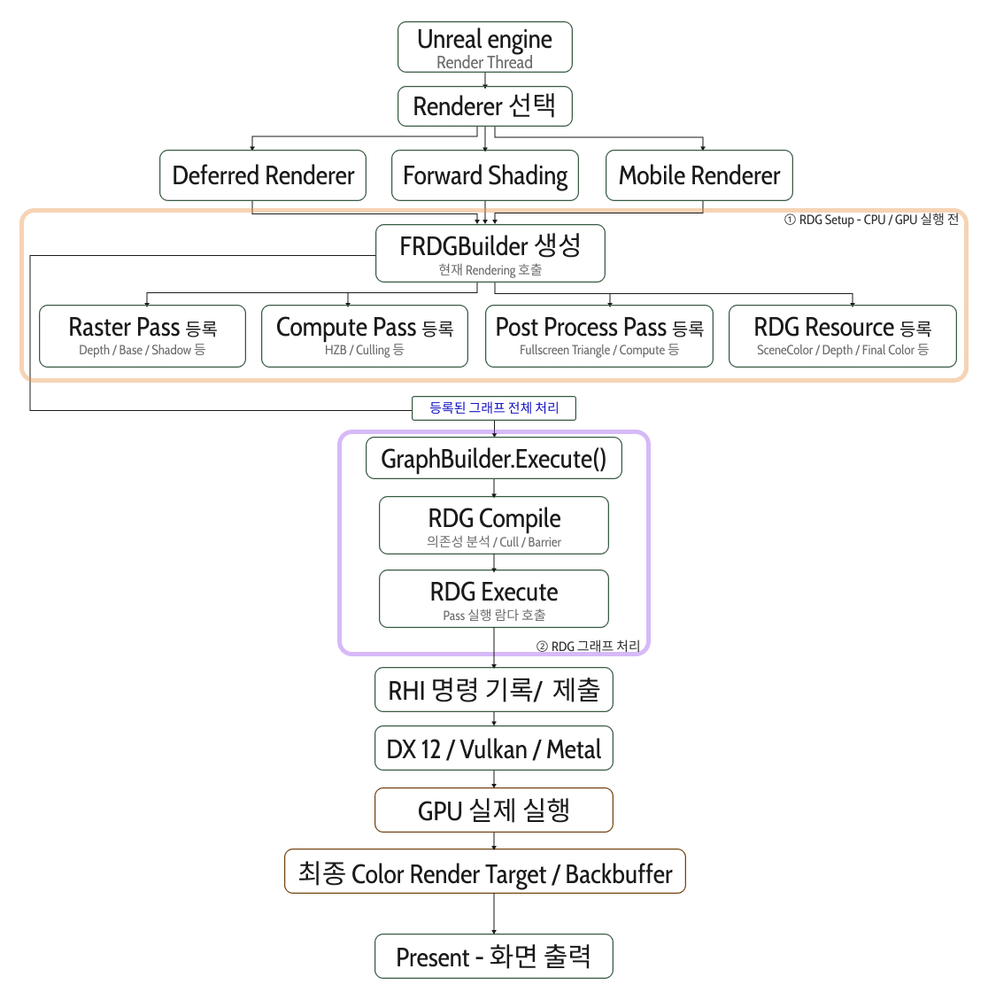

## Unreal Engine 렌더링 파이프라인

Unreal Engine의 렌더링은 [RenderPipeline](https://piusai.github.io/graphics/2026/05/29/RenderPipeline.html)에서 다룬 Rasterizer 파이프라인(IA → VS → RS → PS → OM)과는 층위가 다르다.  
Rasterizer 파이프라인이 **GPU 하드웨어 안에서 정점이 픽셀이 되는 과정**이라면, 이 글은 **엔진이 한 프레임 동안 어떤 Pass를 어떤 순서로 GPU에 맡기는지**에 대한 이야기다.

또, DirectX 같은 특정 그래픽스 API에 맞춰 엔진을 만들면 여러 플랫폼을 지원할 수가 없다.  
그래서 언리얼은 **RHI(Render Hardware Interface)** 로 그래픽스 API를 추상화해서 감싼다.

----
### Unreal Engine RDG 톺아보기

<table width="100%" style="table-layout: fixed; border-collapse: collapse; border: none;"> <tr style="border: none;"> <td width="100%" style="text-align: center; border: none; padding: 15px;">  <br><strong>UERendering</strong> </td>  </tr> </table>

전체 흐름은 크게 두 단계로 나뉜다.

#### ① RDG Setup — CPU / GPU 실행 전

1. **Render Thread**에서 사용할 Renderer를 선택한다. (Deferred / Forward Shading / Mobile)
2. 어떤 Renderer든 **`FRDGBuilder`** 를 생성한다.
3. 이 Builder에 이번 프레임에 필요한 것들을 **등록**만 한다.
   - **Raster Pass** : Depth / Base / Shadow 등
   - **Compute Pass** : HZB / Culling 등
   - **Post Process Pass** : Fullscreen Triangle / Compute 등
   - **RDG Resource** : SceneColor / Depth / Final Color 등

이 단계에서는 **아무것도 실행되지 않는다.** Pass는 "무엇을 읽고 무엇을 쓰는지"와 "나중에 실행할 람다"만 기록된다.

```cpp
FRDGBuilder GraphBuilder(RHICmdList);

FRDGTextureRef SceneColor = GraphBuilder.CreateTexture(Desc, TEXT("SceneColor"));

auto* PassParameters = GraphBuilder.AllocParameters<FMyPassParameters>();
PassParameters->RenderTargets[0] = FRenderTargetBinding(SceneColor, ERenderTargetLoadAction::EClear);

GraphBuilder.AddPass(
    RDG_EVENT_NAME("MyPass"),
    PassParameters,
    ERDGPassFlags::Raster,
    [](FRHICommandList& RHICmdList)
    {
        // 요기는 Execute 단계에서 호출
    });

GraphBuilder.Execute(); // ② 로 넘어가는 지점
```

#### ② RDG 그래프 처리 — `GraphBuilder.Execute()`

등록이 끝나면 `Execute()`가 **등록된 그래프 전체를 한 번에 처리**한다.

- **RDG Compile** : 의존성 분석 / Pass Culling / Barrier 계산
  - Pass와 Resource의 읽기·쓰기 관계로 **DAG(방향 비순환 그래프)** 를 만든다.
  - 최종 결과에 기여하지 않는 Pass와 사용되지 않는 Resource는 제거한다.
  - 리소스 상태 전환(Barrier)이 필요한 위치를 계산한다.
- **RDG Execute** : 살아남은 Pass의 람다를 순서대로 호출한다.

#### ③ RHI → GPU

1. 호출된 람다 안에서 **RHI 명령이 기록되고 제출**된다.
2. RHI가 플랫폼에 맞는 API(**DX12 / Vulkan / Metal**)로 변환한다.
3. **GPU가 실제로 실행**한다.
4. 결과가 **최종 Color Render Target / Backbuffer** 에 쓰인다.
5. **Present**로 화면에 출력된다.

----
### 정리

이렇듯 언리얼 엔진은 Pass와 Resource를 **RDG Graph에 DAG로 먼저 등록**해두고, 실행 직전에 그래프 전체를 분석해서 처리한다.

| 단계 | 하는 일 | 실제 GPU 작업 |
|---|---|---|
| Setup | Pass / Resource 등록 | 없음 |
| Compile | 의존성 분석, Culling, Barrier | 없음 |
| Execute | Pass 람다 호출, RHI 명령 기록 | 이때부터 |

등록과 실행을 분리하기 때문에 얻는 이점은 다음과 같다.
- 쓰이지 않는 Pass / Resource를 **미리 제거**할 수 있다.
- Barrier와 리소스 상태 전환을 **자동으로** 처리한다.
- 수명이 겹치지 않는 리소스는 **메모리를 재사용(Aliasing)** 할 수 있다.