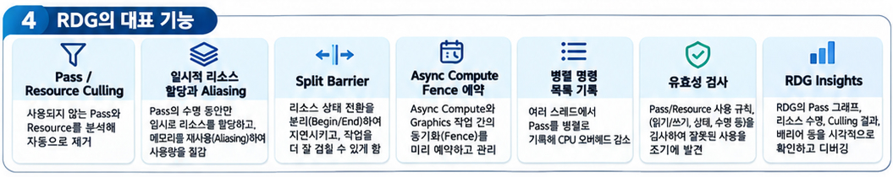

렌더 그래프, [RDG(Render Dependency Graph)](https://dev.epicgames.com/documentation/unreal-engine/render-dependency-graph-in-unreal-engine?lang=ko)는 UE에서 렌더 명령을 바로 실행하지않고, 그래프 자료구조로 **기록→ 컴파일 →실행**하는 즉시 모드 API이다.  

RDG가 UE 렌더링 파이프라인에서 어떤 역할을 하는지 아래 글에 정리해 두었다.

[참고글 - UE RenderingPipeline과 RDG pass의 네가지 종류](https://piusai.github.io/engine/2026/11/10/Unrealengine-RenderPipeline-RDG.html)

----
### RDG 톺아보기

RDG는 Render Pass를 순서대로 나열한 List가 아니다.  
Pass가 어떤 Resource를 읽고 쓰는지에 따라 의존 관계를 연결한 **DAG(Directed Acyclic Graph)**, 방향성 비순환 그래프이다. 엔진은 이 Graph를 분석해서 메모리 사용을 최적화하고, CPU와 GPU작업을 병렬화 한다.  

RDG의 대표적인 기능은 다음과 같다.

|기능|설명|
|---|---|
|Pass / Resource Culling|최종 결과에 쓰이지 않는 Pass와 Resource를 제거|
|일시적 Resource 할당과 Aliasing|수명이 겹치지 않는 Resource끼리 메모리 재사용|
|Split Barrier|서브 리소스 상태 전환의 지연을 숨겨 GPU 작업을 더 많이 겹침|
|Async Compute Fence 예약|Queue 간 동기화를 자동 처리|
|병렬 명령 목록 기록|여러 Thread에서 Pass를 나눠 기록|
|Validation 검사|API 사용과 리소스 의존성의 오류를 검출|
|RDG Insights|그래프 구조와 메모리 수명을 시각화|

UE의 렌더 파이프라인을 바꾸고 싶을 때는 엔진 코드를 직접 뜯어고치는 대신, **엔진이 열어둔 RDG Graph에 내 Pass를 등록**하는 방식을 쓴다.  

<table width="100%" style="table-layout: fixed; border-collapse: collapse; border: none;"> <tr style="border: none;"> <td width="100%" style="text-align: center; border: none; padding: 15px;">  <br><strong>RDG의 대표적 기능</strong> </td>  </tr> </table>

### 0. RDG를 사용하는 이유
DX에서 직접구현을 하면 RT(Render Thread)에서만 손봐야할것들을 GT(Game Thread)에서도수정가능하게 열어둔다면, 이슈가 생기기 마련이다.  
이와같이 UE의 Renderpipeline에서도 개발자가 수정하게 둔다면, 데이터를 GPU가 읽는 형태로 변환하는 과정이나, Shader Code로 바인딩 하는 과정 등을 안전하게 관리하기 어렵다.

또한 UE는 DX, Vulkan같은 여러 API 위에서 렌더링 작업을 관리해야하는 크로스 플랫폼 엔진이다. 이런 상황에서 리소스 접근을 제한 없이 열어두면 관리 비용이 크게 늘어난다. 그래서 Resource의 읽기·쓰기 의존성을 엔진이 추적할 수 있는 RDG를 통해 Pass를 등록하는 방식을 쓰는 경우가 많다.

> 참고: `FPixelShaderUtils::AddFullscreenPass()`는 기본값으로 `ERDGPassFlags::None`이 들어간다.

#### 0.1 RDG의 Keyword
-  `Shader_PARAMETER_RDG_*` 읽기 · 쓰기 의존성
   ⇒ Extension : Shader Parameter Struct에 RDG 리소스를 선언할 수있도록 추가  
   -  ex) `SHADER_PARAMETER_RDG_TEXTURE`, `BEGIN_SHADER_PARAMETER_STRUCT` 같은 매크로
- `FGlobalShader` : 특정 Mesh나 Material에 묶이지 않는 Shader 기반 클래스
  - Fullscreen pass, Compute Pass처럼 Material과 무관한 Pass에 사용
  - `IMPLEMENT_GLOBAL_SHADER`로 `.usf`파일 경로 · 엔트리함수 · Shader 타입 연결
  - RunTime에는 `GetGlobalShadermap`으로 얻은 ShaderMap에서 `TShaderMapRef`로 가져온다
- `AllocParameters`  - 파라미터 소유권 및 수명 관리

#### 0.2 Render Graph Builder
1. `FRDGBuilder` 인스턴스화.
2. Resource를 생성한다.
   - `FRDGBuilder::CreateTexture` : 텍스쳐 생성
   - `FRDGBuilder::CreateBuffer` : 버퍼 생성
3. `FRDGBuilder::AddPass`로 Pass 추가한다. 이때 **Pass Parameter 구조체**와 **실행 람다**를 인자로 지정한다.
4. 그래프 구성이 끝나면 `FRDGBuilder::Execute`를 호출해 Graph를 **컴파일 하고 실행**한다.

#### 0.3 RenderGraphUtils
`RenderGraphUtils.h` 일반적인 패스 추가할 수있는 유용한 유틸리티 함수가 있다
엔진 보일러 플레이트 코드 줄일 수 있도록 가능하면 Utility 함수 사용하자.!


---

### 1. RDG의 데이터 흐름
RDG를 활용하기 위해서는 데이터 흐름을 이해해야하는데, 아래와 같은 흐름들이 겹치며 흐름을 찾아내기가 여간 쉬운일이 아니다.

**1.1** RDG가 RenderPipeline에서 GPU로 보내는 방법들  
  - `PrePostProcessPass_RenderThread()`를 활용한 FullscreenRasterizer 방식
  - `FRDGBuilder`에 RDG DAG 그래프를 넣어서 처리
**1.2** Module & Subsystem  
**1.3**  Shader Binding, Shader Parameter
  - Shader DirectoryMapping, `.usf`까지 보내는 shader binding


#### 1.1 RDG가 Render Pipeline 에서 GPU까지 보내는 순서 및 방법들

Fullscreen Rasterizer 기준으로 정리하면 다음과 같다.
1. `FRDGTextureRef`구조체 등을 활용한 `RDG Resource` 등록
2. 등록된 `RDGResource`를 `AddCopyTexturePass`로 텍스쳐 패스에 등록 (`FRDGBuilder`) 에 넣어줌
3. `AddFullscreenPass`로 Fullscreen Pass를 등록한다.

`FRDGBuilder`에서는 Parameter 구조체의 메타데이터를 이용해 Resource 참조와 접근 관계를 수집하고, 이것이 DAG의 간선이 된다.

#### 1.2 Module & Subsystem
내 Pass를 RDG에 등록하려면 엔진이 그래프를 열어주는 시점에, 내 코드가 호출되도록 **연결 고리**가 필요하다. 보통 아래 세가지가 역할을 나눠 맡는다.

|구성 요소|역할|
|---|---|
|**Module**|셰이더 `.usf`가 있는 디렉터리를 엔진에 매핑하고, 렌더링 확장 객체를 등록하는 진입점|
|**Subsystem**|GT 쪽에서 설정값 · 리소스(예: RenderTarget, 파라미터)를 들고 있다가 RT로 넘겨주는 창구|
|**SceneViewExtension**|렌더링 도중 콜백(`PrePostProcessPass_RenderThread` 등)으로 RDG에 Pass를 추가하는 지점|

흐름을 요약하면 다음과 같다.
1. Module의 `StartupModule`에서 가상 Shader Directory를 mapping한다(`AddShaderSourceDirectoryMapping`)
   - Shader를 쓰는 모듈은 `.uplugin` / `.uproject`의 `LoadingPhase`를 `PostConfigInit`처럼 일찍 로드되도록 설정해야한다.
2. Subsystem이 GT에서 필요한 데이터를 관리한다.
3. SceneViewExtension 콜백이 RT에서 호출되며, 여기서 `FRDGBuilder`에 Pass를 등록한다.
4. GT 데이터는 복사본 RT에 넘긴다. GT와 RT가 같은 객체를 동시에 건드리지 않도록 ThreadSafe하게 하기위해서이다.

#### 1.3 Shader Binding
바인딩을 생성하기 위해서 `FShader`파생 클래스에 `FParameters`유형으로 파라미터 구조체를 선언한다. 아래는 `FGlobalShader`를 파생한 셰이더 Class를 Fullscreen Pass로 등록하는 예시이다.

```cpp

TShaderMapRef<FPiusShaderPS> PixelShader(GlobalShaderMap);

//parameter 구조체는 GraphBuilder가 소유 · 수명 관리
FPiusShaderPS::FParameters* PassParameters = GraphBuilder.AllocParameters<FPiusShaderPS::FParameters>();

FPixelShaderUtils::AddFullscreenPass(
		GraphBuilder,
		GlobalShaderMap,
		RDG_EVENT_NAME("PiusFullScreenPass"),
		PixelShader,
		PassParameters,
		ViewRect);		

```


