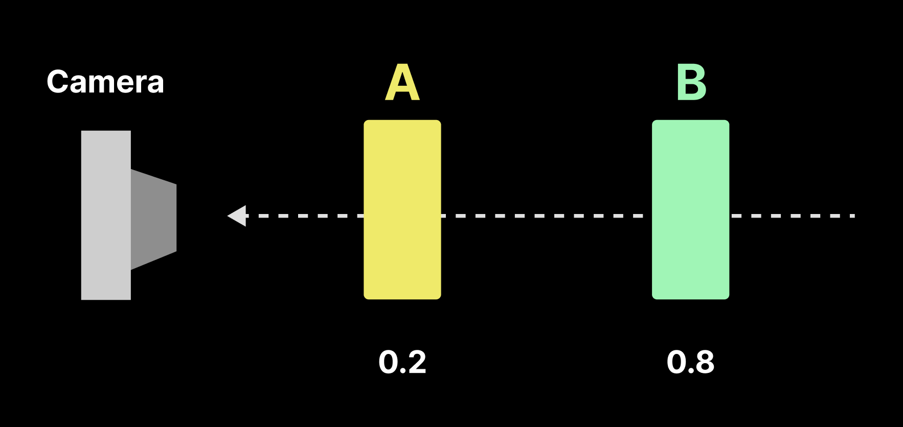
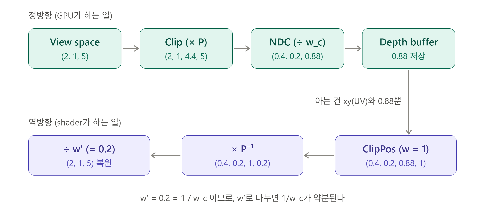
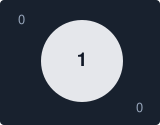

Shader에서 많이 활용되는 기법중 하나는 **기준(Space)**을 변환하는것이다.

사실 Vertex Shader도 `Local → World → View → Clip`으로 **기준축**을 바꿔가는 과정이다. 이러한 Vertex Shader 파이프라인을 뒤집거나, Screen 기준으로 바꾸거나 하는 방법들에 대해 정리해보려 한다.

참고글 : [VertexShader와 Rasterizer에서의 기준 축 변환]() - 추후 추가예정

**키워드**:  
- NDC : Normalize Device Coordinate
- `TextureObject.SampleLevel(SamplerState, floatLocation, floatLOD)`함수 : 
  MipMap Level에서 Texture를 **Sampling**(샘플링)하는데에 사용.
- Sampling(추출): 재계산이 아닌, `level`인자에 명시해 준 그 숫자의 mipmap에서만 데이터를 **뽑아온다**, 지정한 레벨에서 색상데이터만 추출한다는 의미!

---
### 0. 한 눈에 알아보는 흐름

> [正] Local → World → View → Clip → ( /w) NDC → Viewport → Screen(Pixel)  
> 			(VertexShader Stage) ↑  ||  ↑ (Rasterizer stage)
> 
> [逆] ScreenUV + Device Depth → NDC/Clip → (×P⁻¹) → (/w) View → (×V⁻¹) World

`Clip = View x P` , 양변에 `P⁻¹`곱하면  
`P : ViewToClip`
`View = Clip x P⁻¹` -> `mul(ClipPos , ClipToView)`

| 기법               | 하는 일                         | 핵심 연산                                      |
| ---------------- | ---------------------------- | ------------------------------------------ |
| 동차좌표 정규화         | Clip → NDC                   | `xyz / w`                                  |
| 해상도 역수 (invSize) | Pixel → 0~1 UV               | `pixel * (1 / size)`                       |
| Screen UV        | Viewport 기준 0~1 좌표           | `(SV_POSITION.xy - ViewRectMin) * InvSize` |
| UV ↔ NDC         | 좌표계 범위/축 변환                  | `uv * 2 - 1`, Y 반전                         |
| Depth 복원         | Depth Buffer → View/World 위치 | `mul(Clip, P⁻¹)` 후 `/ w`                   |

공통점과 키워드는 하나다. "어떤 기준의 값을 → 다른 기준의 값으로 **정규화** / **역변환**".  
물리에서 힘의 크기를 계산하기전에 dir vector를 `normalize`하듯이, Shader에서는 `w`로 나누거나(NDC), 해상도의 역수를 곱해서(UV)단위 공간으로 맞춘뒤 계산한다.

---

### 1. 동차 좌표 정규화 : Clip → NDC

Projection Transform을 거치면 VTX는 clip space의 동차좌표$(x_c, y_c, z_c, w_c)$가 된다, 여기서 `w`로 나누는 것이 Perspective Divide이며, 동차좌표를 정규화하는 과정이다.

$$
\mathrm{NDC}=\left(\frac{x_c}{w_c},\frac{y_c}{w_c},\frac{z_c}{w_c}\right)
$$

DirectX에서 일반적인 NDC 범위는 다음과 같다.

- $X, Y: [-1,1]$
- $Z: [0,1]$

> OpenGL은 Z가 $[-1, 1]$이다. 글에서는 DX(UE기준)으로 통일.

### 2. NDC → Screen(Pixel) - Viewport Transform
Rasterizer가 NDC를 Viewport(해상도)에 맞춰 Screen 좌표로 바꾼다.  
ex) 1920 x 1080 해상도의 전체 viewport

$$
x_{screen}=\frac{x_{ndc}+1}{2}\times1920
$$

$$
 y_{screen}=\frac{1-y_{ndc}}{2}\times1080
$$

> Y에 `1-y`로 들어가는 이유 : NDC는 Y가 위(+)방향이지만, Screen / Texture 좌표는 좌상단이 (0,0)이고, 아래로 증가하기 때문.

Rasterizer는 hlsl에서 프로그래밍 불가능하다해서 그냥 넘겼는데,
`SV_POSITION`의 input, output에서도 값이 **서로 다르게 동작** 하기 때문에 이 변환을 꼭 짚고 넘어가야겠다.

|위치|`SV_POSITION` 의 의미|
|---|---|
|Vertex Shader **output**|Clip Space 좌표 `(x_c, y_c, z_c, w_c)`|
|Pixel Shader **input**|Screen 좌표. `xy` = 픽셀 좌표(중심이 `+0.5`), `z` = Device Depth, `w` = `1 / w_c`|

```cpp
// unreal engine .usf
void MainPS(
	float4 InPosition : SV_POSITION,
	out float4 OutColor : SV_Target0)
{
	float2 pixelXY = InPosition.xy; // 픽셀좌표 (960.5, 540.5)
}
```

---
### 3. 해상도의 역수(invSize)로 Screen UV 만들기
Pixel 좌표를 0~1 UV로 바꾸려면 해상도로 나누어야 한다. 이때 나누셈 대신, 역수를 한번만 계산해서 곱하는 방식이 더욱 자주 쓰인다.

```cpp
// .usf
float2 InvRes = 1.0f / ViewRectMinAndSize.zw; //resolution 역수(CPU에서 미리 넘겨주기도함)

float2 ScreenUV = (InPosition.xy - ViewRectMinAndSize.xy) * InvRes;
```

그냥 진짜 쉽게 기준도 0으로맞춰서 표현하면 아래와 같다

```cpp
float2 ScreenUV = InPosition.xy / float2(1920, 1080);
```

`ScreenUV`는 Viewport 기준 0~1 좌표다.

**역수**를 쓰는 이유? 
- 곱셈이 나눗셈보다 가볍기때문
- Resolution은 Frame내에서 변하지 않는 값으로, `1/size`를 한 번만 계산해서 재사용 할 수있다.
- 같은 값을 **UV변환, Texel Offset, Blur Sample 간격** 등에 두루 쓰이니

```cpp
//한 Texel 만큼 이동(Blur, Edge 검출, 굴절 Offset 등)
float2 TexelSize = InvRes;
float4 Right = Tex.SampleLevel(Samp, ScreenUV + float2(TexelSize.x, 0), 0);

//Pixel -> UV (Texel 중심 기준)
float2 UV = (PixelCoord + 0.5) * InvRes;
```

**ViewRect**를 빼는 이유(UE)  
UE는 RenderTarget이 화면 해상도보다 크거나, 하나의 Target 안에 일부 영역(ViewRect)만 쓰는 경우가 있다. 그래서 `SV_POSITION.xy`에서 `ViewRectMin`을 빼고, ViewRect 크기의 역수를 곱해야 "내 뷰 기준" 0~1 UV가 된다.(Dynamic Resolution, Split Screen, editor Viewport 등에서 중요)

---
### 4. Screen UV ↔ NDC 변환
먼저, UV(0~1)과 NDC(-1 ~ 1 )은 범위와 Y 방향이 다르다.
> "Remap 하는 과정"

```cpp
//ScreenUV -> NDC XY
float2 NDC = ScreenUV * 2.0 - 1.0;
NDC.y = - NDC.y;    //ScreenUV(0,0) 좌상단 = NDC( -1, +1)

//NDC XY -> ScreenUV (역방향)
float2 UV = NDC * float2(0.5, -0.5) + 0.5;
```

World 위치를 Clip으로 보낸뒤 Screen UV를 구하는 방향은, **굴절, Screen Space 효과**에서 자주 쓰인다.

```cpp
float4 Clip = mul(float4(WorldPos, 1), WorldToClip);
float2 NDC = Clip.xy / Clip.w;
float2 UV = NDC * float2(0.5, -0.5) + 0.5;
```

---
### 5. Depth Buffer로 위치 복원하기

<table width="100%" style="table-layout: fixed; border-collapse: collapse; border: none;"> <tr style="border: none;"> <td width="100%" style="text-align: center; border: none; padding: 15px;">  <br><strong>DepthBuffer</strong> </td>  </tr> </table>
(카메라와 가까운 A만 그려져야한다)

Depth Buffer는 화면의 각 픽셀(또는 Sample)위치에 해당하는 Depth 값을 저장한다.  
카메라와 가까운 물체(A)만 그려져야 하므로, 가장 가까운 깊이만 남기는 용도이다.

> **주의** : Depth Buffer에는 World Z가 저장되는 것이 아니다.  
> Projection과 Rasterization을 거쳐 계산된 **Device Depth**가 저장된다.  
> 따라서 Depth Buffer를 Sampling한다고 3D World Position을 바로 얻을 수 없다.

(UE는 **Reveresd-Z**를 쓴다. Device Depth가 `Near = 1, Far = 0 `이다. 직접 복원할때 이점에 주의하기!!!)

**ScreenUV + Device Depth**로 NDC 좌표를 구성하고,  **Inverse Projection Matrix**를 적용한 뒤, **Perspective Divide**를 수행하면 View Space위치를 복원할 수 있다.

> ① Screen UV + Device Depth  
>     → ② NDC / Clip 좌표 구성  
>     → ③ Inverse Projection Matrix  
>     → ④ Perspective Divide  
>     → ⑤ View Space Position  
>     → ⑥ Inverse View Matrix  
>     → ⑦ World Space Position  

#### Depth Buffer로 ViewSpace 위치 복원

```cpp
// 1. ScreenUV → UDC XY ··· ①
float2 NDC = ScreenUV * 2.0 - 1.0;
NDC.y = -NDC.y; //좌상단 : ScreenUV (0,0) → NDC(-1, +1)

//2. Depth Buffer에서 Device Depth 읽기 ··· ①
float Depth = SceneDepthTexture.SampleLevel(DepthSampler, ScreenUV, 0).r;

//3. NDC XY + Device Depth → Clip 좌표 구성 ··· ② 
float4 ClipPos = float4(NDC.xy, Depth, 1.0f /* 동차좌표 */);

//4. Inverse Projection(③)으로 ViewSpace(⑤) 복원
float4 ViewPos = mul(ClipPos, ClipToView);
ViewPos.xyz /= ViewPos.w;
```

`ClipToView` : 일반적인 경우 Projection Matrix의 역행렬 

$$
P_{\text{view}} = \operatorname{PerspectiveDivide} \left( P_{\text{ndc}}\cdot M_{\text{projection}}^{-1} \right)
$$

행렬을 역으로 곱하면 **동차 ViewSpace좌표** 나오고, `w`로 나누니, 실제 **ViewSpace의 3D Position**를 얻은 것이다. 아래와 같이 `ClipToView`를 찾아준다.

``` cpp
const FMatrix44f ClipToView = FMatrix44f(View.ViewMatrices.GetInvProjectionMatrix());
```

<table width="100%" style="table-layout: fixed; border-collapse: collapse; border: none;"> <tr style="border: none;"> <td width="100%" style="text-align: center; border: none; padding: 15px;">  <br><strong>Depth Reconstruction</strong> </td>  </tr> </table>

`near = 1`, `far = 11`, View 위치 `(2, 1, 5)`. 설명을 위해 일반 Z(Near=0, Far=1)를 사용했다. UE는 Reversed-Z라 저장되는 값은 다르지만, **복원 원리(w=1로 넣고 → P⁻¹ → w′로 나눔)는 동일**하다.

- 위와 같이 ViewSpace에서 예시로 Claude가 정방향과 역방향을 그려주었다.


World까지 가려면 한 단계를 더 간다.

```cpp
//5. View → World ⑦
float3 WorldPos = mul(float4(ViewPos.xyz, 1), ViewToWorld).xyz;
```

>정방향에서 `w`로 나눠 NDC로 갔으니, 역방향에서는 `w=1`로 정규화된 Clip 좌표를 넣게된다. 이때 결과의 `w`에 `1/w_c`가 남아 있으므로, `w`로 다시 나눠야 실제 View Space 위치가 된다.

- 동차 좌표는 네 성분에 같은 수를 곱해도 같은 점이다. 그래서 `(NDC, 1)`은 실제 Cilp 좌표를 $1/w_c$배 한것과 같은 점이고, $w_c$를 몰라도 w=1로 넣을 수 있다.

---
### 6. 활용 예시 : 화면 굴절
이 기법들이 한꺼번에 쓰이는 예가 ScreenSpace Refraction.

1. `ScreenUV`로 현재 픽셀의 SceneColor를 샘플링한다. (`SceneColor` : 화면에 보이는 색상)
2. `Depth Buffer` + 역행렬로 **View/World 위치를 복원**해서, 굴절대상 뒤쪽 표면까지의 거리를 구한다.
3. 굴절 방향으로 이동한 위치를 다시 Clip → NDC → Screen UV로 보내 SceneColor를 다시 샘플링한다.
4. 굴절 대상만 구분해야할때는 `Custom Stencil`로 마스킹

<table width="100%" style="table-layout: fixed; border-collapse: collapse; border: none;"> <tr style="border: none;"> <td width="50%" style="text-align: center; border: none; padding: 5px;">  <br><strong>Scene Color : 화면에 보이는 색상</strong> </td> <td width="50%" style="text-align: center; border: none; padding: 5px;">  <br><strong>CustomStencil : Sphere 1, 주변 0</strong> </td> </tr> </table>


### 7. 정리

- **Clip → NDC** : `w`로 나눈다. (동차좌표 정규화)
- **NDC → Screen** : Viewport 크기를 곱한다. Y는 뒤집는다.
- **Pixel → UV** : 해상도의 **역수**를 곱한다. UE에서는 ViewRect를 기준으로 한다.
- **UV → NDC** : `*2-1`, Y 반전.
- **Depth → Position** : `Device Depth`로 Clip을 만들고 `P⁻¹`를 곱한 뒤 `/w`.
- 결국 전부 **"기준을 바꾸고, 필요하면 정규화/역변환한다"**는 같은 아이디어이며, 정방향 파이프라인을 이해하면 역방향도 그대로 뒤집어서 쓸 수 있다.