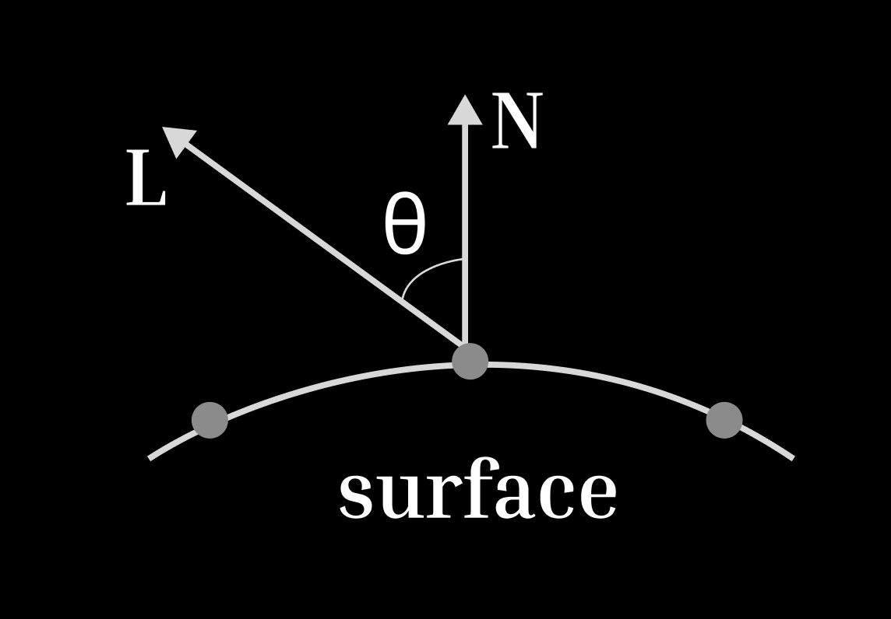
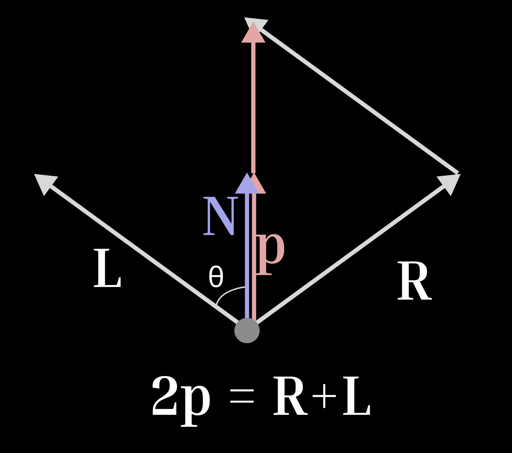
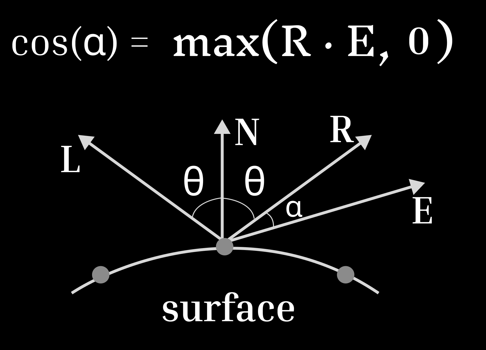
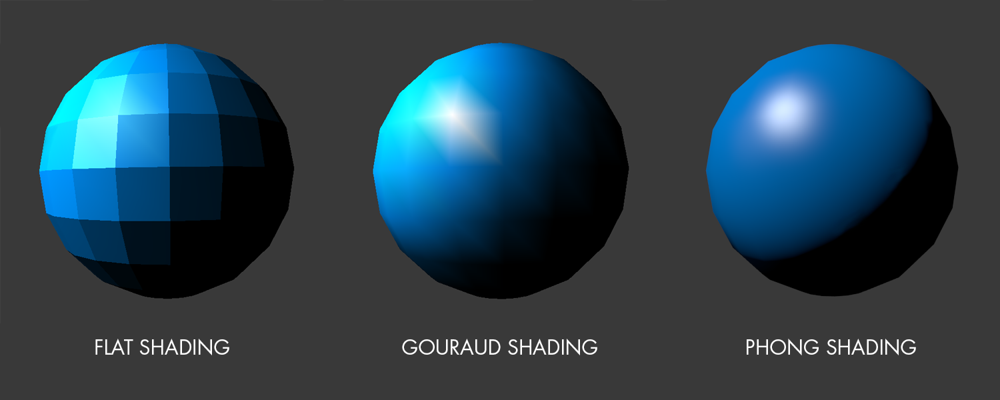
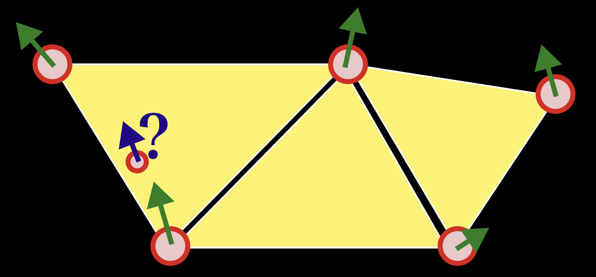
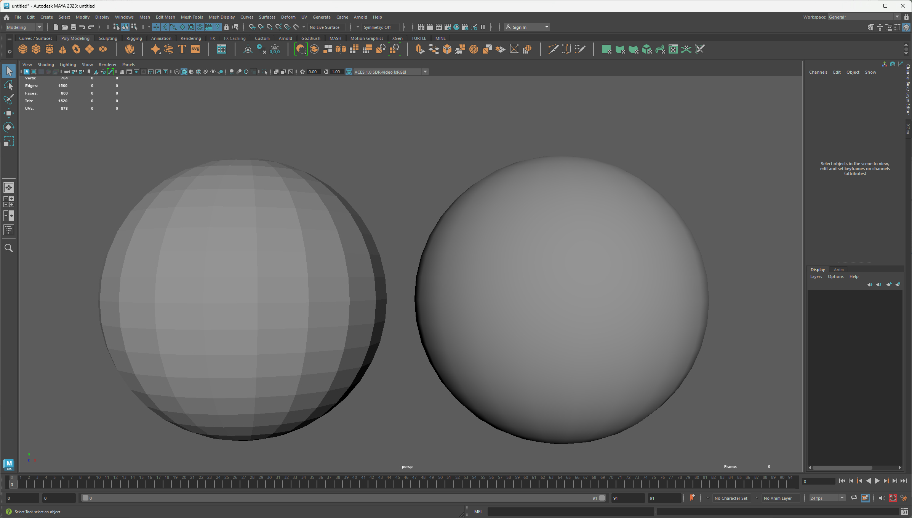
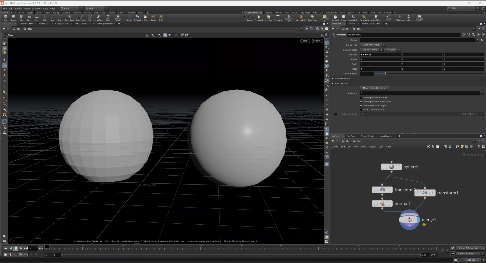

**Illumination(Reflection) Model** : 한 점에서 빛의 세기(Intensity)를 어떤 식으로 계산 할까?  
**Shading Model** : 그 식을 갖고 (Face/ Vtx / pixel)에서 계산하고, 삼각형 내부는 어떻게 채울까?


--- 
### 1. Phong Illumination(Reflection) Model
표면의 최종 밝기를 **Ambient + Diffuse + Specular** 세 성분의 합으로 계산한다.

 $$I = I_a + I_d + I_s$$
 
 $$I = k_a\, i_a + k_d\, i_d\, \max(0,\ \hat{L} \cdot \hat{N}) + k_s\, i_s\, \max(0,\ \hat{R} \cdot \hat{E})^{n}$$

#### 기호

| 기호              | 의미                                               |
| --------------- | ------------------------------------------------ |
| $k_a, k_d, k_s$ | 재질(Material)의 ambient / diffuse / specular 반사 계수 |
| $i_a, i_d, i_s$ | 광원의 ambient / diffuse / specular 세기              |
| $\hat{N}$       | 표면의 단위 법선 벡터                                     |
| $\hat{L}$       | 표면점 → 광원 방향 단위 벡터                                |
| $\hat{E}$       | 표면점 → 카메라(Eye) 방향 단위 벡터                          |
| $\hat{R}$       | $\hat{L}$이 $\hat{N}$에 대해 반사된 단위 벡터               |
| $n$             | shininess(광택 지수)                                 |

#### 1.1 Ambient - 주변광


$$I_a = k_a \cdot i_a$$

- 광원의 위치 / 방향과 무관한 상수값 → 거리 감쇠 없음, Normal 계산도 하지 않음.
- 빛이 닿지 않는 면도 완전히 검게 되지 않도록 하는 간접광 근사

``` cpp
//hlsl
float3 ambient = gAmbientLight * mat.Ambient;
```

#### 1.2 Diffuse

$$I_d = k_d \cdot i_d \cdot \max(\hat{L} \cdot \hat{N}, 0)$$

- $\hat{L}$, $\hat{N}$ 사이의 각의 **Cosine을 dotproduct**로 계산
- 빛이 정면으로 들어올 수록 밝고, 비스듬할수록 어두워지겠다
- 90도 이상인 뒷면에서는 dot product가 음수가 되므로 `max(dot(L,N), 0)`으로 0아래로 내려가지 않게 Clamping한다.
- 시점 ($\hat{E}$)과 무관 : 어느 방향에서 봐도 같은 밝기.

<table width="90%" style="table-layout: fixed; border-collapse: collapse; border: none;"> <tr style="border: none;"> <td width="100%" style="text-align: center; border: none; padding: 15px;">  <br><strong>Lambertlaw</strong> </td>  </tr> </table>


#### 1.3 Specular

Specular는 **반사 벡터 $\hat{R}$** 과 **시선(Eye) 벡터 $\hat{E}$** 가 가까울수록 밝아지는 하이라이트이다.  
그런데 $\hat{R}$은 입력으로 주어지지 않으므로 $\hat{L}$, $\hat{N}$으로부터 직접 구해야 한다.

**반사 벡터(Refelction vector)**구하기 :
<table width="100%" style="table-layout: fixed; border-collapse: collapse; border: none;"> <tr style="border: none;"> <td width="100%" style="text-align: center; border: none; padding: 15px;">  <br><strong>SpecularLightVector</strong> </td>  </tr> </table>
1. **반사 법칙**: 입사각 = 반사각 = $\theta$. $\hat{L}$과 $\hat{R}$은 $\hat{N}$을 기준으로 좌우 대칭이다.
2. **$\vec{p}$ 정의**: $\hat{L}$을 $\hat{N}$ 방향으로 투영한 벡터

$$\vec{p} = (\hat{L} \cdot \hat{N})\hat{N}$$

3. 대칭이므로 $\hat{L}$, $\hat{R}$의 $\hat{N}$ 방향 성분은 둘 다 $\vec{p}$로 같고, 표면 방향 성분은 부호만 반대라서 더하면 사라진다.

$$\hat{L} + \hat{R} = 2\vec{p}$$

**최종 정리** : 

$$\hat{R} = 2\vec{p} - \hat{L} = 2(\hat{L} \cdot \hat{N})\hat{N} - \hat{L}$$

#### Specular 식 세우기
<table width="100%" style="table-layout: fixed; border-collapse: collapse; border: none;"> <tr style="border: none;"> <td width="100%" style="text-align: center; border: none; padding: 15px;">  <br><strong>Specularlaw</strong> </td>  </tr> </table>

- 그림의 **$\alpha$는 $\hat{R}$과 $\hat{E}$ 사이의 각도**이다.
- 단위 벡터이므로 $\cos\alpha = \hat{R} \cdot \hat{E}$, 음수는 0으로 클램프한다.
- 각이 작을수록(= $\hat{E}$가 $\hat{R}$에 가까울수록) 1에 가까워져 밝아진다.
- 여기에 **shininess 지수 $n$** 을 거듭제곱해 하이라이트를 뾰족하게 만든다.

$$I_s = k_s \cdot i_s \cdot \max(\hat{R} \cdot \hat{E},\ 0)^{\,n}$$

- $n$이 클수록 하이라이트가 작고 날카로워진다. (거듭제곱으로 cosine 곡선을 뾰족하게 만듦)

**문제점**:  
- $\hat{R}$은 조명 계산마다(Pixel Shading이면 pixel마다) 반사 연산이 필요하다.
- 반면 $\hat{L}$, $\hat{E}$는 이미 알고 있는 값이라 쉽게 구할 수 있다.
  → 1.4에서 $\hat{R}$ 없이 계산하는 방법을 쓴다.

#### 1.4 Blinn-Phong (Half Vector)

$\hat{L}$, $\hat{E}$는 쉽게 구할 수 있으니, $\hat{R}$ 대신 **둘의 중간 벡터**를 구해서 쓰자.

$$\hat{H} = \frac{\hat{L} + \hat{E}}{\lVert \hat{L} + \hat{E} \rVert}$$

$$I_s = k_s \cdot i_s \cdot \max(\hat{N} \cdot \hat{H},\ 0)^{\,n}$$

- $\hat{H}$는 $\hat{L}$을 $\hat{E}$ 방향으로 완벽히 반사시키는 면의 법선이다.
  → $\hat{N} = \hat{H}$이면 $\hat{R} = \hat{E}$, 즉 정반사 방향을 정확히 보고 있다.
- $\hat{N}$과 $\hat{H}$ 사이 각은 $\hat{R}$과 $\hat{E}$ 사이 각($\alpha$)의 **절반**이다.
  → 같은 하이라이트 크기를 내려면 $n$을 Phong보다 약 4배 크게 잡는다.
- 반사 계산이 필요 없고, 시선이 낮은 각도일 때도 하이라이트가 더 안정적이다.

| | Phong | Blinn-Phong |
|---|---|---|
| 사용 벡터 | $\hat{R}$ (반사 벡터) | $\hat{H}$ (Half Vector) |
| Specular 항 | $(\hat{R} \cdot \hat{E})^{n}$ | $(\hat{N} \cdot \hat{H})^{n}$ |
| 추가 연산 | 반사 계산 | $\hat{L}+\hat{E}$ 정규화 |

```cpp
// hlsl
// Phong
float3 R = reflect(-L, N);
float  spec = pow(max(dot(R, E), 0.0f), mat.Shininess);

// Blinn-Phong
float3 H = normalize(L + E);
float  spec = pow(max(dot(N, H), 0.0f), mat.Shininess);
```


---
### 2. 광원 종류 (Light Type)

| 광원              | 특징                    | 비고                                     |
| --------------- | --------------------- | -------------------------------------- |
| **Ambient**     | 위치/방향 없음, 감쇠 없음       | $I_a = k_a i_a$                        |
| **Directional** | 방향만 존재, **감쇠 없음**     | 태양광 근사. homogeneous 좌표 $w = 0$ (방향 벡터) |
| **Point**       | 한 점에서 전방향 발산          | vertex ↔ light 사이 **거리 $d$** 로 감쇠      |
| **Spot**        | 꼭짓점(apex)에서 원뿔 형태로 발산 | 방향 + 각도 제한                             |

#### Ambient Light

$$I_{ambient} = k_a \cdot i_a$$

``` hlsl
float3 ambient = gAmbientLight * mat.Ambient;
```

- 광원 위치/방향의 영향 없어서 거리 감쇠도 없음
- Model Normal 계산하지도 않음

#### Directional Light

- 감쇠 없음
- homogeneous coordinate : 0

#### Point Light

- vertex - point light - distance거리 계산

$$att(d) = \frac{1}{k_c + k_l d + k_q d^2}$$

- $d$: 표면점과 광원 사이 거리, $k_c, k_l, k_q$: 상수 / 선형 / 이차 감쇠 계수

#### Spotlight
- $P_{s}$: apex 위치
- $\hat{S}$: light driection - 원뿔 중심축
- θ : 원뿔 angle

$$
spot = \max(-\hat{L} \cdot \hat{S},\ 0)^{p}
$$

- 선형이 아니어서 Falloff(감쇠곡선) 을 가지므로, 수식보다 그래프(곡선)로 조절 하기도 한다.
- $p$가 클수록 중심에 집중되고 경계가 빠르게 어두워짐


---
### 3. Shading Model(Phong Shading)
Illumination Model은 조명식이고, Shading Model은 그 식을 어느 단위에서 계산하느냐의 차이다. 결국 삼각형 내부 픽셀에 도달하는 빛의 Intensity를 어떻게 연산하겠냐가 핵심이다.
<table width="100%" style="table-layout: fixed; border-collapse: collapse; border: none;"> <tr style="border: none;"> <td width="100%" style="text-align: center; border: none; padding: 15px;">  <br><strong>Shading_models(Wikimedia-commns)</strong> </td>  </tr> </table>
세 가지 Shading Model(Flat / Gouraud / Phong) 모두 1장의 **Phong Illumination 공식**으로 밝기를 계산한다.
차이는 그 공식을 **어디(Face / Vertex / Pixel)에서 계산하고 무엇을 보간하느냐**이다.  

Flat → Gouraud → Phong 순으로 아래 **Interpolation(보간)** 이 들어가며 점점 부드러워진다.
<table width="90%" style="table-layout: fixed; border-collapse: collapse; border: none;"> <tr style="border: none;"> <td width="100%" style="text-align: center; border: none; padding: 15px;">  <br><strong>vertexInterpolation</strong> </td>  </tr> </table>
위 이미지와 같이 Polygon의 정보는 Vertex마다 정보를 갖고있다.  
vtx과 vtx사이의 값들은 어떻게 처리를하냐에 따라서 달라지는것이 ShadingModel이다.
그것을 다시 정리해 이렇게 물을 수 있다.
> Normal이 vtx기준으로 들어 있는데, 그렇다면 Face내부인, Pixel에 있는 빛의 계산은 어떻게 표현하는것일까?

 이 값을 어떻게 처리하느냐가 Shading Model이다.

#### 3.0 한눈에 비교

| |Flat|Gouraud|Phong|
|---|---|---|---|
|조명 계산 단위|**Face(삼각형)** 당 1번|**Vertex** 당 1번|**Pixel** 당 1번|
|사용하는 Normal|Face Normal|Vertex Normal|보간된 Pixel Normal|
|보간 대상|없음|**색상(Intensity)**|**Normal**|
|계산 위치|–|Vertex Shader|Pixel(Fragment) Shader|
|결과|면이 뚝뚝 끊김|매끄럽지만 하이라이트 놓침/번짐|하이라이트까지 매끄러움|
|비용|가장 낮음|중간|가장 높음|

#### 3.1 Flat Shading
- 삼각형 당 조명 계산 1번, 계산된 색을 면 전체에 동일하게 적용한다.
- Face Normal 사용 → 3개의 vertex의 **Cross Product**로 구한다.

$$I_{face} = k_d \cdot i_d \cdot \max(\ \hat{L} \cdot \hat{N}_{face}, 0)$$


**특징** :   
- 빠르다 - 동일한 삼각형(Face) 내에 있는  픽셀에 하나의 LightModel - Normal만을 계산!
- Maya에서의 HardenEdge와 같이 끊겨서 보인다.
- Quad Modeling에서는 사각형을 이루는 두 삼각형이 같은 normal → 같은 intensity.

-> 3가지 vtx의 cross product로 normal vector를 구한다.


**연산 순서**:  
1. vtx 3개로부터 삼각형의 Normal(Face Normal)을 구한다.
2. 1번으로 구한 normal vector와 light model과 연산
   → output : 삼각형 내부는 모두 pixel이 동일한 pixel intensity

- 각 pixel 단위로 intensity 계산 결과 : 개별적인 Primitive(삼각형/Face) 마다의 같은 빛의 intensity 연산(hardenedge)

#### 3.2 Gouraud Shade
- Flat Shade는 너무 끊겨서 보이므로 Vertex Normal로 조명을 계산하고 결과(색)를 선형 보간한다
- Scanline 기준으로 삼각형의 두 변을 따라 보간한뒤, 가로 방향으로 한번 더 보간 → 삼각형 내부 전체를 채운다

**Keyword** :  
- 명암을 계산 다시 하자
- 선형 보간을 두번해서, 삼각형 내부에있어서 보간을 다 할수가있다
- 색이 부드럽게 이어져서 **매끄럽게** 나온다

**연산 순서**:  
1. **FlatShade로부터 구한 삼각형 face의 normal**로부터 vtx의 normal을 평균내 구한다
2. vtx normal과 light vector를 연산(VS에서 수행)
   → output : **vertex intensity**
3. 삼각형 Edge에 물린 pixel 대해서 vtx를 선형 보간으로 intensity를 계산한다
   → output : **테두리 pixel intensity**
4. 3번으로 테두리 pixel intensity로 내부의 픽셀도 한번 더 보간한다
   → output : 삼각형 내부 pixel intensity

**특징** :  
- 색이 부드럽게 이어져 매끄럽다.
- 단점 : 하이라이트(Specular)가 삼각형 내부에 있고, vtx에는 걸리지 않으면 **놓치거나 번져보임**


#### 3.3 Phong Shading
- Gouraud가 highlight이 퍼지기 때문에, 보간 대상을 색이 아니라 Normal로 바꾼다.
- 각 Pixel마다 Normal을 구하고 조명 모델을 Pixel에서 다시 적용한다.

**Phong 연산**:  
1. **Gouraud Shade로부터 구한 각 Vertex의 normal**을 보간해, 각 pixel에 해당하는 Normal을 보간해 구한다(보간 후 재 정규화 필요)
   → Output : Pixel vertex Normal
2. 1번으로 부터의 Pixel Normal로 Light 모델(Ambient + Diffuse + Specular)을 연산한다. 
   - 조명 모델 재 적용
   → Output : Pixel Intensity

**특징** :  
- 하이라이트가 vertex위치와 관계없이 부드럽고 정확하게 나타낸다.
- 비용은 가장 높지만 현재 GPU의 pixel Shader에서는 일반적으로 사용.


### 4. Shading Model vs Illumination Model 혼동 주의
- Phong Illumination Model : 조명 공식(Ambient + Diffuse + Specular)
- Phong Shading : 그 공식을 각 픽셀마다, 보간된 Normal로 계산하는 방식
- Flat / Gouraud / Phong Shading 모두 같은 Phong Illumination공식 쓸 수 있고,  
  그 차이는 "어디서 계산하고 무엇을 보간하느냐"이다.


### 5. Dcc tool의 Harden / Soften Edge

<table width="100%" style="table-layout: fixed; border-collapse: collapse; border: none;"> <tr style="border: none;"> <td width="35%" style="text-align: center; border: none; padding: 5px;">  <br><strong>Maya Harden/SoftenEdge</strong> </td> <td width="37%" style="text-align: center; border: none; padding: 5px;">  <br><strong>Houdini Normal</strong> </td> </tr> </table>

- 위와 같이 Dcc tool에서도 Harden/Soften Edge로 개별적인 Vtx단위, Normal을 설정할 수 있따.
- 이것은 shade단에서가아니라 object vertex normal 속성으로 저장되는 값이다.
	- Soften : 공유 vertex의 normal을 평균 → Smooth한 표면
	- Harden : Face별 Normal유지 → 각진 표면


### 6. 요약
1. Phong Illumination : `Ambient + Diffuse(Lambert) + Specular( R·E or N·H)^n`
2. Blinn - Phong 은 R대신 Half Vector H를 써서 계산 단순화
3. Shading Model은 조명 계산 단위와 보간 대상의 차이 : 
	1. Flat : Face 단위 계산, 보간 없음
	2. Gouraud : Vertex에서 계산한 색을 보간
	3. Phong : Normal을 보간하고 pixel에서 계산
4. 광원은 Ambient(무감쇠 무방향) / Directional(무감쇠) / Point(거리감쇠) / Spot(원뿔 + Falloff)로 나뉜다.


