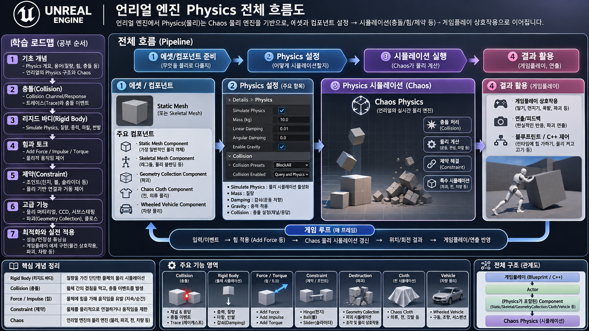

<table width="90%" style="table-layout: fixed; border-collapse: collapse; border: none;"> <tr style="border: none;"> <td width="100%" style="text-align: center; border: none; padding: 15px;">   <strong>UEPhysics</strong> </td>  </tr> </table>

