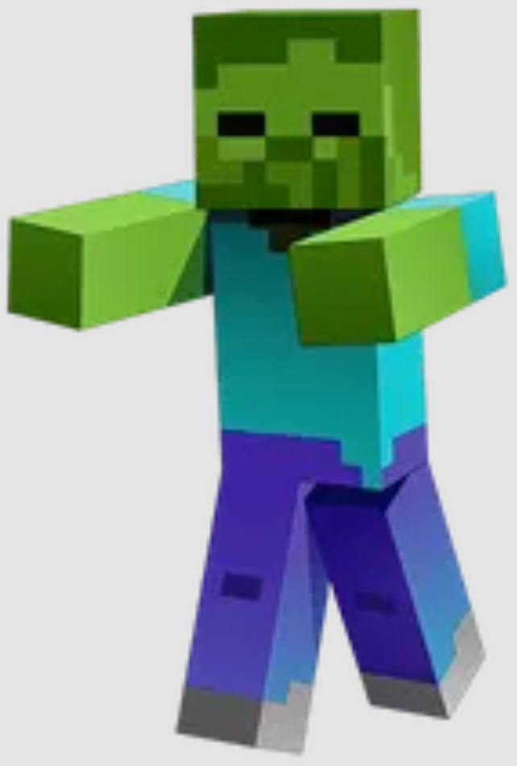
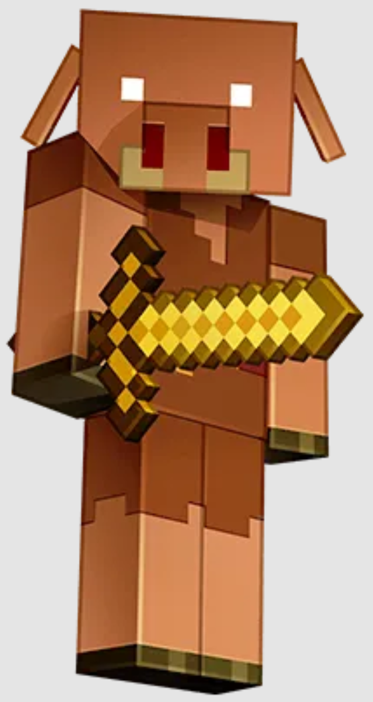
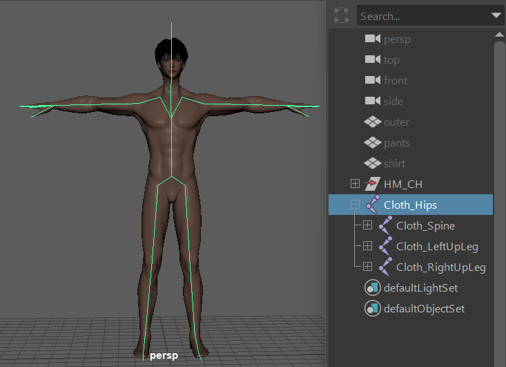
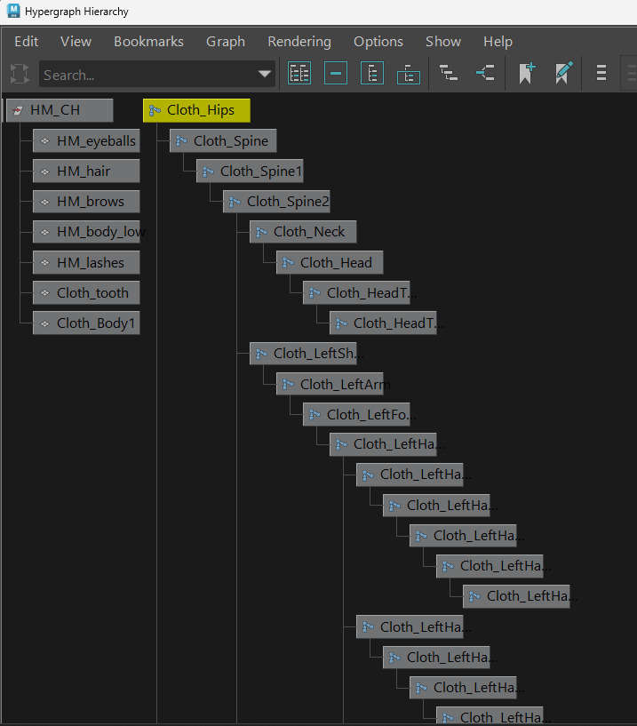
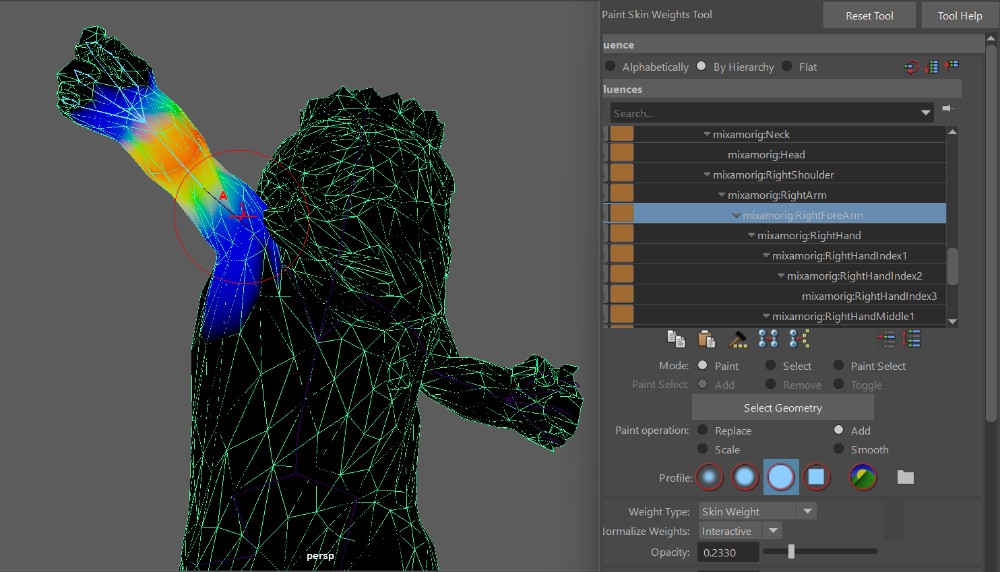
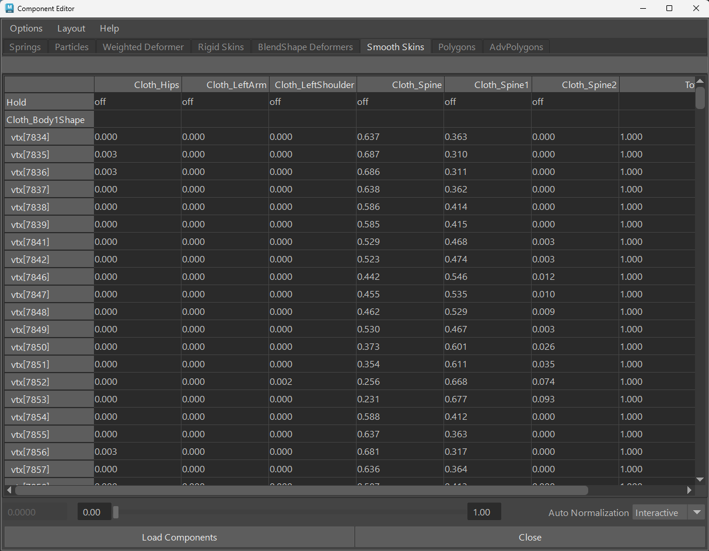
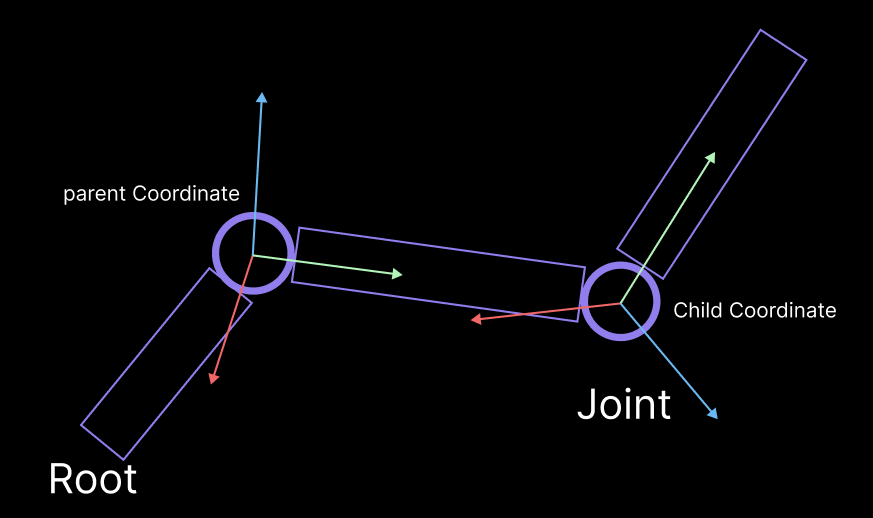

Animation를 알아본다. Art 관점이 아닌, 프로그래머의 관점(데이터, 수식, 파이프라인)을 통해 animation을 알아보자. (뗄레야 뗄수는 없어서, 중간중간에 예시를 Art로 들기는 할것이다)

### 1. Animation ?

Animation은 시간에 따라 Object의 Space상의 이동이다. (위치, 회전, 크기, 정점 등)  
컴퓨터 그래픽스의 Animation은 크게 두가지다.

|     | Keyframe Animation                          | Physics-Based Animation                                 |
| --- | ------------------------------------------- | ------------------------------------------------------- |
| 성격  | Determine (결정적)                             | Undetermine (비결정적)                                      |
| 제작  | 아티스트가 DCC 툴로 제작   (Maya, Max, Houdini 등) | 물리 시뮬레이션이 계산   (Havok, PhysX, Chaos 등)               |
| 장점  | Bone과 Mesh만 있으면 원하는 장면을 자유롭게 연출             | 무작위성 가능, 아티스트가 일일이 제작하지 않아도 됨                           |
| 단점  | 제작 시간이 오래 걸림                                | Solver에 따라 연산이 무거움,   프로그래머가 Rule과 Constraint를 정해야 함 |

이 글에서는 Keyframe 기반 **Character Animation**에 집중한다.

<table width="100%" style="table-layout: fixed; border-collapse: collapse; border: none;">
  <tr style="border: none;">
    <td width="100%" style="text-align: center; border: none; padding: 5px;">
      <a href="https://www.youtube.com/watch?v=bsPtvhlaXbk" target="_blank" style="position: relative; display: inline-block;">
        
        
      </a>
      <strong>Rigging Pipeline timestemp </strong>
    </td>
  </tr>
</table>

---
### 2. Animation 방식 분류
#### 2.1 Vetex Animation( VertexMorphing)
- 정점 위치를 두 키 포즈 사이에서 Blend한다.  
- Bone이 없음

$$
𝑉_{World} = (1− 𝑎) × 𝑉_1 + 𝑎 × 𝑉_2,  (0 ≤ 𝑎 ≤ 1)
$$

- $V_1$, $V_2$: 같은 정점의 두 키 포즈 위치
- $a$: 시간 또는 블렌드 값
- 용도: 표정, Blend Shape, Morph Target
- 단점: 정점 수만큼 키 데이터가 필요해서 메모리가 큼

<table width="100%" style="table-layout: fixed; border-collapse: collapse; border: none;"> <tr style="border: none;"> <td width="50%" style="text-align: center; border: none; padding: 5px;">   </td> </tr> </table>
위와 같은 Blend Shape(in Maya)와 같다.

#### 2.2 Articulated Body (Heierarchy Structure)
- 관절로 연결된 강체들을 Tree(graph)구조로 표현한다.
- Mesh를 부모 자식 관계로 상속시키고, Mesh마다 Move, Scale, Rotate를 포함한 Matrix를 매 Frame 또는 변화 하는 Frame마다 저장하여 사용.

$$ M_{transform} = M_{local} × M_{animation} × M_{parent} $$

- Tree이기에, graph의 이점인, 제어 · 순회 · 검색이 빠르다.

<table width="50%" style="table-layout: fixed; border-collapse: collapse; border: none;"> <tr style="border: none;"> <td width="50%" style="text-align: center; border: none; padding: 5px;">   <strong></strong> </td> <td width="40%" style="text-align: center; border: none; padding: 5px;">   <strong></strong>마인크래프트 캐릭터 </td>  </tr> </table>
- Mesh마다 통으로 움직이기때문에, Pivot점을 기준으로만 통으로 Transform 수정이 일어난다.  
- 이 구조가 Skeletal Animation의 뼈대가 된다

---
### 3. Skeletal Animation (Bone 기반)

#### 3.1 **뼈의 움직임** :

$$ M_{boneTransform} = M_{boneLocal} × M_{boneAnimation} × M_{boneParent} $$

$$ M_{World} = M_{local} × M_{meshLocal} × M_{boneTransform} $$

- 각 뼈는 부모 기준 Local 변환을 가진다.
- 부모부터 자식 순서로 곱해 내려가면 모든 뼈의 Root(모델)공간 변환이 나온다.
- Root에서 시작하는 트리 순회(DFS) 한 번이면 된다. : 부모가 항상 먼저 계산된다

<table width="100%" style="table-layout: fixed; border-collapse: collapse; border: none;"> <tr style="border: none;"> <td width="50%" style="text-align: center; border: none; padding: 5px;">   <strong></strong> </td> <td width="32%" style="text-align: center; border: none; padding: 5px;">   <strong></strong> </td> </tr> </table>

#### 3.2 **Vertex의 움직임 - Skining Technique ** : 

정점 하나는 여러 Bone의 영향을 가중치(Weight)로 나눠 받는다.

$$ V_{world} = \sum_{i} \left( V_{local} \cdot M_{i} \cdot W_{i} \right), \quad \sum W_i = 1 $$

- Mesh를 Bone에 붙이는 Binding 작업, Hierarchical 구조의 3D mesh, Joint 간에 끊김 현상 발생할 수 있어, 각 Bone이 움직일때 영향을 받는 vtx를 weight으로 제어한다.

<table width="100%" style="table-layout: fixed; border-collapse: collapse; border: none;"> <tr style="border: none;"> <td width="50%" style="text-align: center; border: none; padding: 5px;">   Maya Point Weight</td> </tr> </table>
위와 같이 이를 Maya에서는 Skin Weight Paint로 Matrix의 영향을 설정한다.

$M_i$는 단순한 본 행렬이 아니라 다음과 같다.

$$ M_i = M_{offset(i)} \times M_{boneToRoot(i)} $$

- Offset : vtx를 bind pose의 model공간에서 Bone Local 공간으로 내리는 행렬
- BoneToRoot : 애니메이션이 적용된 Bone의 현재 반환
- 정점이 Bone Local로 내려갔다가 움직인 Bone을 따라 다시 올라오는 구조다.
- VTX하나에 보통 4~5개 Bone이 Weight을 준다. (Maya는 Max influences default : 5개)
- DX11에서는 정점 입력에 `uint4 + float4`로 4개를 쓰는게 일반적이다. 5개로 작업되었다면 load할때, Weight가 큰 4개만 남기고 합이 1이 되도록 재 정규화 한다.

<table width="100%" style="table-layout: fixed; border-collapse: collapse; border: none;"> <tr style="border: none;"> <td width="50%" style="text-align: center; border: none; padding: 5px;">   Maya Skin Weight 확인</td> </tr> </table>

Ex) Bone 2개가 영향을 주는 정점
$$ V_{world} = V_{local} \times M_1 \times W_1 + V_{local} \times M_2 \times W_2 $$

- Weight가 들어가있는 vertex들이 $M_i$(=Offset x Bone To root) : $M_{boneTransform}$에다가 곱해져 Bone과 같이 움직인다.

### 3.3 Rigging Data

Rigging이 만들어내는 데이터는 크게 세 덩어리이다.

|데이터|정의|시간|프로그래머 관점의 실체|
|---|---|---|---|
|**Skeleton**|Joint location의 List|불변|부모 인덱스 배열 + Bind Pose / Offset 행렬|
|**Posture**|Joint orientation의 List|한 시점|Joint별 Local 변환 (T/R/S) 묶음|
|**Motion**|Posture의 List|시간 구간|Joint별 Keyframe Track (= Clip)|

> Skeleton은 뼈대 구조, Posture는 그 뼈대로 취한 한 장의 자세, Motion은 자세를 시간순으로 모은 것이다.

#### Posture

- 각 link(Bone) 마다 Coordinate Frame을 지정
	- 부모 기준 Local 변환을 가짐!
<table width="100%" style="table-layout: fixed; border-collapse: collapse; border: none;"> <tr style="border: none;"> <td width="50%" style="text-align: center; border: none; padding: 5px;">   parent-child Joint</td> </tr> </table>

- 각 뼈는 부모 기준 로컬 변환을 가진다.

<table width="100%" style="table-layout: fixed; border-collapse: collapse; border: none;">
  <tr style="border: none;">
    <td width="100%" style="text-align: center; border: none; padding: 5px;">
      <a href="https://www.youtube.com/watch?v=uiASjGuvDOs" target="_blank" style="position: relative; display: inline-block;">
        
        
      </a>
      <strong>Character Animation in UE</strong>
    </td>
  </tr>
</table>
Single Posture가 모여 최종 Motion을 가지면 위와 같은 Motion들을 시행하도록 FSM을 구성하는것이 Animation State Machine이다.

---
#### 4. IK vs FK

#### 4.1 FK(Forward Kinematics)
**개념**: 부모 관절부터 자식 관절 순서로 각도를 정해, 그 결과로 끝점(손, 발)의 위치가 결정되는 방식.

**한계**:  
- 얼마나 꺾어야지, 부모 관절의 회전이 자식 전체에 영향을 주므로 부모가 특히 중요하다.
- 목표 지점에 도달하거나, 물건 파지해야 할때 문제 생긴다.
1. FK에서는 부모에서 조금씩 돌리고,
2. 자식도 돌려도 하다가
3. 도착 못찾으면 다시 처음부터 다시 조정해야한다
- 위 과정을 시행착오로 풀기 어려워, 가능한 동작을 사전에 학습/제작 해놓아야한다.
- 하지만 모든 공간상의 위치에 대해 학습시키는 것은 사실상 어렵다.

#### 4.2 IK(Inverse Kinematics)

**개념**: 끝점의 목표 위치를 먼저 정하고, 거기에 도달하기 위한 각 관절의 각도를 역으로 계산하는 방식.

**특징**:
- FK로 먼저 갖다 놓은 뒤 IK로 다시 보정할 수 있다.
- 다만 결과가 **부자연스러울 수 있다.**
- "도달 가능하다"는 가정하에 계산한다. (범위 밖이면 풀 수 없다.)
- **사용 예시**: 물건을 잡을 때, 계단 같은 step을 걸을 때(발 위치를 지형에 맞춤)

#### 4.3 회전 표현: Euler의 한계 → Quaternion

**Euler 각**

- X, Y, Z 각각의 회전값으로 최종 방향을 결정한다.
- 같은 최종 위치/방향이어도 **해가 매우 많다.** (표현이 유일하지 않다.)
- 그래서 IK처럼 해를 계산해 내는 방식에서는 값이 튀거나 불안정해지기 쉽다.

**결론**: IK 기반에서는 **Quaternion**을 사용한다.

> 보충: Euler는 짐벌락(gimbal lock) 문제와 보간 시 부자연스러운 회전이 생기는 문제도 있다. Quaternion은 이를 피하고 부드러운 보간(Slerp)이 가능하다.

각 관절을 얼마정도 꺾어야하는지가 fbx에 저장이 되어있다
