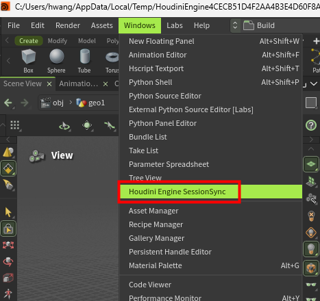
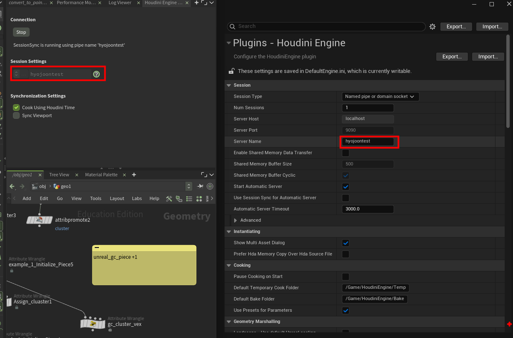
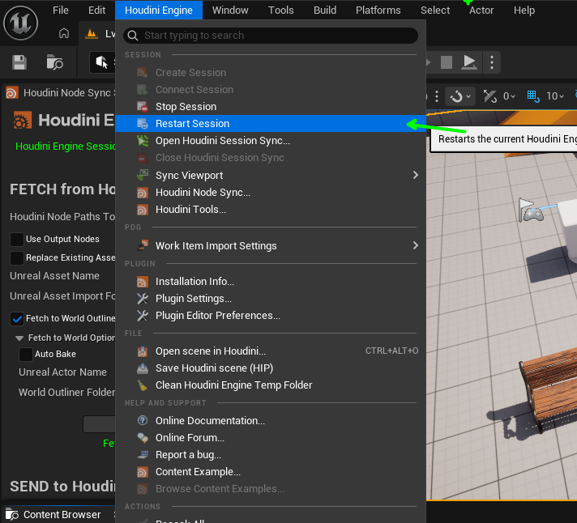
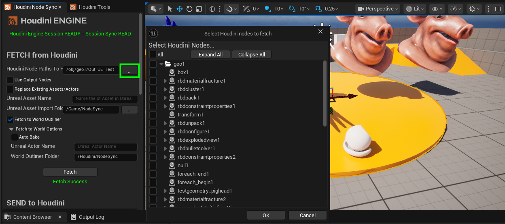
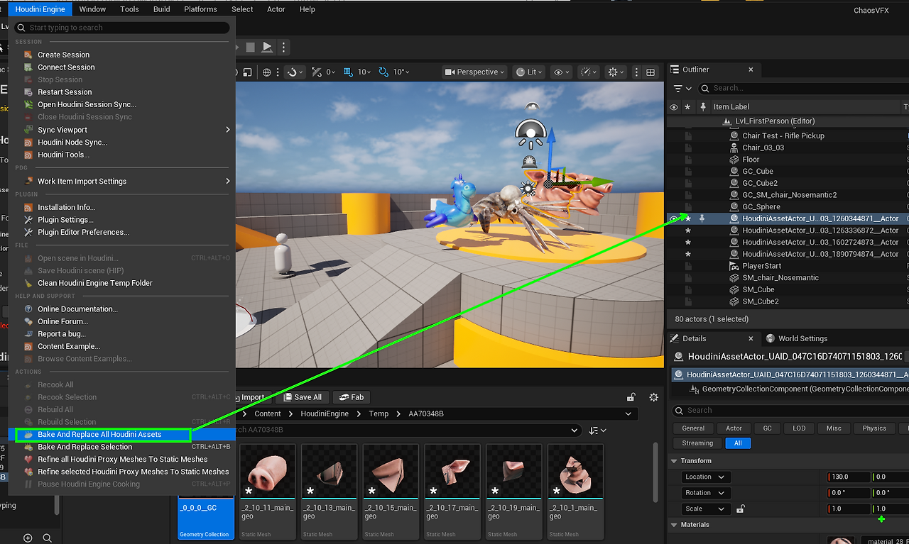

Houdini 와 Unreal engine Node sync에 대해 정리한다.
<table width="100%" style="table-layout: fixed; border-collapse: collapse; border: none;">
  <tr style="border: none;">
    <td width="100%" style="text-align: center; border: none; padding: 5px;">
      <a href="https://www.youtube.com/watch?v=EhpZiKUeqNI&feature=youtu.be" target="_blank" style="position: relative; display: inline-block;">
        
        <span style="position: absolute; top: 50%; left: 50%; transform: translate(-50%, -50%); width: 68px; height: 48px; background: url('https://upload.wikimedia.org/wikipedia/commons/b/b8/YouTube_play_button_icon_%282013%E2%80%932017%29.svg') no-repeat center/contain;"></span>
      </a>
      <strong>Houdini UE Node Sync</strong>
    </td>
  </tr>
</table>
### 1. 환경 확인 및 목표

- **Houdini 20 버전 이상**부터 Houdini Engine Session Sync를 사용할 수 있다.
- 사용하는 **UE 버전에 맞는 Houdini 버전**을 별도로 맞춰야 한다.
- 이 글에서는 **Houdini 22 + Unreal Engine 5.7** 조합을 사용했다.


Houdini에서 작업한 **Fracture**를 **GeometryCollection**까지 만들어 UE로 가져와보자.

---
### 2. 연결 방법

#### 2.1 Session Sync 열기

<table width="100%" style="table-layout: fixed; border-collapse: collapse; border: none;"> <tr style="border: none;"> <td width="50%" style="text-align: center; border: none; padding: 5px;">  <br><strong>Houdini Engine Session Sync</strong> </td> </tr> </table>

Houdini에서 **Engine Session Sync**를 열어준다.

#### 2.2 서버 이름 맞추기

<table width="100%" style="table-layout: fixed; border-collapse: collapse; border: none;"> <tr style="border: none;"> <td width="50%" style="text-align: center; border: none; padding: 5px;">  <br><strong>Houdini, UE Server name</strong> </td> </tr> </table>

Houdini와 UE의 **Server Name을 동일하게** 맞춰준다.

연결에 성공하면 UE **Output Log**에 아래 메시지가 출력된다.

```
Successfully connected to Session Sync
```

이 메시지가 보이면 연결이 완료된 것이다.

---

## 3. 노드 불러오기

### 3.1 Restart Session

<table width="100%" style="table-layout: fixed; border-collapse: collapse; border: none;"> <tr style="border: none;"> <td width="50%" style="text-align: center; border: none; padding: 5px;">  <br><strong>Restart Session</strong> </td> </tr> </table>

**Restart Session**으로 세션을 다시 시작한다.

### 3.2 Houdini 노드 확인

<table width="100%" style="table-layout: fixed; border-collapse: collapse; border: none;"> <tr style="border: none;"> <td width="50%" style="text-align: center; border: none; padding: 5px;">  <br><strong>Houdini Node Import</strong> </td> </tr> </table>

이렇게 Houdini의 Node를 UE로 불러올 수 있다.

---

## 4. Bake → GeometryCollection

<table width="100%" style="table-layout: fixed; border-collapse: collapse; border: none;"> <tr style="border: none;"> <td width="50%" style="text-align: center; border: none; padding: 5px;">  <br><strong>Baking And Replace All Houdini Assets</strong> </td> </tr> </table>

**Baking And Replace All Houdini Assets**로 Bake하면 Fracture 결과를 **Geometry Collection**으로 만들 수 있다.

---

## 5. 정리

| 단계 | 내용 |
|---|---|
| 1 | Houdini에서 Engine Session Sync 열기 |
| 2 | Houdini / UE Server Name 일치시키기 |
| 3 | Output Log에서 `Successfully connected to Session Sync` 확인 |
| 4 | Restart Session 후 Node 불러오기 |
| 5 | Baking And Replace All Houdini Assets로 Geometry Collection 생성 |

> 환경: Houdini 22 / Unreal Engine 5.7 (Houdini 20 이상, UE 버전에 맞는 Houdini 필요)
