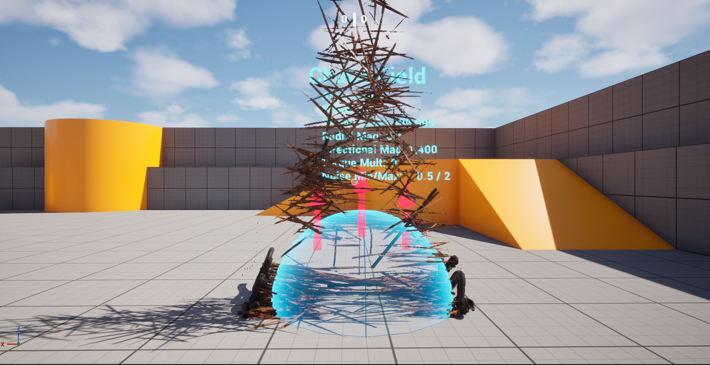
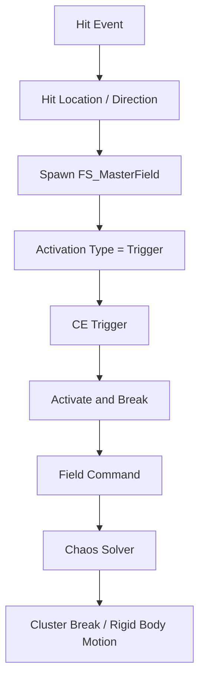
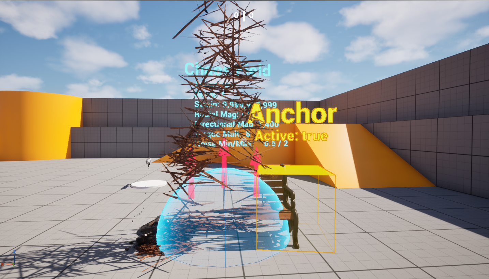
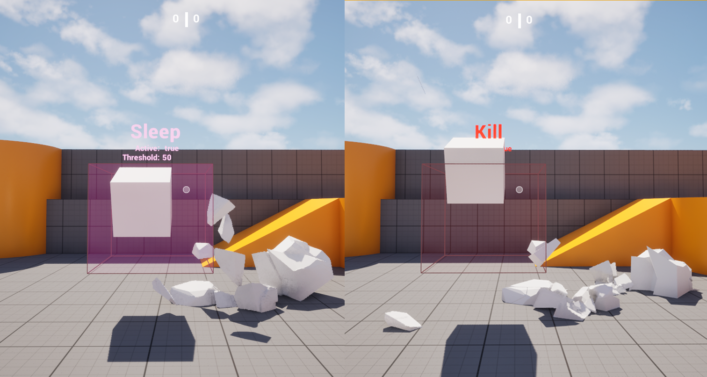
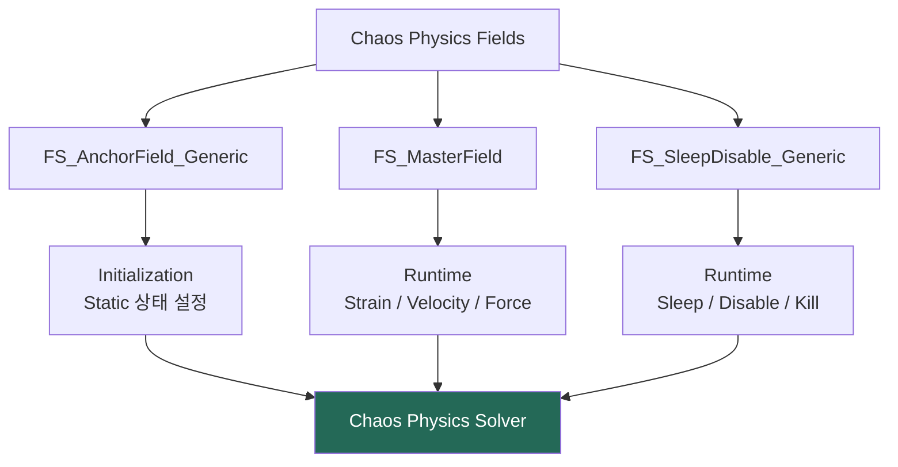

### 0. Chaos Physics Field
`Physics Field`는 특정 공간 영역에 있는 Chaos 물리 객체에 힘, 속도, Strain, Dynamic State 등을 적용하는 시스템이다.

대표적인 사전 제작 Field Actor는 다음과 같다.

|Field Actor|기능|적용 방식|
|---|---|---|
|`FS_MasterField`|Cluster 파괴 및 파편 운동|Trigger / Tick 등|
|`FS_AnchorField_Generic`|특정 파편 고정|Initialization|
|`FS_SleepDisable_Generic`|Sleep / Disable / Kill|실행 중 적용|

### 01. `FS_MasterField`

- Parent Class : `AFieldSystemActor`
- Component : `UFieldSystemComponent`
- 주요 기능 : External Strain, Internal Strain(Decay), Linear / Angular Velocity, Force, Noise

`FS_MasterField`는 Geometry Collection의 Cluster에 External Strain을 적용하여 파괴를 유도하고, Radial / Directional Velocity 및 Angular Velocity 등을 이용해 파편의 이동과 회전을 제어한다. Noise를 조합하면 불규칙한 파괴 움직임을 연출할 수 있다.

<table width="100%" style="table-layout: fixed; border-collapse: collapse; border: none;"> <tr style="border: none;"> <td width="100%" style="text-align: center; border: none; padding: 15px;">   <strong>MasterField01</strong> </td>  </tr> </table>

Physics Field는 UFieldSystemComponent를 통해 Chaos Physics에 명령을 전달하며, 실제 물리 계산은 Chaos Solver가 수행한다.

#### 1-1. Trigger 흐름

- `SpawnActor` 로 Field Actor를 생성
- `CE Trigger` : Trigger 방식의 Field를 명시적으로 활성화
- Activation Type은 BP 기본값으로 미리 설정 가능해, 매번 Spawn 이후 설정필요 X

Hit Event를 이용하는 경우 다음과 같은 순서로 실행한다.

1. Hit Event
	- Object와의 충돌 감지
	- Hit Location 획득
	- 충격 위치에 `FS_MasterField Actor` 생성
2. Set Activation Type
	- Trigger로 설정
	- 자동 실행 아닌 명시적 활성화 방식
3. CE Trigger
	- `FS_MasterField`내부 Custom Event 호출
	- Field 활성화 및 파괴 처리 시작

※ Hit Event와 Spawn Actor는 구현 예시이며, 미리 배치한 Field Actor를 활성화할 수도 있다.

#### 1.2. FS_MasterFiels 내부 처리
#### BP 내부 기능

**① Activate and Break*  
- Make Dynamic: 필요한 경우 Field 범위의 물리 객체를 Dynamic 상태로 변경
- External Strain: Cluster 파괴를 유도하는 외부 손상 적용
- Internal Strain (Decay) : 내부 파괴 임계값을 낮춰 내부 파괴 저항에 영향을 주는 Field

**② Make it Move**  
- Radial Velocity: 중심으로부터 방사형 이동
- Directional Velocity: 특정 방향으로 이동
- Angular Velocity: 파편 회전
- Linear Force: 물리적인 힘 적용
- Noise: 이동 방향이나 강도에 무작위성 추가

**③ Cleanup & LifeSpan**  
- Field 활성화 시간과 실행 횟수 관리
- 필요 없는 Field Actor 제거
- Field Actor 제거와 Geometry Collection 파편 제거는 별개의 작업

참고로 위 항목들은 기본 Blueprint의 기능적 분류이지, Solver가 반드시 위 순서대로 한 번씩 실행한다는 의미는 아니다.

---

### 02. FS_AnchorField_Generic

Anchor Field는 Geometry Collection의 초기 물리 상태를 설정하는 Construction Field이며, 한 번 설정된 Static 상태는 이후 시뮬레이션에서도 유지될 수 있다. 단, 별도의 Dynamic State 변경을 통해 상태를 변경할 수 있다.

- Geometry Collection의 `Initialization Fields`배열에 등록
- 초기화 시점에 Field 평가
- 지정된 Bone의 물리 상태를 Static으로 설정
- 이후 Solver에서 해당 상태를 유지.

<table width="100%" style="table-layout: fixed; border-collapse: collapse; border: none;"> <tr style="border: none;"> <td width="100%" style="text-align: center; border: none; padding: 15px;">   <strong>AnchorField01</strong> </td>  </tr> </table>

Houdini의 `i@active=0`와 유사한 개념이다. 내부구현은 다르지만..

>Geometry Collection 생성
    ↓
Initialization Fields 확인
    ↓
FS_AnchorField_Generic
    ↓
영향받는 Bone → Static
    ↓
Chaos Simulation

하지만 이는 Geometry Collection Component에 직접 `ChaosPhysics - Initialize Field - index`로 초기에 들어가야한다.

---

### **03. FS_SleepDisable_Generic**

<table width="100%" style="table-layout: fixed; border-collapse: collapse; border: none;"> <tr style="border: none;"> <td width="100%" style="text-align: center; border: none; padding: 15px;">   <strong>SleepDisable Sleep / Kill</strong> </td>  </tr> </table>
- Threshold : 50

시뮬레이션 중 파편의 물리 상태를 제어하는 Field.
- Sleep : 두번쨰 Object랑 부딫치면 깨어난다
- Kill : Chaos Simulation 죽음

|Mode|설명|
|---|---|
|Sleep|일정 속도 이하인 파편을 휴면 상태로 변경. 다시 활성화 가능|
|Disable|조건을 충족하는 파편을 시뮬레이션에서 제외|
|Kill|겹치는 대상의 시뮬레이션을 즉시 중지|

- 불필요한 물리 계산 감소
- 파편이 계속 떨리는 현상 방지
- 잔해의 물리 시뮬레이션 관리

- **Disable / Kill** : 이 곧 파편 Mesh 삭제가 아님. **물리 시뮬레이션에서 제외**하는 것이다.

### 전체 요약
