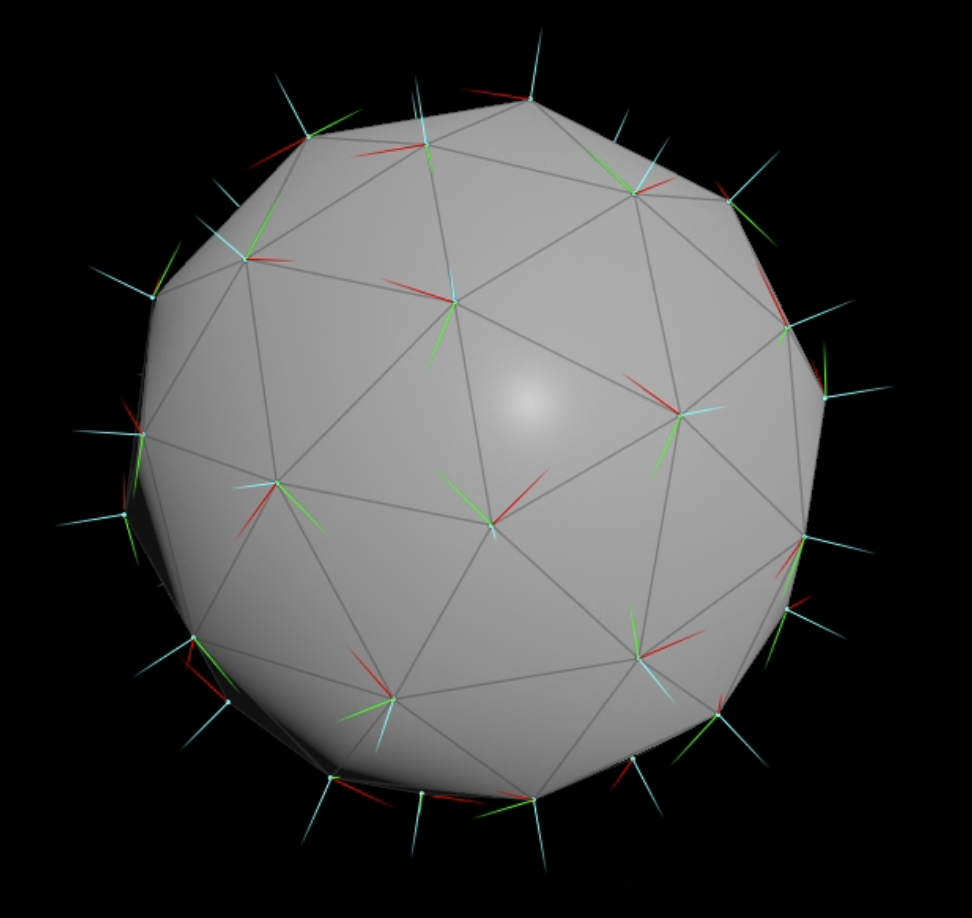
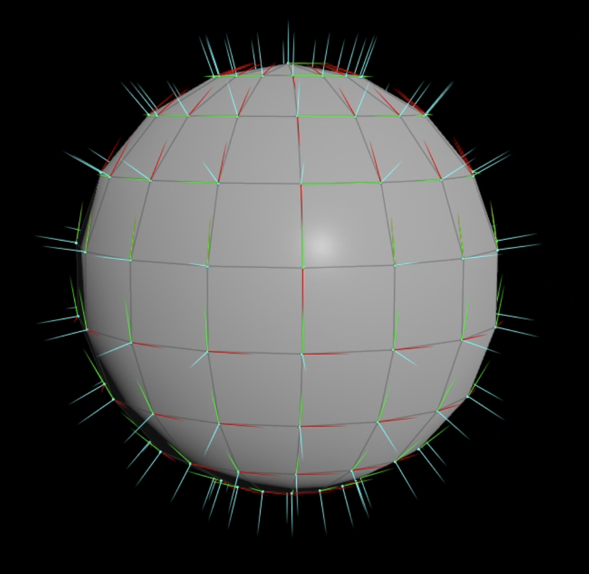
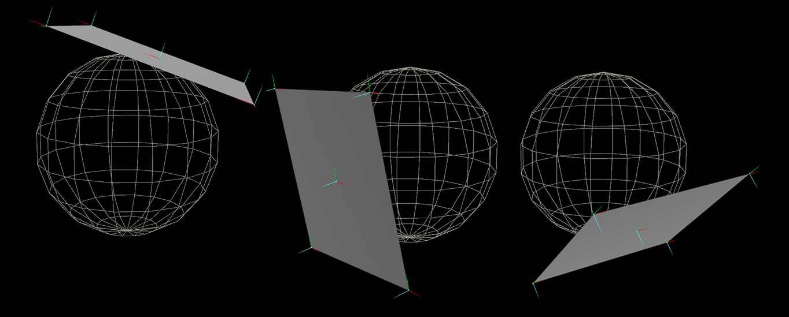
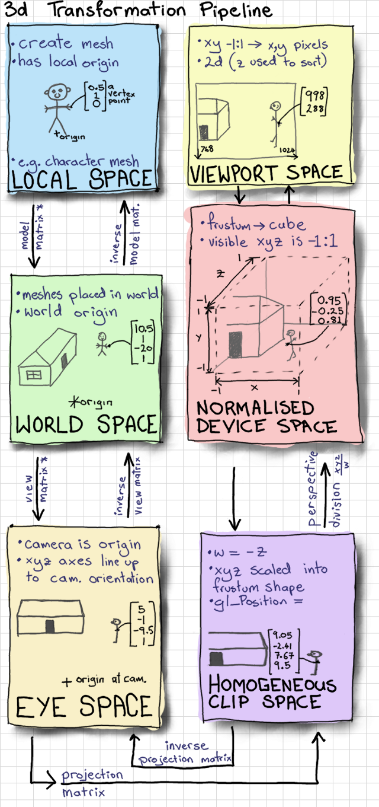

Multi Texturing


--- 
### 1. Normal Mapping
- Bump & Dent : 울퉁 불퉁한 표면 표현
- RGB -> XYZ : Position정보 색상정보
이미지들끼리 합성하기 좋기 떄문에 NM  Texture 이미지로 저장


RGB Packing
``` cpp
#include <cstdint>

// 패킹: 0xAARRGGBB
inline uint32_t PackARGB(uint8_t a, uint8_t r, uint8_t g, uint8_t b)
{
    return (uint32_t(a) << 24) |
           (uint32_t(r) << 16) |
           (uint32_t(g) << 8)  |
            uint32_t(b);
}

// RGB만 (알파 없음)
inline uint32_t PackRGB(uint8_t r, uint8_t g, uint8_t b)
{
    return (uint32_t(r) << 16) |
           (uint32_t(g) << 8)  |
            uint32_t(b);
}

// 언패킹
inline uint8_t GetR(uint32_t c) { return (c >> 16) & 0xFF; }
inline uint8_t GetG(uint32_t c) { return (c >> 8)  & 0xFF; }
inline uint8_t GetB(uint32_t c) { return  c        & 0xFF; }
inline uint8_t GetA(uint32_t c) { return (c >> 24) & 0xFF; }
```


### 02. Tangent Space의 이유와 순서
1. Normal Map(Texture)에서의 Coordinate 는 "저장된 공간기준"
2. World내 Tangent Coordinate 재정의
3. Normal 적용

4. point마다의 @Up, @N, @Right

| 기호  | name      | Houdini | 의미                |
| --- | --------- | ------- | ----------------- |
| T   | Tangent   | @Up     | 표면의 접선 방향         |
| B   | Bitangent | @Right  | 표면을 따라가는 다른 접선 방향 |
| N   | Normal    | @N      | 표면 바깥쪽을 향하는 법선 방향 |


$$N_{TS}=2RGB-1$$


<table width="100%" style="table-layout: fixed; border-collapse: collapse; border: none;"> <tr style="border: none;"> <td width="50%" style="text-align: center; border: none; padding: 5px;">  <br><strong>SphereVector</strong> </td> <td width="48%" style="text-align: center; border: none; padding: 5px;">  <br><strong>SphereMeshVector</strong> </td> </tr> </table>

- Normal : 푸른색
- Right Vector : x Axis - 녹색
- Up Vector : y Axis - 빨간색
<table width="100%" style="table-layout: fixed; border-collapse: collapse; border: none;"> <tr style="border: none;"> <td width="100%" style="text-align: center; border: none; padding: 15px;">  <br><strong>TangentSpace</strong> </td>  </tr> </table>


---
### Animation

시간에 따라 Object의 Space상의 이동

1. Computer Assisted Animation - determine
2. Computer Generated Animation - undetermine

Physics-based Animation


- Rigid body animation

$𝑉_{World} = (1− 𝑎) × 𝑉_1 + 𝑎 × 𝑉_2,  (0 ≤ 𝑎 ≤ 1)$

- Articulated body:
  graph 구조로 표현 가능

$M_{transform} = M_{local} × M_{animation} × M_{parent}$

graph의 이점 : 제어, 검색이 빠르겠다.


#### Bone Base에서의 핵심 공식

**뼈의 움직임** :

$M_{boneTransform} = M_{boneLocal} × M_{boneAnimation} × M_{boneParent}$

**Vertex의 움직임** : 

$M_{World} = M_{local} × M_{meshLocal} × M_{boneTransform}$

애니메이션할때 필요한 위치가 정

- weight가 들어가있는 vertex들이 $M_{boneTransform}$에다가 곱해져서 같이 움직이겠다.


---
### IK vs FK

#### 1. FK(Forward Kinematics)
**개념**: 부모 관절부터 자식 관절 순서로 각도를 정해, 그 결과로 끝점(손, 발)의 위치가 결정되는 방식.

**한계**:  
- 얼마나 꺾어야지, 부모 관절의 회전이 자식 전체에 영향을 주므로 부모가 특히 중요하다.
- 목표 지점에 도달하거나, 물건 파지해야 할때 문제 생긴다.
1. FK에서는 부모에서 조금씩 돌리고,
2. 자식도 돌려도 하다가
3. 도착 못찾으면 다시 처음부터 다시 조정해야한다
- 위 과정을 시행착오로 풀기 어려워, 가능한 동작을 사전에 학습/제작 해놓아야한다.
- 하지만 모든 공간상의 위치에 대해 학습시키는 것은 사실상 어렵다.

#### 2. IK(Inverse Kinematics)

**개념**: 끝점의 목표 위치를 먼저 정하고, 거기에 도달하기 위한 각 관절의 각도를 역으로 계산하는 방식.

**특징**:
- FK로 먼저 갖다 놓은 뒤 IK로 다시 보정할 수 있다.
- 다만 결과가 **부자연스러울 수 있다.**
- "도달 가능하다"는 가정하에 계산한다. (범위 밖이면 풀 수 없다.)
- **사용 예시**: 물건을 잡을 때, 계단 같은 step을 걸을 때(발 위치를 지형에 맞춤)

### # 3. 회전 표현: Euler의 한계 → Quaternion

**Euler 각**

- X, Y, Z 각각의 회전값으로 최종 방향을 결정한다.
- 같은 최종 위치/방향이어도 **해가 매우 많다.** (표현이 유일하지 않다.)
- 그래서 IK처럼 해를 계산해 내는 방식에서는 값이 튀거나 불안정해지기 쉽다.

**결론**: IK 기반에서는 **Quaternion**을 사용한다.

> 보충: Euler는 짐벌락(gimbal lock) 문제와 보간 시 부자연스러운 회전이 생기는 문제도 있다. Quaternion은 이를 피하고 부드러운 보간(Slerp)이 가능하다.

각 관절을 얼마정도 꺾어야하는지가 fbx에 저장이 되어있다


**Skining Technique** :

$$
V_{world} = V_{local} \cdot M_1 \cdot W_1 + V_{local} \cdot M_2 \cdot W_2
$$


---

## Interaction

### Picking

Ray Casting


- Perspective
- Orthogonal

3차원 Ray로 날린다 하면 해주는걸 

Mouse (2D Screen) UV -> Ray (3D World)

[Shader에서 기준을 바꾸는 방법](https://piusai.github.io/graphics/2026/11/11/Shader-Coordinate.html)
1. 2D Screen Space ->UV
2. NDC, View Space(Device Depth)
3. World space 
4. Ray 로 변경된 이후, 삼각형 collision
<table width="100%" style="table-layout: fixed; border-collapse: collapse; border: none;"> <tr style="border: none;"> <td width="100%" style="text-align: center; border: none; padding: 15px;">  <br><strong>MousePicking</strong> </td>  </tr> </table>


## Interaction

### Picking

마우스로 3D 오브젝트를 클릭해서 선택하는 기법입니다. 카메라에서 마우스 위치를 통과해 씬 안으로 3D **Ray**를 쏘고, 이 Ray가 오브젝트와 교차하는지 검사하는 방식을 **Ray Casting**이라고 합니다. 그래픽 API와 무관한 순수 수학 문제(교차 판정, intersection testing)라서 어떤 3D 환경에서든 같은 원리가 적용됩니다.

> Mouse (2D Screen) UV → Ray (3D World)

**핵심 아이디어**: 보통 메시를 로컬 → 월드 → 뷰 → 클립 → 화면으로 변환하는데, 피킹은 이 **파이프라인을 역방향**으로 거슬러 올라갑니다. 그래서 `inverse(view) * inverse(projection)` 같은 역행렬이 등장합니다.

<table width="100%" style="table-layout: fixed; border-collapse: collapse; border: none;"> <tr style="border: none;"> <td width="100%" style="text-align: center; border: none; padding: 15px;">  <br><strong>MousePicking</strong> </td> </tr> </table>

[역변환 파이프라인](https://antongerdelan.net/opengl/raycasting.html) _메시에서 출발하는 대신, 2D 마우스 위치에서 출발해 역행렬로 월드 공간의 Ray를 얻는다. (출처: Anton Gerdelan)_

---

### Ray의 구성

- **Origin (O)**: 카메라의 월드 좌표
- **Direction (D)**: 마우스 위치로부터 계산 후 정규화
- 모든 계산은 **같은 공간**에서 해야 합니다. 여기서는 월드 공간 기준입니다.
- **Perspective**: 모든 Ray의 시작점이 카메라 원점이고, 방향이 픽셀마다 다릅니다.
- **Orthogonal**: Ray 방향은 모두 같고, 시작 위치가 픽셀마다 다릅니다.

아래 단계는 Perspective 기준입니다. ([Shader에서 기준을 바꾸는 방법](https://piusai.github.io/graphics/2026/11/11/Shader-Coordinate.html) 글과 같은 흐름입니다.)

EyeSpace == CameraSpace == ViewSpace


### 좌표 변환 단계

|단계|공간|하는 일|
|---|---|---|
|0|2D Viewport (Screen)|마우스 픽셀 좌표 `x: 0~width`, `y: height~0` (y축이 위에서 아래로 증가)|
|1|3D NDC (≈ UV 정규화)|범위를 -1~1로 바꾸고 y를 뒤집음|
|2|4D Clip|z는 정면 방향(-1), w는 1로 설정|
|3|4D Eye (View)|`inverse(Projection)`을 곱한 뒤 z,w를 (-1, 0)으로 덮어씀|
|4|4D World|`inverse(View)`를 곱하고 xyz만 취해 **정규화**|

```cpp
//glsl
// Step 1: Viewport -> NDC
float x = (2.0 * mouse_x) / width - 1.0;
float y = 1.0 - (2.0 * mouse_y) / height;

// Step 2: NDC -> Clip
vec4 ray_clip = vec4(x, y, -1.0, 1.0);

// Step 3: Clip -> Eye
vec4 ray_eye = inverse(projection) * ray_clip;
ray_eye = vec4(ray_eye.xy, -1.0, 0.0);   // 앞쪽 방향 + "점이 아니라 방향"

// Step 4: Eye -> World
vec3 ray_wor = normalize((inverse(view) * ray_eye).xyz);
```

**포인트 정리**

- **UV 단계**: 위 Step 1이 "Screen → UV(0~1) → NDC(-1~1)"에 해당합니다. 한 줄로 합쳐 계산한 것입니다.
- **Perspective Divide는 하지 않습니다**: Ray는 깊이가 없는 "방향"이라서 w로 나누는 과정이 필요 없습니다. 점(point)을 복원하는 특수한 경우에만 필요합니다.
- **z, w를 (-1, 0)으로 덮어쓰는 이유**: x,y만 언프로젝트하면 되고, w=0은 "위치가 아니라 방향"이라는 뜻이라서 이동 성분(translation)이 곱해지지 않습니다.
- 카메라가 -Z를 보고 있다면, 화면 중앙에서는 Ray가 `[0, 0, -1]`에 가깝게 나옵니다. 화면 가장자리로 갈수록 x,y 성분이 커지는데, 정도는 종횡비와 FOV에 따라 달라집니다.
- 이 모든 과정을 한 줄로 압축할 수도 있습니다. (위 역행렬을 미리 합친 형태)

---

### 교차 검사 (Ray 이후)

**Ray vs Plane**

- 평면 하나로 표면을 근사해서 먼저 검사하면 비용이 적습니다.
- 활용 예: 가상의 **바닥 평면**을 두고, 드래그로 영역(zone)을 지정하거나 유닛을 박스로 선택하는 경우. 평면과의 교차를 2번 구해서 박스의 두 모서리를 얻습니다.

**Ray vs Sphere** (가장 쉬운 오브젝트 선택법)

- 오브젝트마다 중심점 C와 반지름 r만 알면 됩니다.
- 구의 방정식(중심에서 거리 r인 점들)에 Ray의 점 방정식을 대입해서 **t**를 풉니다.
- 결과 해석:
    - 교점 2개: 앞면과 뒷면에 모두 맞음 → **t가 작은 쪽**(가까운 쪽)을 선택
    - 교점 1개(t 같음): 구의 가장자리를 스침
    - 해 없음: 빗나감
    - t 하나가 음수: Ray 시작점이 구 안쪽
- 제곱근을 계산하기 전에 판별식(`b² - c`)부터 확인하고, t가 양수인지도 반드시 검사해야 합니다.
- 단점: 크거나 불규칙한 오브젝트는 구가 지나치게 커져서 주변 물체와 겹칠 수 있습니다.
- 최적화: 제곱근 전에 Ray 방향으로의 투영(dot)과 피타고라스로 제곱 거리를 먼저 비교하면 빠르게 걸러낼 수 있습니다.

**그 외**

- **AABB**: 축 정렬 박스. 범위 계산이 쉽지만 회전하는 불규칙 물체는 박스가 너무 커집니다.
- **OBB**: 오브젝트와 함께 회전하는 박스.
- **삼각형 (Barycentric)**: 메시의 정확히 어느 지점을 클릭했는지 알 수 있습니다. 총알 자국을 정확한 위치에 붙이는 용도 등에 쓰입니다. 삼각형을 전부 검사하기 전에 **bounding sphere로 먼저 걸러내는 것**이 정석입니다.

---

### 언제 Ray Casting을 쓰나?

|상황|추천|
|---|---|
|도형 위에 드래그해서 그리기 (박스 선택 등)|Ray Casting|
|작고 까다로운 메시를 대충 클릭해도 선택되게 하고 싶을 때|Ray Casting|
|**픽셀 단위로 정확한 선택**이 필요할 때|색상 기반 피킹 (Color Picking)|

색상 피킹은 렌더링 패스가 한 번 더 필요하지만, Ray Casting은 선택 가능한 오브젝트마다 1~5번의 Ray 검사가 필요하다는 점이 비용 차이입니다.

---

### 참고

- [Mouse Picking with Ray Casting - Anton's OpenGL 4 Tutorials](https://antongerdelan.net/opengl/raycasting.html)
- [Shader에서 기준을 바꾸는 방법](https://piusai.github.io/graphics/2026/11/11/Shader-Coordinate.html)