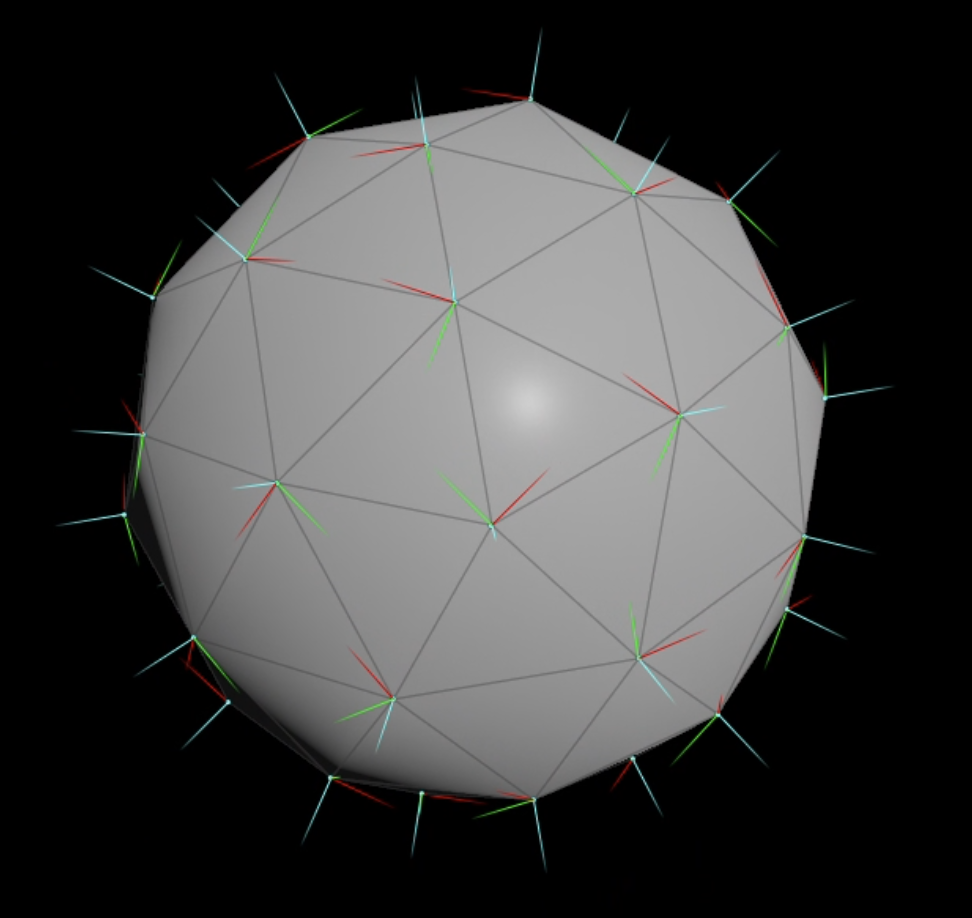
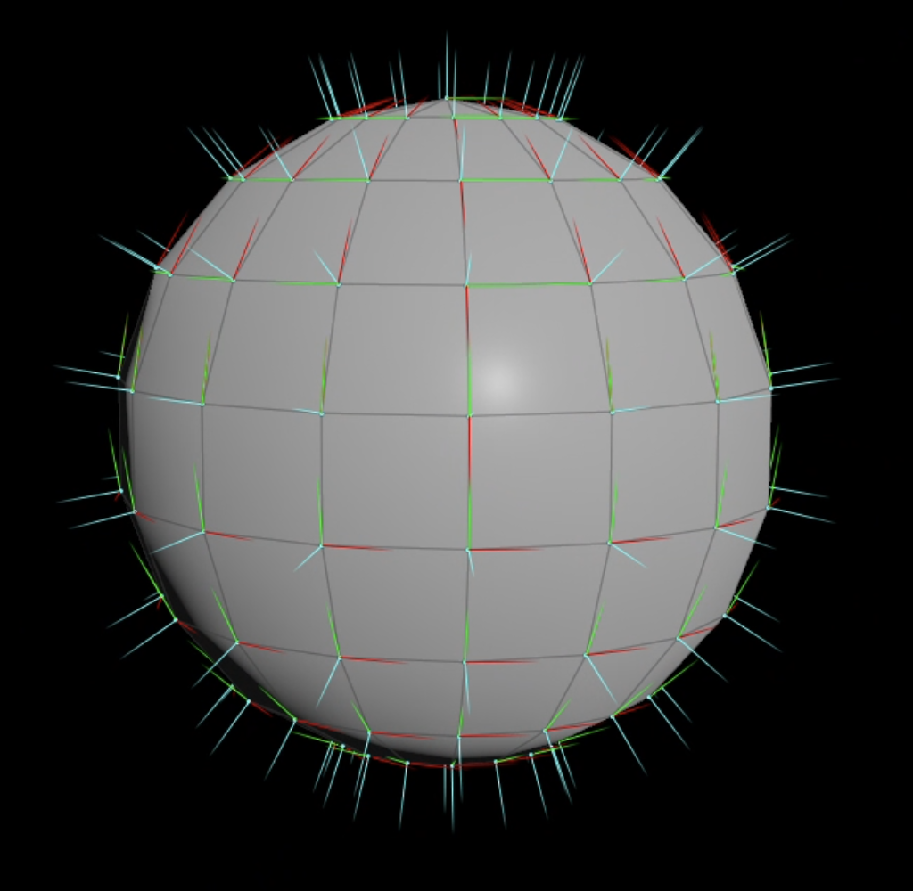
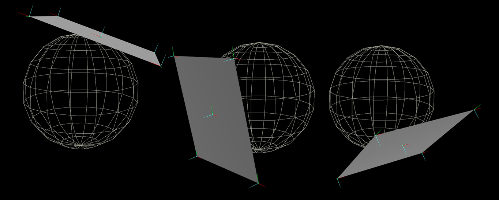

Multi Texturing


--- 
### 1. Normal Mapping
- Bump & Dent : 울퉁 불퉁한 표면 표현
- RGB -> XYZ : Position정보 색상정보
이미지들끼리 합성하기 좋기 떄문에 NM  Texture 이미지로 저장


RGB Packing
``` cpp
#include <cstdint>

// 패킹: 0xAARRGGBB
inline uint32_t PackARGB(uint8_t a, uint8_t r, uint8_t g, uint8_t b)
{
    return (uint32_t(a) << 24) |
           (uint32_t(r) << 16) |
           (uint32_t(g) << 8)  |
            uint32_t(b);
}

// RGB만 (알파 없음)
inline uint32_t PackRGB(uint8_t r, uint8_t g, uint8_t b)
{
    return (uint32_t(r) << 16) |
           (uint32_t(g) << 8)  |
            uint32_t(b);
}

// 언패킹
inline uint8_t GetR(uint32_t c) { return (c >> 16) & 0xFF; }
inline uint8_t GetG(uint32_t c) { return (c >> 8)  & 0xFF; }
inline uint8_t GetB(uint32_t c) { return  c        & 0xFF; }
inline uint8_t GetA(uint32_t c) { return (c >> 24) & 0xFF; }
```


### 02. Tangent Space의 이유와 순서
1. Normal Map(Texture)에서의 Coordinate 는 "저장된 공간기준"
2. World내 Tangent Coordinate 재정의
3. Normal 적용

4. point마다의 @Up, @N, @Right

| 기호  | name      | Houdini | 의미                |
| --- | --------- | ------- | ----------------- |
| T   | Tangent   | @Up     | 표면의 접선 방향         |
| B   | Bitangent | @Right  | 표면을 따라가는 다른 접선 방향 |
| N   | Normal    | @N      | 표면 바깥쪽을 향하는 법선 방향 |


$$N_{TS}=2RGB-1$$


<table width="100%" style="table-layout: fixed; border-collapse: collapse; border: none;"> <tr style="border: none;"> <td width="50%" style="text-align: center; border: none; padding: 5px;">  <br><strong>SphereVector</strong> </td> <td width="48%" style="text-align: center; border: none; padding: 5px;">  <br><strong>SphereMeshVector</strong> </td> </tr> </table>

- Normal : 푸른색
- Right Vector : x Axis - 녹색
- Up Vector : y Axis - 빨간색
<table width="100%" style="table-layout: fixed; border-collapse: collapse; border: none;"> <tr style="border: none;"> <td width="100%" style="text-align: center; border: none; padding: 15px;">  <br><strong>TangentSpace</strong> </td>  </tr> </table>


---
### Animation

시간에 따라 Object의 Space상의 이동

1. Computer Assisted Animation - determine
2. Computer Generated Animation - undetermine

Physics-based Animation


- Rigid body animation

$𝑉_{World} = (1− 𝑎) × 𝑉_1 + 𝑎 × 𝑉_2,  (0 ≤ 𝑎 ≤ 1)$

- Articulated body:
  graph 구조로 표현 가능

$M_{transform} = M_{local} × M_{animation} × M_{parent}$

graph의 이점 : 제어, 검색이 빠르겠다.


#### Bone Base에서의 핵심 공식

**뼈의 움직임** :

$M_{boneTransform} = M_{boneLocal} × M_{boneAnimation} × M_{boneParent}$

**Vertex의 움직임** : 

$M_{World} = M_{local} × M_{meshLocal} × M_{boneTransform}$

애니메이션할때 필요한 위치가 정

- weight가 들어가있는 vertex들이 $M_{boneTransform}$에다가 곱해져서 같이 움직이겠다.


---
### IK vs FK

#### 1. FK(Forward Kinematics)
**개념**: 부모 관절부터 자식 관절 순서로 각도를 정해, 그 결과로 끝점(손, 발)의 위치가 결정되는 방식.

**한계**:  
- 얼마나 꺾어야지, 부모 관절의 회전이 자식 전체에 영향을 주므로 부모가 특히 중요하다.
- 목표 지점에 도달하거나, 물건 파지해야 할때 문제 생긴다.
1. FK에서는 부모에서 조금씩 돌리고,
2. 자식도 돌려도 하다가
3. 도착 못찾으면 다시 처음부터 다시 조정해야한다
- 위 과정을 시행착오로 풀기 어려워, 가능한 동작을 사전에 학습/제작 해놓아야한다.
- 하지만 모든 공간상의 위치에 대해 학습시키는 것은 사실상 어렵다.

#### 2. IK(Inverse Kinematics)

**개념**: 끝점의 목표 위치를 먼저 정하고, 거기에 도달하기 위한 각 관절의 각도를 역으로 계산하는 방식.

**특징**:
- FK로 먼저 갖다 놓은 뒤 IK로 다시 보정할 수 있다.
- 다만 결과가 **부자연스러울 수 있다.**
- "도달 가능하다"는 가정하에 계산한다. (범위 밖이면 풀 수 없다.)
- **사용 예시**: 물건을 잡을 때, 계단 같은 step을 걸을 때(발 위치를 지형에 맞춤)

### # 3. 회전 표현: Euler의 한계 → Quaternion

**Euler 각**

- X, Y, Z 각각의 회전값으로 최종 방향을 결정한다.
- 같은 최종 위치/방향이어도 **해가 매우 많다.** (표현이 유일하지 않다.)
- 그래서 IK처럼 해를 계산해 내는 방식에서는 값이 튀거나 불안정해지기 쉽다.

**결론**: IK 기반에서는 **Quaternion**을 사용한다.

> 보충: Euler는 짐벌락(gimbal lock) 문제와 보간 시 부자연스러운 회전이 생기는 문제도 있다. Quaternion은 이를 피하고 부드러운 보간(Slerp)이 가능하다.

각 관절을 얼마정도 꺾어야하는지가 fbx에 저장이 되어있다


**Skining Technique** :

$$
V_{world} = V_{local} \cdot M_1 \cdot W_1 + V_{local} \cdot M_2 \cdot W_2
$$

