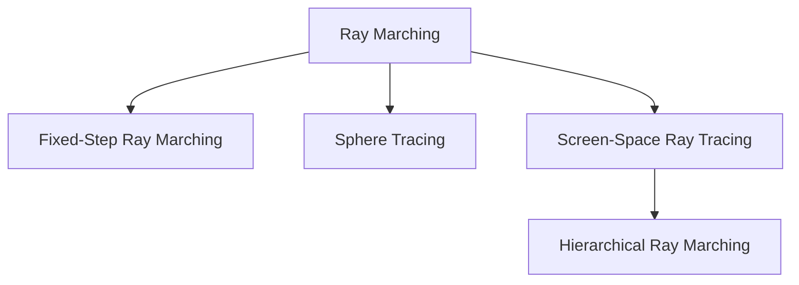
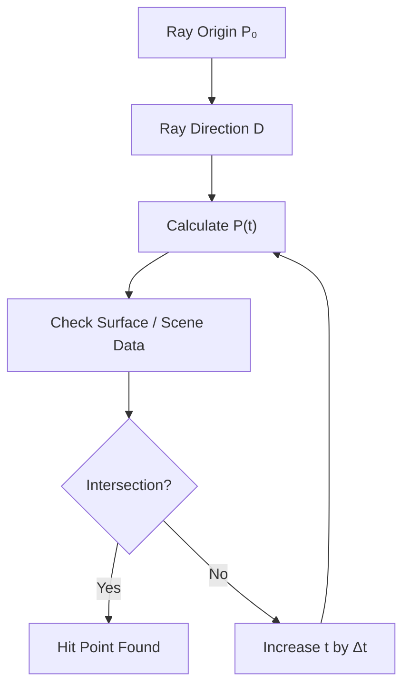
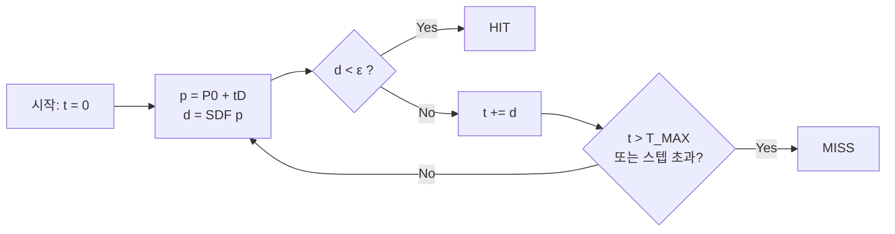
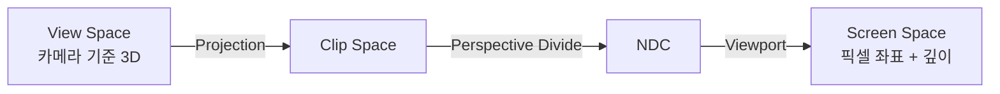
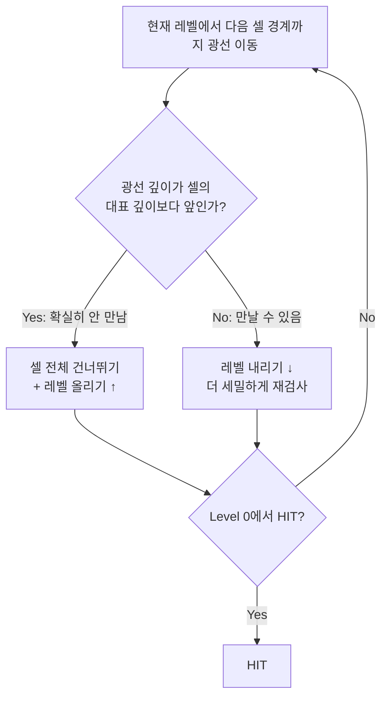

Ray Tracing에서 자주 등장하는 개념 중 하나인 **Ray Marching**을 알아보자.

Ray Marching의 기본원리는 Ray를 일정한 방향으로 조금씩 Marching(이동)하면서  
공간 또는 화면상의 정보를 검사하는 기법이다.

광선의 시작점에서 진행방향을 따라 이동하고, 각 위치에서 표면이나 물체와 교차하는지 확인한다. 
이러한 과정을 반복하여 광선이 물체와 만나는 위치를 찾거나, 공간 내부의 정보를 Sampling한다.

RayMarching은 SDF(Signed Distance Function)을 이용한 3D 공간 탐색부터 Depth Buffer를 활용하는 Screen-Space Ray Tracing까지 다양한 형태로 활용한다.

---





### 1. Ray Marching의 기본 원리

#### 1.1 Ray Equation

Ray Marching을 이해하기 위해서는 먼저 광선의 수학적 표현을 알아야 한다.  
광선은 시작점과 진행 방향으로 표현할 수 있다.


$$P(t)=P_0+tD$$

- $P_o$ : 광선의 시작점(Origin)
- $\mathbf D$: 광선의 진행 방향(Direction)
- $\mathbf p(t)$ : 현재 광선의 위치
- $t$ : 광선의 진행 거리 또는 매개변수


> $\mathbf{D}$가 단위 벡터이면 $t$가 곧 **실제 이동 거리**가 된다.

가장 단순한 고정 Ray Marching은 아래와 같이 $t$를 갱신

$$t_{i+1}=t_i+\Delta t$$

#### 1.2 그림으로 보기

```
  P0 ●──────●──────●──────●──────●──────●──▶ D
     t0     t1     t2     t3     t4     t5
     └─Δt──┘
     각 점(●)에서 "지금 위치가 물체 안/표면인가?"를 검사
```


#### 1.2 Marching Process

가장 기본적인 Ray Marching은 시작점에서 일정한 간격으로 광선을 이동시키며 각 위치를 검사한다.

$$t_{i+1}=t_i+\Delta t$$

$$P_i=P_0+t_i\mathbf{D}$$

- $\Delta t$ : 한 번의 이동에서 사용하는 Step Size
- $t_i$ : 현재 반복 단계의 진행 거리
- $P_i$ : 현재 검사 위치

이 과정을 반복하면서 물체의 표면과 교차 지점을 찾는다.


광선을 한번에 이동시키지 않고, 여러 위치를 반복해서 공간을 검사하는것이 핵심이다.


### 2. Fixed-Step Ray Marching

일정 간격으로 광선을 이동시키는 가장 기본적인 방식

$$
t=0,\ 1,\ 2,\ 3,\ 4,\ldots
$$
### 3. Sphere Tracing
Signed Distance Function(SDF)를 이용해 안전하게 이동 가능 거리를 계산하는 방식
Houdini에서의 vdb sdf도 이 방식이다.
이를 활용해 Volume -> polygon으로 바꾸기도 한다.


### 4. Screen-Space RayTracing
화면 공간에서 Depth Buffer를 이용해 광선과 장면의 교차 여부를 검사하는 방식

- Depth Buffer
- View Space / ScreenSpace 변환
- Ray - Depth간의 교차판정
- Self-Intersection과 Miss

### Hierachical Ray Marching
Depth Hierarchy를 활용해 불필요한 탐색 줄이는 방식
- Depth Pyramid
- 계층적 탐색
- 탐색 효율 / 정확도


# Ray Marching

> Ray Tracing 계열에서 가장 자주 등장하는 개념 중 하나. **핵심 아이디어: 광선을 한 방향으로 조금씩 전진(March)시키면서, 매 위치에서 공간(또는 화면 공간) 정보를 검사한다.**

---

## 0. 큰 그림

|구분|교차 판정 방식|대표 예|
|---|---|---|
|해석적(Analytic) Ray Tracing|수식으로 한 번에 교차점 계산|Ray-Triangle, Ray-Sphere|
|**Ray Marching**|**조금씩 전진하며 반복 검사 (수치적)**|Sphere Tracing, SSR, Volume Rendering|


- **Fixed-Step / Sphere Tracing** → 3D 공간에서 마칭 (SDF, 볼륨 등)
- **Screen-Space / Hierarchical** → 화면 공간(Depth Buffer)에서 마칭

---

## 1. Linear Ray Marching

광선의 시작점에서 일정한 방향으로 이동하며, 각 위치에서 표면/물체와 만나는지 검사하는 방법.

### 1.1 수식

광선 위의 한 점은 다음과 같이 표현한다.

$$ P(t) = P_0 + t,\mathbf{D} $$

|기호|의미|
|---|---|
|$P_0$|광선의 시작점 (Origin)|
|$\mathbf{D}$|광선의 진행 방향 (보통 정규화된 단위 벡터)|
|$t$|시작점에서부터 진행한 거리|
|$P(t)$|현재 광선의 위치|

> $\mathbf{D}$가 단위 벡터이면 $t$가 곧 **실제 이동 거리**가 된다.

가장 단순한 고정 간격 Ray Marching은 아래와 같이 $t$를 갱신한다.

$$ t_{i+1} = t_i + \Delta t $$

### 1.2 그림으로 보기

```
  P0 ●──────●──────●──────●──────●──────●──▶ D
     t0     t1     t2     t3     t4     t5
     └─Δt──┘
     각 점(●)에서 "지금 위치가 물체 안/표면인가?"를 검사
```

---

## 2. Fixed-Step Ray Marching

일정 간격 $\Delta t$로 광선을 이동시키는 **가장 기본적인 방식**.

### 알고리즘

```text
t = 0
for i in 0 .. MAX_STEPS:
    p = P0 + t * D
    if inside_object(p):      # 또는 density / SDF 검사
        return HIT(p)
    t += Δt
return MISS
```

### 장단점

|장점|단점|
|---|---|
|구현이 매우 단순|$\Delta t$가 크면 **얇은 물체를 건너뜀 (tunneling)**|
|볼륨(구름/연기) 적분에 자연스러움|$\Delta t$를 줄이면 **비용 급증**|

### 문제 상황: 얇은 물체 놓치기

```
  ●────────●────────●────────●────────●──▶
                       ││
                       ││  ← 얇은 벽
  샘플 사이에 벽이 끼어 있으면 어떤 샘플도 벽 안에 있지 않다 → MISS (오탐 없음, 누락 발생)
```

> 보완책: HIT 직전/직후 구간에서 **이진 탐색(Bisection)** 으로 교차점을 정밀화.

---

## 3. Sphere Tracing

**Signed Distance Function(SDF)** 으로 "여기서 가장 가까운 표면까지의 거리"를 알 수 있으면, 그 거리만큼은 **어느 방향으로 가도 안전**하다. 이 값을 보폭으로 사용한다.

### 3.1 수식

$f(P)$ = 점 $P$에서 장면의 가장 가까운 표면까지의 부호 있는 거리 (바깥 +, 안쪽 −)

$$ t_{i+1} = t_i + f\big(P(t_i)\big) $$

예) 중심 $C$, 반지름 $r$인 구의 SDF:

$$ f(P) = \lVert P - C \rVert - r $$

### 3.2 그림으로 보기

```
              ○ ← 안전 구(반지름 = f(P))
            ╱   ╲
   P0 ●────●─────●──────●─●●▶  ┃ 표면
         t0    t1       t2 t3   ┃
   (표면에 가까워질수록 보폭이 자동으로 작아진다)
```

- 멀리 있을 땐 **큰 보폭**, 표면에 가까울수록 **작은 보폭** → Fixed-Step보다 훨씬 효율적이고 얇은 물체도 놓치지 않는다.

### 3.3 종료 조건

```text
t = 0
for i in 0 .. MAX_STEPS:
    p = P0 + t * D
    d = f(p)
    if d < ε:        return HIT(p)   # 표면에 충분히 가까움
    t += d
    if t > T_MAX:    return MISS     # 너무 멀리 감
return MISS                           # 스텝 한도 초과
```



### 3.4 법선(Normal) 구하기

SDF의 **기울기(gradient)** 가 곧 표면 법선이다.

$$ \mathbf{N} \approx \text{normalize}\big(\nabla f(P)\big) $$

실제로는 중심 차분으로 근사한다 (x, y, z 각각 $\pm\epsilon$ 샘플).

### 3.5 Houdini와의 연결 (VDB SDF)

- Houdini의 **VDB SDF**는 "각 복셀이 표면까지의 부호 있는 거리 값을 가진 볼륨"이다. 즉 Sphere Tracing이 사용하는 $f(P)$와 **같은 종류의 데이터**다.
- 이 SDF를 레이로 렌더링/교차 검사할 때 Sphere Tracing 계열 방식을 쓸 수 있다.

> ⚠️ **정정 포인트 (헷갈리기 쉬움)** Volume → Polygon 변환은 보통 Sphere Tracing이 아니라 **등가면 추출(Isosurface Extraction)**, 즉 **Marching Cubes / Dual Contouring** 류로 한다. (Houdini의 _Convert VDB_, _VDB to Polygons_ 계열) 이름이 비슷하지만 **Marching Cubes ≠ Ray Marching**.
> 
> ||Ray Marching / Sphere Tracing|Marching Cubes|
> |---|---|---|
> |목적|광선과 표면의 교차를 찾음 (렌더링)|SDF에서 폴리곤 메시를 생성|
> |출력|히트 위치/거리|메시 (버텍스, 폴리곤)|
> |SDF 사용|보폭 계산|0-등가면 위치 보간|

---

## 4. Screen-Space Ray Tracing

3D 장면 대신 **화면 공간의 Depth Buffer**를 "장면의 근사"로 삼아, 광선과 장면의 교차 여부를 검사하는 방식. (SSR, SSAO 류의 스크린 스페이스 효과의 기반)

### 4.1 Depth Buffer

- 각 픽셀에 **카메라에서 가장 가까운 표면까지의 깊이**가 저장되어 있다.
- 즉 화면에 **보이는 표면만** 알고 있는 "불완전한 장면 정보"다.

### 4.2 View Space ↔ Screen Space 변환



일반적인 SSR 흐름:

1. 픽셀의 **View-Space 위치** $P$와 법선 $N$을 복원
2. 반사 방향 $R = \text{reflect}(\mathbf{V}, N)$ 계산
3. 광선의 **시작점/끝점을 Screen Space로 투영**
4. 화면 공간에서 **픽셀 단위로 전진**하며 Depth Buffer와 비교

> 화면 공간에서 직선으로 전진하면 픽셀 간격이 일정해서 샘플링이 균일하다. (원근 때문에 깊이는 $1/z$ 기준으로 보간해야 정확하다.)

### 4.3 Ray ↔ Depth 교차 판정

```
 카메라 ──────────────────────────────▶ 화면 X
   깊이(z)
    ▲
    │            ╱ ← Ray (깊이가 점점 증가)
    │          ╱
    │   ┌────╱──┐
    │ ──┤  ╱    ├───  ← Depth Buffer (보이는 표면)
    │   └─╳─────┘
    │     ↑
    │   교차: Ray 깊이가 버퍼 깊이를 처음 "뚫는" 지점
```

판정식 (한 샘플 기준):

$$ \text{HIT} \iff d_{\text{buffer}} ;<; d_{\text{ray}} ;<; d_{\text{buffer}} + \text{thickness} $$

- $d_{\text{ray}}$ : 현재 샘플에서 광선의 깊이
- $d_{\text{buffer}}$ : 그 픽셀의 Depth Buffer 값
- **thickness** : 표면의 가상 두께 (Depth Buffer에는 뒷면 정보가 없으므로 필요)

### 4.4 Self-Intersection과 Miss

**Self-Intersection (자기 교차)**

- 광선이 출발한 **자기 자신의 표면**과 바로 교차해버리는 문제.
- 원인: 시작점이 Depth Buffer 값과 거의 같아서 첫 스텝에서 "뚫림"으로 판정.
- 해결: 시작점을 **법선 방향으로 약간 밀기(bias)**, 첫 스텝을 **한두 픽셀 건너뛰기**, 깊이 비교에 **오프셋** 사용 + 스텝마다 **지터(jitter)**.

**Miss (놓침)**

|원인|설명|
|---|---|
|화면 밖으로 나감|광선이 화면 경계를 벗어나면 정보가 없음|
|가려진 정보 없음|물체 뒤쪽/가려진 면은 Depth Buffer에 없음|
|thickness 부적절|너무 얇으면 통과, 너무 두꺼우면 허위 히트(Ghost)|
|스텝이 큼|얇은 지오메트리를 건너뜀 (Fixed-Step과 동일 문제)|

```
 카메라 ─▶  ┃ 기둥(앞)       Ray가 기둥 뒤로 들어가면
            ┃                Depth Buffer상으론 "기둥에 가려짐"
     Ray ───┃──╲             → 실제론 기둥 뒤 물체에 맞아야 해도
            ┃   ╲ ?            그 정보가 버퍼에 없어서 Miss/오판
```

> 보통 Miss가 났을 때는 **리플렉션 프로브/환경맵으로 폴백**하고, 화면 가장자리는 **페이드 아웃**한다.

---

## 5. Hierarchical Ray Marching

Depth Buffer를 **계층(피라미드)** 으로 만들어, 광선이 "확실히 아무것도 안 만나는 구간"을 **한 번에 건너뛰는** 방식. (Hi-Z Tracing)

### 5.1 Depth Pyramid (Hi-Z)

원본 Depth Buffer를 밉맵처럼 줄여 가며, 각 텍셀에 **그 영역의 대표 깊이(보통 가장 가까운 깊이)** 를 저장한다.

```
 Level 2 (거침)   [  z=0.30  ]  [  z=0.55  ]
                  ┌─────────┐  ┌─────────┐
 Level 1          [0.30][0.45] [0.55][0.70]
                  ┌────┬────┐ ┌────┬────┐
 Level 0 (원본)   [..][..][..][..] [..][..][..][..]

 상위 레벨 1칸 = 하위 레벨 2×2칸의 대표값(min)
```

### 5.2 계층적 탐색



```
 레벨↑(큰 보폭)  ──────────────▶ ──────────────▶   (아무것도 없는 영역: 크게 점프)
 레벨↓(작은 보폭)                          ▶ ▶ ▶ ▶ HIT  (가까워지면 세밀하게)
```

- 비어 있는 영역은 **큰 걸음**, 표면 근처는 **작은 걸음** → Sphere Tracing과 "적응형 보폭"이라는 점에서 닮았다. (차이: 거리 필드 대신 **깊이 피라미드**로 안전 구간을 판단)

### 5.3 탐색 효율 vs 정확도

|항목|내용|
|---|---|
|효율|선형 스텝(수백 번) → 로그 수준의 스텝으로 감소|
|정확도|피라미드 대표값이 **보수적(conservative)** 이어야 놓치지 않음|
|주의|Reversed-Z 사용 시 min/max가 뒤바뀜|
|한계|여전히 Depth Buffer 기반이므로 **화면 밖/가려진 정보는 못 봄**|

---

## 6. 한눈에 비교

|방식|공간|보폭|장점|약점|
|---|---|---|---|---|
|Fixed-Step|3D|고정|단순, 볼륨 적분에 적합|얇은 물체 누락, 비용 큼|
|Sphere Tracing|3D (SDF)|SDF 값|빠르고 정확|SDF가 필요|
|Screen-Space|화면 (Depth)|픽셀 단위|기존 버퍼 재활용, 저렴|화면 밖/가려진 면 정보 없음|
|Hierarchical|화면 (Hi-Z)|계층 적응형|탐색 횟수 대폭 감소|피라미드 생성/구현 복잡|

---

## 7. 한 줄 요약

- **Ray Marching** = 광선을 조금씩 전진시키며 교차를 _탐색_
- **Fixed-Step** → 단순하지만 놓치거나 느림
- **Sphere Tracing** → SDF 거리만큼 안전하게 점프
- **Screen-Space** → Depth Buffer로 3D 장면 대신 화면 정보로 검사
- **Hierarchical** → Depth Pyramid로 빈 공간을 크게 건너뜀

---

## 참고 (더 찾아볼 키워드)

- Inigo Quilez — _Raymarching SDFs_, 2D/3D SDF 함수 모음
- Hart (1996) — _Sphere Tracing_
- McGuire & Mara (2014) — _Efficient GPU Screen-Space Ray Tracing_
- Stachowiak (2015) — _Stochastic Screen-Space Reflections_ (Hi-Z tracing)