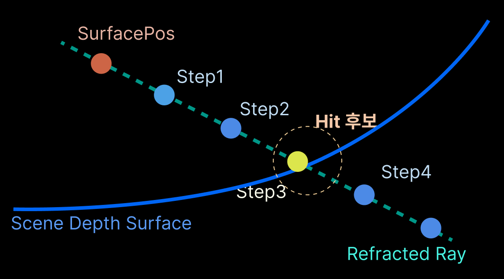
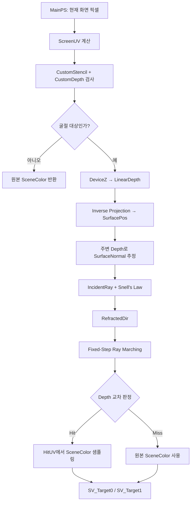
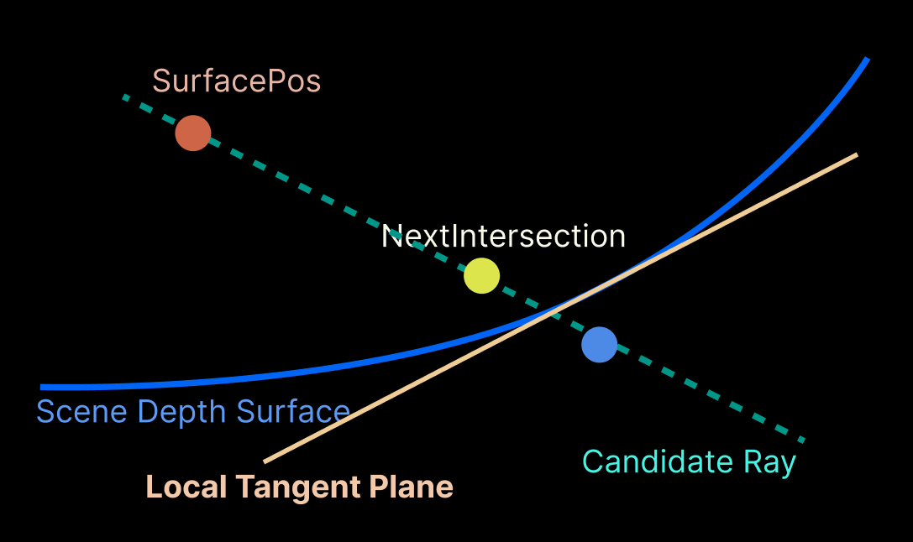
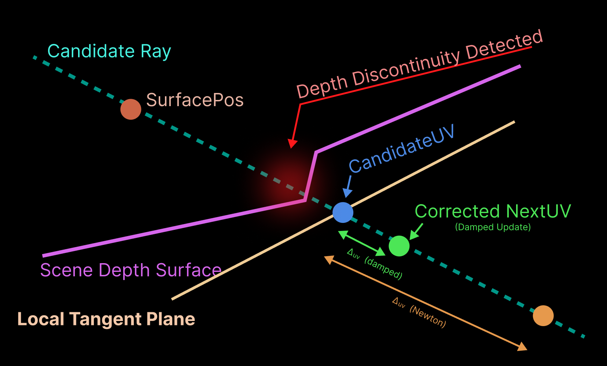

Unreal Engine의 Refraction 방식과 비교하며, 최신 굴절 기술을 탐색하고, 새로운 Refraction을 조합하기 위해서 논문을 작성 했다.

---
### Architecture
- **Module** : `RefractMethod` (Plugin)
- **Shader (.usf)** : UE RDG 아키텍쳐 활용. PostProcess 직전 RDG에 Fullscreen PixelShader Pass를 등록하고, CustomDepth / CustomStencil을 굴절 Shader로 처리(대상 마스크와 표면 정보로 활용)한다.

---

### 1. 전체적인 UE RenderPipeline 아키텍쳐

Unreal engine의 RenderPipeline을 직접 수정하는것이 아니라, Engine이 열어둔 확장 지점에 끼어드는 방식으로 진행하였다. `FSceneViewExtensionBase`를 상속한 클래스에서 아래 함수들을 override하면, Engine이 정해진 시점에 이 함수들을 호출해준다.

| 함수                                  | 호출 스레드 | 역할                                                        |
| ----------------------------------- | ------ | --------------------------------------------------------- |
| `BeginRenderViewFamily()`           | GT     | CVar를 읽어 `Cached*` 멤버에 저장                                 |
| `PrePostProcessPass_RenderThread()` | RT     | 엔진 Scene Rendering이 끝난 뒤, PostProcess 시작 직전에 우리의 Pass를 추가 |
| `SetupViewFamily()`, `SetupView()`  | GT     | 같은 확장 지점이지만 현재 구현 사용 X                                    |

Module(Plugin) 형식으로 작업했기 떄문에, `StartupModule()`에서 가상 Shader경로를 `Shader`폴더로 Mapping해주어야 한다!

<table width="100%" style="table-layout: fixed; border-collapse: collapse; border: none;"> <tr style="border: none;"> <td width="100%" style="text-align: center; border: none; padding: 15px;">  <br><strong>FSceneViewExtension</strong> </td>  </tr> </table>

#### 1.1 GT ↔ RT 데이터 전달
GT와 RT 사이에는 별도의 복사 커맨드 없이 `Cached*` 멤버를 공유한다 (GT가 쓰고, RT가 읽는다). `Enable` 같은 일부 CVar는 RT에서 `GetValueOnRenderThread()`로 직접 읽는다.

>⚠️ **Thread-safety 주의** 이 구조는 동작은 하지만 thread-safe하지 않다. RT는 GT보다 1~2프레임 늦게 실행되므로, RT가 N프레임 값을 읽는 도중 GT가 N+1프레임 값을 덮어쓸 수 있다(race). 파라미터가 한 프레임 섞이는 정도라 시각적 영향은 작지만, 엄밀하게는 `ENQUEUE_RENDER_COMMAND`로 값을 복사해 RT에 넘기는 방식이 필요하다.

#### 1.2 Engine RDG Graph에 Pass 추가
Engine이 넘겨준 RDG Graph에 우리의 Pass를 추가해서 SceneColor를 갱신하는 방식으로 진행하였다.

- 내가 `FRDGBuilder`를 만든게 아니라 Engine이 이미 생성해서 넘겨준 `GraphBuilder`에 Pass를 추가하는 경우, 직접 `Execute()`를 호출하면 안된다. 그 Graph의 소유자인 Engine이 나중에 알아서 `Execute`한다.
- `AddFullscreenPass`나 `AddCopyTexturePass`를 호출하면 Pass가 그 Graph에 기록만 되고, Engine이 Frame Rendering 마무리하면서 `GraphBuilder.Execute()` 한번 호출할때 같이 올라간 우리 Pass도 함께 Compile되고 실행된다.
- RDG는 결과를 아무도 읽지 않는 Pass를 자동으로 Cull(제거)한다. 그래서 Method Pixel Shader의 출력은 Composit Pass( Capture 복사)가 읽어야 살아남는다.
- Plass Lambda는 나중에 실행되므로, Shader Parameter는 Stack이 아니라 `GraphBuilder.AllocParameters<>()`로 **RDG 메모리에 할당**해야한다. (4.2.9 참고)

#### 1.3 `NewExtension()`이란?

```cpp
SceneViewExtension = FSceneViewExtensions::NewExtension<FRefractSceneViewExtension>(GetWorld(), this);
```

- **생성과 등록**을 한방에 한다.  
  Engine의 `SceneViewExtension`목록에 올려주어야하는데, Class 생성자 `FAutoRegister`가 이 등록을 위한 인자이다. 그래서 일반`New` / `MakeShared`로 만들면 Engine이 모른다.
- Engine은 **약한 참조**만 갖는다.  
  목록은 WeakPointer로 들고있기에, 계속 객체를 살려두는 것은 Subsystem의 `SceneViewExtension` 멤버(`TSharedPtr`)이다. `Deinitilaize()`에서 `Reset()`을 하면 객체가 사라지고, Hook 호출도 끝난다.
- **World 단위**로 동작한다.  
  `FWorldSceneViewExtension`이므로, `GetWorld()`로 넘긴 World 뷰에서만 훅이 호출된다.

#### 1.4 Subsystem Setter와 CVar

Subsystem의 Setter(`SetMethod`, `SetIOR` 등)는 멤버를 바꾸면서 해당 CVar도 함께 갱신하고, 렌더링 시점에는 이 CVar 값이 `BeginRenderViewFamily()`에서 읽힌다. (Source of truth 정리는 4.1 참고)

---
### 2. Class별 확인

| 파일                            | 현재 책임                                                        |
| ----------------------------- | ------------------------------------------------------------ |
| `RefractMethod.cpp`           | `/Plugin/RefractMethod` 가상 셰이더 경로 등록                         |
| `RefractMethodSubsystem.cpp`  | 월드별 View Extension 생성, Blueprint 설정 진입점                      |
| `RefractMethodTypes`          | 각 Refract Model에따른 구조체                                       |
| `RefractMethodRenderer`       | Main Class RT, CVar읽기, SceneTexture Binding, RDG Pass와 합성 등록 |
| `*.usf` / `FBaseline2SSRPS` 등 | **TODO**: `.usf` 파일 경로와 Shader 클래스 선언 위치 추가                  |
|                               |                                                              |

---
### 3. RefractMethodSubsystem
- Parent : `UWorldSubsystem`
- `Initialize()` : `NewExtension<FRefractScenViewExtension>` 등록
- Memeber Variable : `TargetRefractionRT`, `TargetDebugRT` (약한 참조)

---

### 4. RefractMethodRenderer - `FRefractSceneViewExtension`
- Parent : `FWorldSceneViewExtension`
- `URefractMethodSubsystem::Initialize()`에서 등록한 `FRefractSceneViewExtension`을 활용한다
- 주요 Member Variable :
  - `CachedCommonParams`, `CachedBaseline2Params`, `CachedBaseline3Params`, `CachedBaseline4Params`
  - `CachedRefractionRTResource`, `CachedDebugRTResource`

---
#### 4.1 BeginRenderViewFamily()`:
`FRefractSceneViewExtension`내에서 GameThread에서 현재 설정값과 외부 RenderTarget Resource를 캐시하는 단계이다.

1️⃣ Subsystem에서의 현재 Parameter를 Cached구조체에 복사.  
   - `GetCommonParams()` , `GetBaseline2Params()`, `GetBaseline3Params()`, `GetBaseline4Params()` 
2️⃣ 외부 `RenderTarget`리소스를 Render Resource Pointer를 cache  
   - `GameThread_GetRenderTargetResource()`사용
   - 이 단계에서 실제로 RenderTarget에는 그리지는 않는다.
   - 이후 `PrePostProcessPass_RT()`에서 RDG Pass로 처리한다

3️⃣ 설정값을 Cached 구조체에 확정  
- 선택된 Method와 관계없이 각 Basline에 필요한 Parameter를 모두 캐시해둠.
- 현재 구현에서는 CVar가 최종 authoritative 설정값. `GetValueOnGameThread()`로 CVar를 읽어 Cached Parameter 확정

---
#### 4.2 `PrePostProcessPass_RenderThread()`:
`FRefractSceneViewExtension`내에서 실제 렌더링 관련 RDG Pass를 등록하는 핵심 함수이다.

```text
Engine의 기존 Scene Texture 참조
        ↓
공통 Background Snapshot 생성
        ↓
선택한 Refraction Pixel Shader에
Scene Texture / Matrix / Parameter 전달
        ↓
Fullscreen Pixel Shader Pass를 RDG에 등록
        ↓
굴절 결과를 별도 RDG Texture에 생성
        ↓
Composite Pixel Shader로
기존 SceneColor + 굴절 결과 합성
        ↓
최종 SceneColor에 기록
```

**Engine의 Render Graph 안에서 필요한 Scene Resource를 준비하고, Global Pixel Shader와 Parameter를 연결하여 굴절 Pass와 Composite Pass를 구성하는 Rendering Orchestration 역할**

---
##### 4.2.1 Engine Scene Texture 참조 확보
새로운 SceneTexture를 만드는 것이 아닌, Engine의 현재 RDG에 이미 존재하는 Scene Texture에 대한 참조를 얻는다.
- `SceneColorTexture`, `SceneDepthTexture`, `CustomDepthTexture`, `SceneNormalTexture`를 모두 `FRDGTextureRef` 타입으로 다룬다.

또한 현재 View의 `ViewRect`, `SceneColor->Dec.Extent`를 통해 다음 값을 얻는다.
- 실제 렌더링 View영역
- Scene Texture Resolution

---
##### 4.2.2 Global Shader Map 조회

```cpp
FGlobalShaderMap* GlobalShaderMap =
	GetGlobalShaderMap(View.GetFeatureLevel());
```

- 현재 Feature Level에 맞는 Global Shader를 조회하기 위해 `FGlobalShaderMap`을 가져온다.
- 현재 렌더링 환경에서 사용할 수 있도록 이미 Compile된 Global Shader들의 테이블이다.

이후 다음과 같이 특정 Shader Type을 가져올떄 사용한다.

``` cpp
TShaderMapRef<FBaseline2SSRPS> PixelShader(GlobalShaderMap);
```

- `TShaderMapRef`는 ShaderMap에서 이미 Compiled된 Shader를 조회하는 핸들이다.  
  (`IMPLEMENT_GLOBAL_SHADER`로 등록된 C++ Shader 타입과 `.usf`의 엔트리 함수가 연결되어 있다.)
- DX에서 `CreatePixelShader`와 1:1 대응되는개념은 아니다. RHI Shader 객체의 생성/관리는 Engine이 별도로 담당한다.

##### 4.2.3 ProjectionMatrix 준비
- `ViewToClip`, `ClipToView` 행렬을 얻어 Shader에서 ViewSpace와 Clip Space 사이의 좌표 변환 / 역변환에 이용한다.

---
##### 4.2.4 공통 Background SnapShot 생성

기존 Engine의 `SceneColor`를 먼저 보존한다.

```cpp
FRDGTextureRef SceneColorTarget = SceneColorTexture;
```
이 시점에서 `SceneColorTarget` = Engine의 실제 `SceneColor`이다.  
그 다음 동일한 FRDGTextureDesc를 가진 RDGTexture를 생성한다.

``` cpp
SceneColorTexture =
    GraphBuilder.CreateTexture(
        SceneColorTarget->Desc,
        TEXT("RefractMethod_Background")
    );
```

 `FRDGTextureDesc`는 Texture크기, format, Flag등 Texture의 구조 정보를 나타낸다.
 
 이후 원래 SceneColor를 새 RDG Texture에 복사하는 Pass를 등록한다.
 
```cpp
AddCopyTexturePass(
    GraphBuilder,
    SceneColorTarget,
    SceneColorTexture
);
```

결과적으로 :
- SceneColorOutput (코드 : `SceneColorTarget`) = 실제 Engine SceneColor
- BackGroundColor (코드 `SceneColorTexture`) = SSR / Newton / Ours 가 공통으로 읽는 BackgroundSnapShot

세 알고리즘이 서로 합성 결과를 다시 입력으로 읽지않고, 동일한 원본 BackGround를 사용하기 위한 처리이다.

---
##### 4.2.5 Method / Stencil에 따른 Pass 선택  

`CompareByStencil`이 비활성화된 경우:
> 현재 선택된 Method 1개만 실행

`CompareByStencil`이 활성화된 경우, `MethodIndex`가 Method과 Stencil ID를 동시에 결정하여 총 3개의 Pass를 구성한다.

|MethodIndex (= Stencil ID)|Method|Baseline|
|---|---|---|
|1|SSR|Baseline2|
|2|Newton|Baseline3|
|3|Ours|Baseline4|

```cpp
const ERefractMethod PassMethod =
    bCompareByStencil
        ? static_cast<ERefractMethod>(MethodIndex)
        : CachedCommonParams.Method;
```

`MethodIndex`는 Method 선택뿐 아니라 해당 Pass가 처리할 Stencil ID에도 사용된다.

---
##### 4.2.6 굴절 결과용 RDG Texture 생성  
각 Method Pass마다 다음 출력 Texture를 생성한다.
- `OutRefractionTexture`, `OutDebugTexture`
`FRDGTextureDesc::Create2D()`로 해상도와 Format을 지정하고, Shader Resoruce 및 RenderTarget으로 사용할 수 있도록 생성한다.

##### 4.2.7 Optional Texture Fallback  
Custom Depth나 Scene Normal이 존재하지 않을 경우, Shader Parameter에 nullptr texture가 들어가지 않도록 안전한 대체 Texture를 지정한다.

##### 4.2.8 공통 Shader Parameter 설정
세 알고리즘에서 공통으로 사용하는 Shader Paramter를 설정하기 위한 Helper Lambda이다.  

``` cpp
SetupCommonParams(PassParameters);
```

이 단계는 아직 GPU로 직접 전송하는 단계는 아니다. 이후, RDG Pass 실행에 사용할 Parameter Struct에 값을 채우는 단계이다.

---

##### 4.2.9 Algorithm 별 PS pass 등록

예를들어 SSR은 다음과 같다.

```cpp
TShaderMapRef<FBaseline2SSRPS> PixelShader(GlobalShaderMap);
```

현재 ShaderMap에서 `FBaseline2SSRPS`에대응하는 Compile된 Shader를 가져온다.

```cpp
FBaseline2SSRPS::FParameters* PassParameters =
    GraphBuilder.AllocParameters<FBaseline2SSRPS::FParameters>();
```

PS가 사용할 Parameter Block을 RDG에서 할당한다. Pass Lamda는 Graph Execute 시점에 실행되므로, 스택 변수가 아니라, RDG 수명을 관리하는 메모리여야한다.

```cpp
SetupCommonParams(PassParameters);
```

공통 Parameter를 채운뒤, SSR전용 parameter로 추가 설정한다. 마지막으로 :

```cpp
FPixelShaderUtils::AddFullscreenPass( ... )
```

을 통해 Shader와 Parameter를 묶어서 FullScreen PixelShader pass를 RDG에 등록한다.

전체 흐름은 아래와 같다

```text
Shader 조회
    ↓
Parameter Block 할당
    ↓
공통 Parameter 설정
    ↓
Algorithm 전용 Parameter 설정
    ↓
Fullscreen Pass를 RDG에 등록
    ↓
나중에 Engine이 RDG Execute 시 실제 GPU에서 실행
```

Algorithm 전용 parameter만 다르다.

---
##### 4.2.10 Final Composite Pass

Algorithm Pass가 생성한 결과를 실제 Engine SceneColor에 합성하는 단계이다. 먼저 최종 출력 대상은 원래 Engine SceneColor이다.

```cpp
FRDGTextureRef OutputRenderTarget = SceneColorTarget;
```

즉 OutputRenderTarget = 실제 SceneColor이다.  
동일한 SceneColor를 동시에 읽고 쓰지 않기 위해 읽기용 SnapShot을 하나 더 만든다.

```cpp
FRDGTextureRef CompositeInputColor =
    GraphBuilder.CreateTexture(
        SceneColorTarget->Desc,
        TEXT("RefractMethod_CompositeBackground")
    );

AddCopyTexturePass(
    GraphBuilder,
    SceneColorTarget,
    CompositeInputColor
);
```

- `CompositeInputColor` : 합성 전 현재 SceneColor의 읽기용 복사본
- `SceneColorTarget` : Composite Shader가 최종 결과를 쓸 실제 출력 대상

Debug Mode에 따라 합성할 Texture를 선택한다.

```text
DebugMode == Final
    → OutRefractionTexture
그 외
    → OutDebugTexture
```

이후 Composite Shader를 가져온다.

```cpp
TShaderMapRef<FRefractCompositePS> CompositeShader(GlobalShaderMap);
```

Composite Shader용 Parameter Block을 RDG에서 할당한다.

```cpp
FRefractCompositePS::FParameters* PassParameters =
    GraphBuilder.AllocParameters<FRefractCompositePS::FParameters>();
```

주요 입력은 `CompositeInputColor`, `OutRefractionTexture or OutDebugTexture`, `BlendWeight`, `Viewport Size`이다.

출력 RenderTarget은 실제 Scene Color이다.

```cpp
PassParameters->RenderTargets[0] =
    FRenderTargetBinding(
        SceneColorTarget,
        ERenderTargetLoadAction::ELoad
    );
```

마지막으로 Composit Pixel Shader Pass를 RDG에 등록한다.

```cpp
FPixelShaderUtils::AddFullscreenPass(...)
```

#### 4.2.11 외부 RenderTarget 복사 (Capture)

4.1에서 캐시한 `CachedRefractionRTResource`, `CachedDebugRTResource`를 이 단계에서 RDG에 연결한다.
- `RegisterExternalTexture`로 외부 RT를 RDG Texture로 등록
- `AddCopyTexturePass`로 `OutRefractionTexture` / `OutDebugTexture`를 외부 RT에 복사

**전체 흐름**:  

```text
Engine SceneColor
      ↓
Background Snapshot
      ↓
SSR / Newton / Ours Fullscreen Pass
      ↓
OutRefractionTexture
      ↓
Composite Shader
   ↙          ↘
SceneColor    Refraction Result
Snapshot
      ↓
Final SceneColor
      ↓
 (외부 RT 복사)
      ↓
Engine PostProcess
      ↓
Viewport
```


---
### 5. 공통 Refraction부분

```
[Baseline2_SSR.usf]
Fullscreen Pass
    ├─ Sphere 외부 → OriginalColor, Alpha 0
    └─ Sphere 내부 → Ray Marching, Alpha 1
                ↓
         RefractionTexture
                ↓
[RefractComposite.usf]
Fullscreen Pass
    ├─ SceneColor 샘플링
    ├─ RefractionTexture 샘플링
    └─ Alpha 기반 합성
                ↓
          최종 화면
```


**진입 함수** :  

```cpp
//RefractMethodShaders.cpp
IMPLEMENT_GLOBALSHADER(FBaseline2SSRPS, "/Plugin/RefractMethod/Private/Baseline2_SSR.usf", "MainPS", SF_Pixel);
```

에서 PixelShader의 진입함수로 등록,  
`MRT` - Multiple Render Targets

**Semantic** : 

``` cpp
PassParams->RenderTagets[0] = FRenderTargetBinding(OutRefractionTexture, ERenderTargetLoadAction::ENoAction); // SV_Target0

PassParams->RenderTagets[1] = FRenderTargetBinding(OutDegugTexture, ERenderTargetLoadAction::ENoAction); //SV_Target1
```

PS가 결과를 기록할 RenderTarget을 지정하는 코드.


#### 5.2 현재 픽셀 UV 구하기

```cpp

bool MatchesStencil = RefractionStencilValue >0 ? stencil ==(uint)RefracitonStencilValue를 : (Stencil>= 1 && Stencil <=3);
```

`RefractionStencilValue`가 양수면 해당값과 일치하는 픽셀만 선택, 그렇지 않으면 1~3범위 선택  
- UE의 일반적인 Reverse-Z 환경에서는 가까운 물체일수록 Device Z가 크다.


#### 5.3 View Position Reconstruction - 굴절 시작점 구하기

```cpp
float SurfaceDeviceZ = CustomDeviceZ;

float SurfaceLinearDepth = ConvertDeviceZToLinearDepth(SurfaceDeviceZ, ClipToView);
float3 SurfacePos = ReconstructViewPosition(ScreenUV, SurfaceLinearDepth, ClipToView)
```

- `SurfacePos`  :  현재 PixelShader가 처리하는 화면 픽셀에서 보이는 Sphere 표면의 위치이다.
이렇게 최종 얻은 `SurfacePos`가 굴절 광선의 시작점이 된다.

---
#### 5.4 SurfaceNormal 계산

현재 픽셀의 Depth만 이용하는것이 아닌, 주변 픽셀의 Depth도 가져온다.

```cpp
float3 dx =
	(abs(PosR.z - PosC.z) < abs(PosL.z -PosC.z))
	? (PosR - PosC)
	: (PosC - PosL);
	
float3 dY =
	(abs(PosD.z - PosC.z) < abs(PosU.z - PosC.z))
	? (PosD - PosC)
	: (PosC - PosU)
```

Depth 차이가 작은 이웃을 선택해서 두 접선의 벡터를 추정한다.

```cpp
float3 N = cross(dX, dY);
```

Cross product로 Surface Normal을 만든다.
- Huristic : Depth 경계에서 반대쪽 픽셀 선택하는 오류 줄이려는것이지만, 경계 오류를 완전히 해결하지 못한다.

---
#### 5.5 Incident Ray, Refract Ray 생성
- `SurfacePos` : 광선이 굴절되는 표면위치
- `SurfaceNormal` : 표면의 법선 방향

**ComputeIncidentRay** :  

$$
\mathbf I=\frac{\mathbf P-\mathbf O}{\|\mathbf P-\mathbf O\|}
$$

- View space에서는  $O = (0,0,0)$ 카메라 위치 원점
- $I = normalize(P)$

``` cpp
float3 ComputeIncidentRay(float3 ViewPosition)
{
	return normalize(ViewPosition);
}
```


**ComputeRefractedRay** :  

snell의 법칙으로 `refract()`함수로 계산

```cpp
float3 ComputeRefractedRay(float3 IncidentRay, float3 SurfaceNormal, float IOR)
{
...
float3 I = normalize(IncidentRay);
float3 N = normalize(SurfaceNormal);
float Eta = 1.0f / max(IOR, 1.0001f);
float3 RefractedDir = refract(I, N, Eta);
}
```

`RefractedDir` : 굴절된 Ray가 앞으로 이동할 3D 방향 Vector

---
### 6 Fixed-Step Ray Marching Traversal : SSR 알고리즘

```cpp
float3 RayPos = SurfacePos + RefractedDir * (StepSize * 0.5f);
```

`StepSize * 0.5`만큼 이동한 위치를 초기값으로 설정

이후 반복문으로 계속 이동

```cpp
for(uint Step =0; Step<MaxSteps; ++Step)
{
	StepCount = Step+1;
	RayPos += RefractedDir * StepSize;
}
```

Fixed-Step 탐색식 :  

$$
\mathbf P_k=\mathbf P_0+k\Delta t\mathbf T
$$

- $\mathbf T$ : `RefractedDir`, $\Delta t$ : `StepSize`


<table width="100%" style="table-layout: fixed; border-collapse: collapse; border: none;"> <tr style="border: none;"> <td width="100%" style="text-align: center; border: none; padding: 15px;">  <br><strong>SSRRefractionHLSL_Concept</strong> </td>  </tr> </table>
Sapmle이 실제 표면과 정확히 일치하지 않더라도 깊이 차이 허용범위 안에 있다면 Hit으로 판정될 수있다.

#### 6.1 RayPos를 다시 ScreenUV로 투영

```cpp
float2 SampleUV = ProjectToScreenUV(RayPos, ViewToClip);
```

역변환 한거를 다시 `SceneDepthTexture`인 2D Texture에 그리려한다.

`RayPos → ViewToClip → NDC → SampleUV`


```cpp
float SampleDeviceZ = SceneDepthTexture.SampleLevel(SceneDepthSampler,
					RefractionBufferUV(SapmleUV), 0).r;
float SampleLinearDepth = ConvertDeviceZToLinearDepth(SampleDeviceZ, ClipToView);

float RayLinearDepth = RayPos.z;
float DepthDiff = RayLinearDepth - SampleLinearDepth;
```

- `RayLinearDepth` : 현재 광선 Sample 위치 깊이
- `SampleLinearDepth` : 동일한 화면 좌표의 SceneDepth
- `DepthDiff` : 두 깊이의 차이
- `DeviceZ` : 투영 · 원근 나눗셈 후 Depth Buffer에 저장되는 깊이 값

두 Depth Diff가 충분히 비슷해지면 Ray가 화면에 기록된 Surface와 만났다고 간주한다.

``` cpp
if(Depth Diff >= -DepthTolearnce && DepthDiff<= Thickness)
{
	HitUV = SapmleUV;
	bHit = true;
	break;
}
```

$$
-\epsilon \le z_{\mathrm{ray}}-z_{\mathrm{scene}}\le \tau
$$

- $\epsilon$ :  `DepthTolerance` 
- $\tau$ : `Thickness` -  교차 판정에 허용하는 depth 범위

#### 6.2 최종 HitUV로 최종 굴절 색상 가져오기

``` cpp
float4 RefractedColor = bHit
		? SceneColorTexture.SampleLevel(SceneColorSampler, RefractionBufferUV(HitUV), 0)
		: OriginalSceneColor;
```

지금까지 했던 행동의 최종은 결국 Sphere위의 Scenecolor를 더할려고 하는것이었다.  
광선 교차점을 찾았으면 `HitUV`위치의 SceneColor를가져와서 거기에 
찾지 못했으면 현재 픽셀의 원본 `SceneColor`를 사용하는 FallBack이다.

```cpp
OutRefractionColor = float4(RefractedColor.rgb, 1.0f);
OutDebugColor = float4(DebugVisual, 1.0f);
```


1. FullScreen PS
2. Stencil Mask검사
3. Get CustomDepth
4. Inverse Projection
5. SurfacePos 복원
6. Depth기반 SurfaceNormal 계산
7. Snell's 법칙 굴절
8. Refracted Dir 계산
9. Fixed-Step Ray Marching
10. ViewToClip으로 화면 재 projection
11. Ray Depth Vs SceneDepth 비교
12. HitUv 결정
13. SceneColor Sampling
14. RenderTarget 출력




`MainPS`로 PixelShader에만 들어가도록 했다.


---
### 7. NewTon 방식

5번까지는 동일하다.

[NewTon 방식](https://piusai.github.io/graphics/2026/11/01/Newton-Screen-Space-Refraction.html) 으로 구현했다.
- **NewTon** : 굴절 광선 위에 초기 추정점을 하나 잡고 그 위치에서 얻은 SceneDepth와 Surface Normal로 Tangent Plane을 만든 다음, 광선과 접평면의 교차점을 반복적으로 갱신한다.


| 단계               | Baseline2 Fixed-Step       | Baseline3 Newton       |
| ---------------- | -------------------------- | ---------------------- |
| SurfacePos 복원    | 동일                         | 동일                     |
| SurfaceNormal 계산 | 동일                         | 동일                     |
| RefractedDir 계산  | 동일                         | 동일                     |
| 초기 위치            | `StepSize × 0.5` 오프셋       | `InitialGuessDistance` |
| 교차점 탐색           | 일정 거리 이동                   | 접평면과 광선의 교차점 계산        |
| 반복 갱신            | `RayPos += Dir × StepSize` | 접평면 계산 후 `t` 갱신        |
| 종료 조건            | DepthDiff 허용 범위            | UVDelta 또는 DepthError  |

#### 7.1 Initial Guess - 초기 추정점

``` cpp
float3 InitialPoint = SurfacePoint + RefractedDir * InitialGuessDistance;
float2 CandidateUV = ProjectToScreenUV(InitialPoint ,ViewToClip);
if(!IsInsideViewport(CandidateUV))
{
	CandidateUV = ScreenUV;
}
```

$$
\mathbf q_0=\mathbf p_0+t_0\mathbf T
$$

- $\mathbf p_0$ : `SurfacePos`
- $\mathbf T$ : `RefractedDir`
- $t_0$ : `InitialGuessDistance`
- $\mathbf q_0$ : 초기 추정 위치

1. CandidateUV에서 SceneDepth sampling - 현재 추정 화면 위치의 배경 깊이 확인
2. ScenePos 복원 - CandidateUV + Depth -> 3D 표면 위치
3. SceneNormal 추정 : 주변 SeneDepth를 이용해 접평면의 normal 계산
4. Ray-Tangent Plane Intersection : Ray와 현재 접평면이 만나는 위치 계산
5. NextUV로 재투영 : 새 교차 추정점을 화면 좌표로 변환
6. Convergence 검사 : 수렴했다면 종료, 아니면 CandidateUV갱신후 반복

```cpp
float CandidateLinearDepth = ConvertDeviceZToLinearDepth(CandidateDeviceZ, ClipToView);

float3 ScenePos = ReconstructiveViwePosition(CandidateUV, CandidateLinearDepth, ClipToView);

float3 SceneNormal = EstimateViewNormalFromDepth(CandidateUV, CandidateLinearDepth, InvRes, false);
```

- `SurfaceNormal` : 굴절시키는 Sphere 표면의 Normal
- `SceneNormal` : 굴절된 광선이 만날 배경 surface Normal


<table width="100%" style="table-layout: fixed; border-collapse: collapse; border: none;"> <tr style="border: none;"> <td width="100%" style="text-align: center; border: none; padding: 15px;">  <br><strong>NewtonRefractionHLSL_Concept</strong> </td>  </tr> </table>
배경 표면에서 추정한 Local TangentPlane(접평면)과 굴절 광선의 교차점으로 다음 춪어 위치를 갱신한다. 실제교차점과는 다를 수 있다.


 ① 배경 접평면의 방정식

$$
(\mathbf X-\mathbf P_s)\cdot \mathbf N_s=0
$$
- $\mathbf P_s$ : `ScenePos`, $\mathbf N_s$ : `SceneNormal`

``` cpp
float Denom = dot(RefractedDit, SceneNormal);
float t = dot(ScenePos - SurfacePos, SceneNormal) \ Denom;
```


② 굴절 광선의 방정식

$$
\mathbf R(t)=\mathbf P_0+t\mathbf T
$$
- $\mathbf P_0$ : `SurfacePos`, $\mathbf T$ :`RefractedDir`

```cpp
float3 NextIntersectionPos = SurfacePos + RefractedDit * t;
```


③ 광선이 접평면을 통과하는 시점 계산

$$
(\mathbf P_0+t\mathbf T-\mathbf P_s)\cdot\mathbf N_s=0
$$


매 반복마다 현재 추정 위치에서 배경 surface를 국소적 평면이라 근사하고, 그 평면오가 광선이 만나는 지점을 새로운 추정값으로 사용.

#### 7.2 Next 계산, Convergence

```cpp

float2 NextUV = ProjectToScreenUV(NextIntersectionPos, ViewToClip);

```

|수렴 조건|의미|
|---|---|
|`UVDelta`|이전 후보와 다음 후보의 화면 좌표가 얼마나 달라졌는가|
|`DepthError`|광선 위치와 배경 표면의 깊이가 얼마나 일치하는가|
둘중 하나만 만족하더라도 수렴했다고 처리

---
### 8. Ours : DepthDiscontinuity

Depth Discontinuity를 감지해 Newton의 갱신 폭을 보정하는 부분만 추가


``` cpp
if(EnableCorrection !=0)
{
float NeighborDepth = 
	ConvertDeviceZToLinearDepth( SceneDepthTexture.SampleLevel(
				SceneDepthSampler,
				RefractionBufferUV(NextUV + InvRes), 0
				).r,
				ClipToView);
				
	float LocalGradient = abs(NeighborDepth - NextSceneDepth);
	
	if(LocalGradient > DiscontinuityThreshold)
	{
	nextUV = lerp(CandidateUV, nextUV, 0.5f);
	}
}
```


① Depth Discontinuity 감지

$$
G = |D(NextUV+\Delta UV)-D(NextUV)|
$$

② Newton 갱신 폭 보정
$$
\mathbf u_{k+1} = \mathbf u_k+0.5(\mathbf u_{\text{Newton}}-\mathbf u_k)
$$
Depth Discontinuity Detection + Damped Newton Update

접평면으로 다음 교차 위치를 추정하되, 주변 Depth 차이가 큰 경우 이동 폭을 절반으로 줄여 갱신한다.


<table width="100%" style="table-layout: fixed; border-collapse: collapse; border: none;"> <tr style="border: none;"> <td width="100%" style="text-align: center; border: none; padding: 15px;">  <br><strong>DiscontinuityNewtonRefraction_Concept</strong> </td>  </tr> </table>

