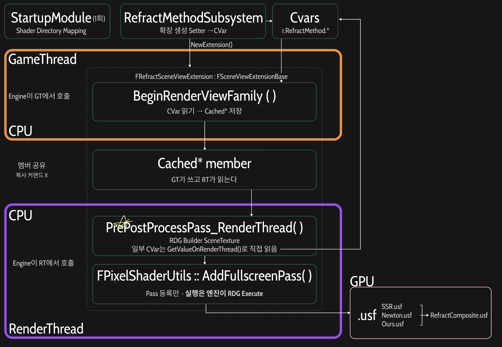

Unreal Engine의 Refraction 방식과 비교하며, 최신 굴절 기술을 탐색하고, 새로운 Refraction을 조합하기 위해서 논문을 작성 했다.

---
### Architecture
- **Module** : `RefractMethod` (Plugin)
- **Shader (.usf)** : UE RDG 아키텍쳐 활용. PostProcess 직전 RDG에 Fullscreen PixelShader Pass를 등록하고, CustomDepth / CustomStencil을 굴절 Shader로 처리(대상 마스크와 표면 정보로 활용)한다.

---

### 1. 전체적인 UE RenderPipeline 아키텍쳐

Unreal engine의 RenderPipeline을 직접 수정하는것이 아니라, Engine이 열어둔 확장 지점에 끼어드는 방식으로 진행하였다. `FSceneViewExtensionBase`를 상속한 클래스에서 아래 함수들을 override하면, Engine이 정해진 시점에 이 함수들을 호출해준다.

| 함수                                  | 호출 스레드 | 역할                                                        |
| ----------------------------------- | ------ | --------------------------------------------------------- |
| `BeginRenderViewFamily()`           | GT     | CVar를 읽어 `Cached*` 멤버에 저장                                 |
| `PrePostProcessPass_RenderThread()` | RT     | 엔진 Scene Rendering이 끝난 뒤, PostProcess 시작 직전에 우리의 Pass를 추가 |
| `SetupViewFamily()`, `SetupView()`  | GT     | 같은 확장 지점이지만 현재 구현 사용 X                                    |

Module(Plugin) 형식으로 작업했기 떄문에, `StartupModule()`에서 가상 Shader경로를 `Shader`폴더로 Mapping해주어야 한다!

<table width="100%" style="table-layout: fixed; border-collapse: collapse; border: none;"> <tr style="border: none;"> <td width="100%" style="text-align: center; border: none; padding: 15px;">  <br><strong>FSceneViewExtension</strong> </td>  </tr> </table>

#### 1.1 GT ↔ RT 데이터 전달
GT와 RT 사이에는 별도의 복사 커맨드 없이 `Cached*` 멤버를 공유한다 (GT가 쓰고, RT가 읽는다). `Enable` 같은 일부 CVar는 RT에서 `GetValueOnRenderThread()`로 직접 읽는다.

>⚠️ **Thread-safety 주의** 이 구조는 동작은 하지만 thread-safe하지 않다. RT는 GT보다 1~2프레임 늦게 실행되므로, RT가 N프레임 값을 읽는 도중 GT가 N+1프레임 값을 덮어쓸 수 있다(race). 파라미터가 한 프레임 섞이는 정도라 시각적 영향은 작지만, 엄밀하게는 `ENQUEUE_RENDER_COMMAND`로 값을 복사해 RT에 넘기는 방식이 필요하다.

#### 1.2 Engine RDG Graph에 Pass 추가
Engine이 넘겨준 RDG Graph에 우리의 Pass를 추가해서 SceneColor를 갱신하는 방식으로 진행하였다.

- 내가 `FRDGBuilder`를 만든게 아니라 Engine이 이미 생성해서 넘겨준 `GraphBuilder`에 Pass를 추가하는 경우, 직접 `Execute()`를 호출하면 안된다. 그 Graph의 소유자인 Engine이 나중에 알아서 `Execute`한다.
- `AddFullscreenPass`나 `AddCopyTexturePass`를 호출하면 Pass가 그 Graph에 기록만 되고, Engine이 Frame Rendering 마무리하면서 `GraphBuilder.Execute()` 한번 호출할때 같이 올라간 우리 Pass도 함께 Compile되고 실행된다.
- RDG는 결과를 아무도 읽지 않는 Pass를 자동으로 Cull(제거)한다. 그래서 Method Pixel Shader의 출력은 Composit Pass( Capture 복사)가 읽어야 살아남는다.
- Plass Lambda는 나중에 실행되므로, Shader Parameter는 Stack이 아니라 `GraphBuilder.AllocParameters<>()`로 **RDG 메모리에 할당**해야한다. (4.2.9 참고)

#### 1.3 `NewExtension()`이란?

```cpp
SceneViewExtension = FSceneViewExtensions::NewExtension<FRefractSceneViewExtension>(GetWorld(), this);
```

- **생성과 등록**을 한방에 한다.  
  Engine의 `SceneViewExtension`목록에 올려주어야하는데, Class 생성자 `FAutoRegister`가 이 등록을 위한 인자이다. 그래서 일반`New` / `MakeShared`로 만들면 Engine이 모른다.
- Engine은 **약한 참조**만 갖는다.  
  목록은 WeakPointer로 들고있기에, 계속 객체를 살려두는 것은 Subsystem의 `SceneViewExtension` 멤버(`TSharedPtr`)이다. `Deinitilaize()`에서 `Reset()`을 하면 객체가 사라지고, Hook 호출도 끝난다.
- **World 단위**로 동작한다.  
  `FWorldSceneViewExtension`이므로, `GetWorld()`로 넘긴 World 뷰에서만 훅이 호출된다.

#### 1.4 Subsystem Setter와 CVar

Subsystem의 Setter(`SetMethod`, `SetIOR` 등)는 멤버를 바꾸면서 해당 CVar도 함께 갱신하고, 렌더링 시점에는 이 CVar 값이 `BeginRenderViewFamily()`에서 읽힌다. (Source of truth 정리는 4.1 참고)

---
### 2. Class별 확인

| 파일                            | 현재 책임                                                        |
| ----------------------------- | ------------------------------------------------------------ |
| `RefractMethod.cpp`           | `/Plugin/RefractMethod` 가상 셰이더 경로 등록                         |
| `RefractMethodSubsystem.cpp`  | 월드별 View Extension 생성, Blueprint 설정 진입점                      |
| `RefractMethodTypes`          | 각 Refract Model에따른 구조체                                       |
| `RefractMethodRenderer`       | Main Class RT, CVar읽기, SceneTexture Binding, RDG Pass와 합성 등록 |
| `*.usf` / `FBaseline2SSRPS` 등 | **TODO**: `.usf` 파일 경로와 Shader 클래스 선언 위치 추가                  |

---
### 3. RefractMethodSubsystem
- Parent : `UWorldSubsystem`
- `Initialize()` : `NewExtension<FRefractScenViewExtension>` 등록
- Memeber Variable : `TargetRefractionRT`, `TargetDebugRT` (약한 참조)

---

### 4. RefractMethodRenderer - `FRefractSceneViewExtension`
- Parent : `FWorldSceneViewExtension`
- `URefractMethodSubsystem::Initialize()`에서 등록한 `FRefractSceneViewExtension`을 활용한다
- 주요 Member Variable :
  - `CachedCommonParams`, `CachedBaseline2Params`, `CachedBaseline3Params`, `CachedBaseline4Params`
  - `CachedRefractionRTResource`, `CachedDebugRTResource`

---
#### 4.1 BeginRenderViewFamily()`:
`FRefractSceneViewExtension`내에서 GameThread에서 현재 설정값과 외부 RenderTarget Resource를 캐시하는 단계이다.

1️⃣ Subsystem에서의 현재 Parameter를 Cached구조체에 복사.  
   - `GetCommonParams()` , `GetBaseline2Params()`, `GetBaseline3Params()`, `GetBaseline4Params()` 
2️⃣ 외부 `RenderTarget`리소스를 Render Resource Pointer를 cache  
   - `GameThread_GetRenderTargetResource()`사용
   - 이 단계에서 실제로 RenderTarget에는 그리지는 않는다.
   - 이후 `PrePostProcessPass_RT()`에서 RDG Pass로 처리한다

3️⃣ 설정값을 Cached 구조체에 확정  
- 선택된 Method와 관계없이 각 Basline에 필요한 Parameter를 모두 캐시해둠.
- 현재 구현에서는 CVar가 최종 authoritative 설정값. `GetValueOnGameThread()`로 CVar를 읽어 Cached Parameter 확정

---
#### 4.2 `PrePostProcessPass_RenderThread()`:
`FRefractSceneViewExtension`내에서 실제 렌더링 관련 RDG Pass를 등록하는 핵심 함수이다.

```text
Engine의 기존 Scene Texture 참조
        ↓
공통 Background Snapshot 생성
        ↓
선택한 Refraction Pixel Shader에
Scene Texture / Matrix / Parameter 전달
        ↓
Fullscreen Pixel Shader Pass를 RDG에 등록
        ↓
굴절 결과를 별도 RDG Texture에 생성
        ↓
Composite Pixel Shader로
기존 SceneColor + 굴절 결과 합성
        ↓
최종 SceneColor에 기록
```

**Engine의 Render Graph 안에서 필요한 Scene Resource를 준비하고, Global Pixel Shader와 Parameter를 연결하여 굴절 Pass와 Composite Pass를 구성하는 Rendering Orchestration 역할**

---
##### 4.2.1 Engine Scene Texture 참조 확보
새로운 SceneTexture를 만드는 것이 아닌, Engine의 현재 RDG에 이미 존재하는 Scene Texture에 대한 참조를 얻는다.
- `SceneColorTexture`, `SceneDepthTexture`, `CustomDepthTexture`, `SceneNormalTexture`를 모두 `FRDGTextureRef` 타입으로 다룬다.

또한 현재 View의 `ViewRect`, `SceneColor->Dec.Extent`를 통해 다음 값을 얻는다.
- 실제 렌더링 View영역
- Scene Texture Resolution

---

##### 4.2.2 Global Shader Map 조회

```cpp
FGlobalShaderMap* GlobalShaderMap =
	GetGlobalShaderMap(View.GetFeatureLevel());
```

- 현재 Feature Level에 맞는 Global Shader를 조회하기 위해 `FGlobalShaderMap`을 가져온다.
- 현재 렌더링 환경에서 사용할 수 있도록 이미 Compile된 Global Shader들의 테이블이다.

이후 다음과 같이 특정 Shader Type을 가져올떄 사용한다.

``` cpp
TShaderMapRef<FBaseline2SSRPS> PixelShader(GlobalShaderMap);
```

- `TShaderMapRef`는 ShaderMap에서 이미 Compiled된 Shader를 조회하는 핸들이다.  
  (`IMPLEMENT_GLOBAL_SHADER`로 등록된 C++ Shader 타입과 `.usf`의 엔트리 함수가 연결되어 있다.)
- DX에서 `CreatePixelShader`와 1:1 대응되는개념은 아니다. RHI Shader 객체의 생성/관리는 Engine이 별도로 담당한다.

##### 4.2.3 ProjectionMatrix 준비
- `ViewToClip`, `ClipToView` 행렬을 얻어 Shader에서 ViewSpace와 Clip Space 사이의 좌표 변환 / 역변환에 이용한다.

---
##### 4.2.4 공통 Background SnapShot 생성

기존 Engine의 `SceneColor`를 먼저 보존한다.

```cpp
FRDGTextureRef SceneColorTarget = SceneColorTexture;
```
이 시점에서 `SceneColorTarget` = Engine의 실제 `SceneColor`이다.  
그 다음 동일한 FRDGTextureDesc를 가진 RDGTexture를 생성한다.

``` cpp
SceneColorTexture =
    GraphBuilder.CreateTexture(
        SceneColorTarget->Desc,
        TEXT("RefractMethod_Background")
    );
```

 `FRDGTextureDesc`는 Texture크기, format, Flag등 Texture의 구조 정보를 나타낸다.
 
 이후 원래 SceneColor를 새 RDG Texture에 복사하는 Pass를 등록한다.
 
```cpp
AddCopyTexturePass(
    GraphBuilder,
    SceneColorTarget,
    SceneColorTexture
);
```

결과적으로 :
- SceneColorOutput (코드 : `SceneColorTarget`) = 실제 Engine SceneColor
- BackGroundColor (코드 `SceneColorTexture`) = SSR / Newton / Ours 가 공통으로 읽는 BackgroundSnapShot

세 알고리즘이 서로 합성 결과를 다시 입력으로 읽지않고, 동일한 원본 BackGround를 사용하기 위한 처리이다.

---
##### 4.2.5 Method / Stencil에 따른 Pass 선택  

`CompareByStencil`이 비활성화된 경우:
> 현재 선택된 Method 1개만 실행

`CompareByStencil`이 활성화된 경우, `MethodIndex`가 Method과 Stencil ID를 동시에 결정하여 총 3개의 Pass를 구성한다.

|MethodIndex (= Stencil ID)|Method|Baseline|
|---|---|---|
|1|SSR|Baseline2|
|2|Newton|Baseline3|
|3|Ours|Baseline4|

```cpp
const ERefractMethod PassMethod =
    bCompareByStencil
        ? static_cast<ERefractMethod>(MethodIndex)
        : CachedCommonParams.Method;
```

`MethodIndex`는 Method 선택뿐 아니라 해당 Pass가 처리할 Stencil ID에도 사용된다.

---
##### 4.2.6 굴절 결과용 RDG Texture 생성  
각 Method Pass마다 다음 출력 Texture를 생성한다.
- `OutRefractionTexture`, `OutDebugTexture`
`FRDGTextureDesc::Create2D()`로 해상도와 Format을 지정하고, Shader Resoruce 및 RenderTarget으로 사용할 수 있도록 생성한다.

##### 4.2.7 Optional Texture Fallback  
Custom Depth나 Scene Normal이 존재하지 않을 경우, Shader Parameter에 nullptr texture가 들어가지 않도록 안전한 대체 Texture를 지정한다.

##### 4.2.8 공통 Shader Parameter 설정
세 알고리즘에서 공통으로 사용하는 Shader Paramter를 설정하기 위한 Helper Lambda이다.  

``` cpp
SetupCommonParams(PassParameters);
```

이 단계는 아직 GPU로 직접 전송하는 단계는 아니다. 이후, RDG Pass 실행에 사용할 Parameter Struct에 값을 채우는 단계이다.

---

##### 4.2.9 Algorithm 별 PS pass 등록

예를들어 SSR은 다음과 같다.

```cpp
TShaderMapRef<FBaseline2SSRPS> PixelShader(GlobalShaderMap);
```

현재 ShaderMap에서 `FBaseline2SSRPS`에대응하는 Compile된 Shader를 가져온다.

```cpp
FBaseline2SSRPS::FParameters* PassParameters =
    GraphBuilder.AllocParameters<
        FBaseline2SSRPS::FParameters
    >();
```

PS가 사용할 Parameter Block을 RDG에서 할당한다. Pass Lamda는 Graph Execute 시점에 실행되므로, 스택 변수가 아니라, RDG 수명을 관리하는 메모리여야한다.

```cpp
SetupCommonParams(PassParameters);
```

공통 Parameter를 채운뒤, SSR전용 parameter로 추가 설정한다. 마지막으로 :

```cpp
FPixelShaderUtils::AddFullscreenPass( ... )
```

을 통해 Shader와 Parameter를 묶어서 FullScreen PixelShader pass를 RDG에 등록한다.

전체 흐름은 아래와 같다

```text
Shader 조회
    ↓
Parameter Block 할당
    ↓
공통 Parameter 설정
    ↓
Algorithm 전용 Parameter 설정
    ↓
Fullscreen Pass를 RDG에 등록
    ↓
나중에 Engine이 RDG Execute 시 실제 GPU에서 실행
```

Algorithm 전용 parameter만 다르다.

---
##### 4.2.10 Final Composite Pass

Algorithm Pass가 생성한 결과를 실제 Engine SceneColor에 합성하는 단계이다. 먼저 최종 출력 대상은 원래 Engine SceneColor이다.

```cpp
FRDGTextureRef OutputRenderTarget = SceneColorTarget;
```

즉 OutputRenderTarget = 실제 SceneColor이다.  
동일한 SceneColor를 동시에 읽고 쓰지 않기 위해 읽기용 SnapShot을 하나 더 만든다.

```cpp
FRDGTextureRef CompositeInputColor =
    GraphBuilder.CreateTexture(
        SceneColorTarget->Desc,
        TEXT("RefractMethod_CompositeBackground")
    );

AddCopyTexturePass(
    GraphBuilder,
    SceneColorTarget,
    CompositeInputColor
);
```

- `CompositeInputColor` : 합성 전 현재 SceneColor의 읽기용 복사본
- `SceneColorTarget` : Composite Shader가 최종 결과를 쓸 실제 출력 대상

Debug Mode에 따라 합성할 Texture를 선택한다.

```text
DebugMode == Final
    → OutRefractionTexture
그 외
    → OutDebugTexture
```

이후 Composite Shader를 가져온다.

```cpp
TShaderMapRef<FRefractCompositePS> CompositeShader(GlobalShaderMap);
```

Composite Shader용 Parameter Block을 RDG에서 할당한다.

```cpp
FRefractCompositePS::FParameters* PassParameters =
    GraphBuilder.AllocParameters<FRefractCompositePS::FParameters>();
```

주요 입력은 `CompositeInputColor`, `OutRefractionTexture or OutDebugTexture`, `BlendWeight`, `Viewport Size`이다.

출력 RenderTarget은 실제 Scene Color이다.

```cpp
PassParameters->RenderTargets[0] =
    FRenderTargetBinding(
        SceneColorTarget,
        ERenderTargetLoadAction::ELoad
    );
```

마지막으로 Composit Pixel Shader Pass를 RDG에 등록한다.

```cpp
FPixelShaderUtils::AddFullscreenPass(...)
```

#### 4.2.11 외부 RenderTarget 복사 (Capture)

4.1에서 캐시한 `CachedRefractionRTResource`, `CachedDebugRTResource`를 이 단계에서 RDG에 연결한다.
- `RegisterExternalTexture`로 외부 RT를 RDG Texture로 등록
- `AddCopyTexturePass`로 `OutRefractionTexture` / `OutDebugTexture`를 외부 RT에 복사

**전체 흐름**:  

```text
Engine SceneColor
      ↓
Background Snapshot
      ↓
SSR / Newton / Ours Fullscreen Pass
      ↓
OutRefractionTexture
      ↓
Composite Shader
   ↙          ↘
SceneColor    Refraction Result
Snapshot
      ↓
Final SceneColor
      ↓
 (외부 RT 복사)
      ↓
Engine PostProcess
      ↓
Viewport
```


---
### 5. Baseline2 : SSR.usf

