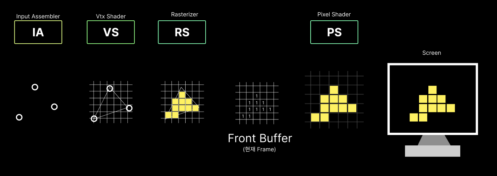
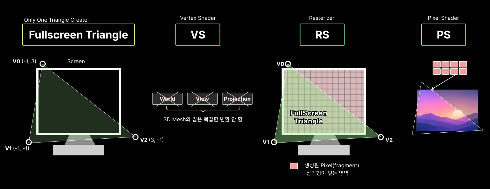
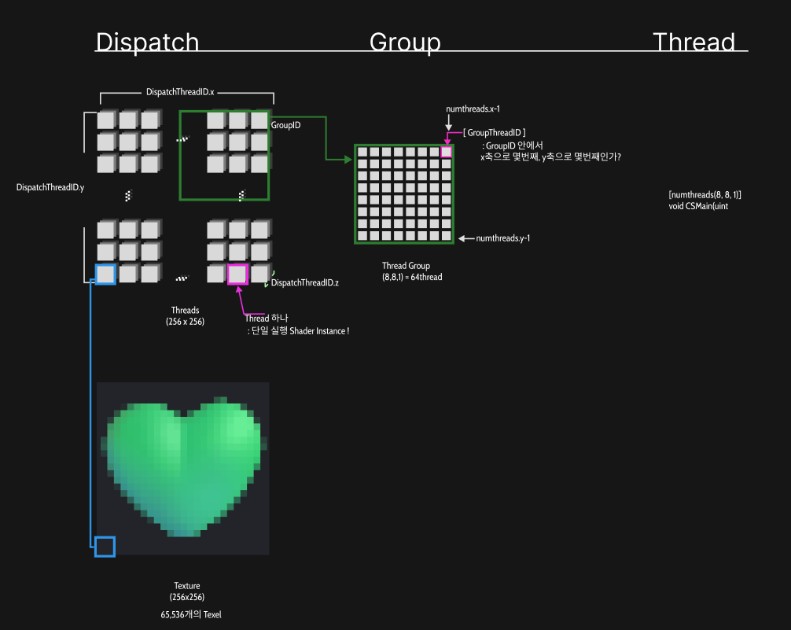

UE에서 RenderPipeline을 수정하기 위해서, 엔진 자체를 뜯어고치기보다, Engine에서 열어둔 RDG graph에 넣어주는 형태로한다. 그러다보면, UE에서 제공하는 별도의 구조체를 활용해야만 하기도하고, 함수들이 튀어나와서 순서에 맞게 꽂아주기도 해서 꼭 짚고 싶었다. 마치 Dx에서 Shader를 등록하는 것과 비슷하게 중요한 흐름이라고 생각한다.

### 0. RDG를 사용하는 이유
UE의 RenderPipeline에 사용자 정의 처리를 추가할때, 엔진이 제공하는 확장 지점에서 **기존 RDG Graph Pass를 등록하는 방식**을 사용할 수 있다.

`PrePostProcessPass_RenderThread()`는 이러한 확장 지점중 하나이다.  
이 함수에 전달된 `GraphBuilder`를 통해 필요한 리소스를 준비하고, 패스의 입출력을 연결한뒤, 실행할 GPU 작업을 등록한다.

RDG는 등록된 패스의 리소스 관계를 분석해 실행에 필요한 의존성, 리소스 수명, 상태 전환 등을 관리한다.

---

### 1. `FRDG~` 구조체
`FRDG`는 리소스를 RDG가 관리한다.

#### 1.1 Texture & Buffer

| Type           | 역할 / 설명                          |
| -------------- | -------------------------------- |
| FRDGTexture    | RDG안에서 texture를 표현하고 추적하는 객체     |
| FRDGTextureRef | `FRDGTexture *`                  |
| FRHITexture    | RHI 계층에서 실제 GPU 텍스쳐 리소스를 표현하는 객체 |

- Texture라고 하더라도, 렌더링 Data를 담는 GPU 저장공간인, **Buffer**라고 생각하면된다

```cpp
FRDGTextureRef SceneDepthTexture;
//화면의 각 픽세렝 대응하는 Depth data를 담은 GPU texture를 RDG에서 가리키는 포인터
```

- Normal G-buffer

하지만 Buffer로 표현되는 구조체가 `FRDGBuffer`로 존재한다.

| Type          | 역할 / 설명                          |
| ------------- | -------------------------------- |
| FRDGBuffer    | RDG안에서 Buffer를 표현하고 추적하는 객체      |
| FRDGBufferRef | `FRDGBuffer *`                   |
| FRHIBuffer    | RHI 계층에서 실제 GPU 텍스쳐 리소스를 표현하는 객체 |

`FRDGTexture`는 **좌표**로 접근하기 용이하고, `FRDGBuffer`는 **일렬로** 나열한 데이터에 적합하다.

| 구분     | `FRDGTexture`                      | `FRDGBuffer`               |
| ------ | ---------------------------------- | -------------------------- |
| 데이터 형태 | 1D·2D·3D 텍셀, 배열 등                  | 원소 또는 바이트의 연속              |
| 접근 기준  | `(x, y)` 좌표, UV 등                  | 인덱스, 바이트 위치                |
| 전용 기능  | 필터링, 밉맵, 렌더 타겟·깊이 타겟 등             | 구조체 배열, 정점·인덱스, 간접 실행 인자 등 |
| 대표 용도  | Scene Color, Scene Depth, G-buffer | 정점 목록, 파티클 데이터, 계산 결과 배열   |

Shader에 들어간 이후는 차이가 명확해진다.
```cpp
//.usf

// Texture: 화면의 (100, 50) 픽셀에서 깊이 읽기
Texture2D<float> DepthTexture;
float depth = DepthTexture.Load(int3(100, 50, 0));

// Buffer: 100번째 파티클의 위치 읽기
StructuredBuffer<float3> ParticlePositions;
float3 position = ParticlePositions[100];
```

- Texture는 UV와 Sampler를 이용해 주변 텍셀 보간 기능도 제공
- Buffer는 보통 Index로 지정한 원소 그대로 읽는다.


### 2.PrePostProcess_RenderThread()에서의 흐름

| 순서        | 하는 일                              | 주요 타입·함수                                                      |
| --------- | --------------------------------- | ------------------------------------------------------------- |
| ① 입력 확보   | Scene Color, Depth 등 기존 리소스를 가져온다 | `FRDGTextureRef`                                              |
| ② 출력 준비   | 결과를 기록할 텍스처를 생성하거나 외부 텍스처를 등록한다   | `FRDGTextureDesc`, `CreateTexture`, `RegisterExternalTexture` |
| ③ 파라미터 연결 | 셰이더의 입력, 상수, 출력 대상을 설정한다          | `FParameters`, `AllocParameters`, `FRenderTargetBinding`      |
| ④ 패스 등록   | 사용할 셰이더와 GPU 작업을 그래프에 추가한다        | `FPixelShaderUtils::AddFullscreenPass`                        |
| ⑤ 결과 연결   | 후속 패스에서 읽거나 외부 출력 대상으로 복사한다       | 다음 패스의 입력, `AddCopyTexturePass` 등                             |
| ⑥ 엔진 실행   | 엔진이 해당 그래프를 실행할 때 등록한 작업이 처리된다    | `GraphBuilder.Execute()`                                      |

#### A. 기존 RDG Texture를 직접 전달 
Scene Color 별도로 복사하지않는다.

```cpp
FRDGTextureRef SceneColor =	Inputs.SceneTexture->SceneColorTexture;

FMySceneShader::FParameters* Parameters = GraphBuilder.AllocParameters<FMySceneShader::FParameters>();

Parameter->InputTexture =SceneColor;
parameter->OutputTexture = GraphBuilder.CreateTexture(Desc, TEXT("myoutput"));
```

#### B. RenderTarget을 RDG에 등록
외부 RHI 리소스를 RDG가 관리할 수있도록 연결해줘야한다.

```cpp
FRHITexture* ExternalTexture = RenderTargetResource->GetRenderTargetTexture();

FRDGTextureRef InputTexture = GraphBuilder.RegisterExternalTexture(
	CreateRenderTarget(ExternalTexture, TEXT("ExternalTexture"))
	);
```


| DirectX                 | Unreal RDG                              |
| ----------------------- | --------------------------------------- |
| CreateBuffer            | CreateBuffer / CreateTexture            |
| 기존 GPU Resource         | 기존 RDG Resource 또는 External Resource 등록 |
| Input Layout            | Vertex Factory / Vertex Declaration 등   |
| VS / PS class           | Global Shader class                     |
| Shader Resource Binding | Shader Parameter structure              |
| DrawIndexed             | Raster Pass 내부 Draw 호출                  |
| Draw                    | Raster Pass 내부 Draw 호출                  |
| GPU 명령 실행               | RDG가 구성한 GPU 명령 실행                      |


---
### 3. Shader Parameter 선언 흐름


---
### 4. RDG 구현 방식 세가지

#### A. Raster Shader 방식
<table width="100%" style="table-layout: fixed; border-collapse: collapse; border: none;"> <tr style="border: none;"> <td width="100%" style="text-align: center; border: none; padding: 15px;">  <br><strong>RasterShader</strong> </td>  </tr> </table>
이렇게 Custom Mesh Rendering할때 RDG에서는 

```cpp
GraphBuilder.AddPass(
	RDG_EVENT_NAME("MyRasterPass"),
	Parameters,
	ERDGPassFlags::Raster,
	[Parameters](FRHICommandList& RHICmdList)
	{
		// Graphics Pipeline 설정
		// Vertex Buffer / Index Buffer 바인딩
		// Vertex Shader / Pixel Shader 사용
		// Draw Indexed 실행
	}
};
	
```
#### B. Fullscreen Raster 방식

<table width="100%" style="table-layout: fixed; border-collapse: collapse; border: none;"> <tr style="border: none;"> <td width="100%" style="text-align: center; border: none; padding: 15px;">  <br><strong>FullScreenRaster</strong> </td>  </tr> </table>

메시 직접 그리는것이 아니라, 화면 전체를 덮는 삼각형을 그리는 방식
: 화면 전체를 대상으로하는 후처리 작업

1. 화면 전체를 덮는 FullScreen Triangle 단 한개만 생성
2. VS에서 삼각형의 정점 위치 설정
3. RS에서 화면 전체에 해당하는 픽셀 생성
4. PS에서 각 픽셀의 SceneColor, Depth등의 Texture를 읽음
5. 계산한 결과를 Output Render Target에 출력
   


- VS 역할 : 정점 3개의 화면 (Clip Space)위치를 직접 지정 : Fullscreen Triangle을 생성
```cpp
AddDrawScreenPass(GraphBuilder, RDG_EVENT_NAME("MyFullscreenPass"),
View, OutputViewport, InputTexture, OutputTexture, PixelShader
);
```


Ex) Blur, Bloom, Refraction 처리할때 많이 활용한다.

|구분|A. 일반 Raster|B. Fullscreen Raster|
|---|---|---|
|그리는 대상|3D 메시|화면 전체 삼각형|
|Vertex|메시 정점|보통 3개|
|VS|메시 정점 변환|화면 좌표 생성|
|RS|메시의 픽셀 생성|화면 전체 픽셀 생성|
|PS|메시 표면 셰이딩|화면 Texture 후처리|
|대표 용도|캐릭터, 배경, 오브젝트|Blur, Bloom, Refraction|


Rasterizer와 비교했을때, 최종 투영된 영역만 PS실행된다면, 

#### C. Compute Shader

<table width="100%" style="table-layout: fixed; border-collapse: collapse; border: none;"> <tr style="border: none;"> <td width="100%" style="text-align: center; border: none; padding: 15px;">  <br><strong>ComputeShader</strong> </td>  </tr> </table>

나중에 이미지 좀 수정하기