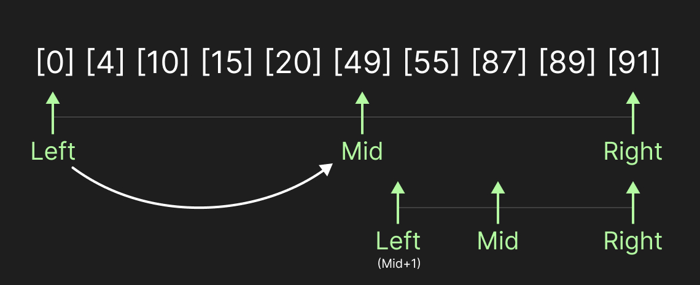
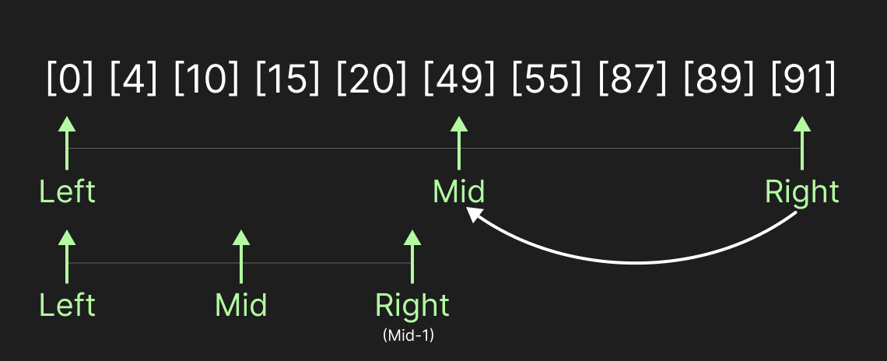

(작성중)
현재 binary search만을 할려면 이것만 올리기

---

이진 탐색(Binary Search)은 Vector로 구현한다.

O(logN)으로 시간복잡도로 찾을 수있다.  
가장 기초의 Binary Tree는 정렬되어있는 vector에서 활용해본다.

### 01. 정렬된 Vector에서의 Binary Search

```cpp

#include <iostream>
using namespace std;
#include <vector>

vector <int> rankedvectors;

void BinarySearch(int N)
{
	int right = rankedvectors.size();
	int left = 0;
	bool find = false;

	while (left <= right)
	{
		cout << "[RANGE] : " << left << " ~ " << right << endl;
		int mid = static_cast<int>((right + left) / 2);
		if (N < rankedvectors[mid])
		{
			cout << N << " < " <<rankedvectors[mid] << endl;
			right = mid - 1;
		}
		else if (rankedvectors[mid] < N)
		{
			cout << rankedvectors[mid]<<" < " << N << endl;
			left = mid + 1;
		}
		else
		{
			cout << "FOUND!" << endl;
			find = true;
			break;
		}
	}
	if (!find) cout << "NOT - FOUND!" << endl;
}


int main()
{
	rankedvectors = { 0, 4, 10, 15, 20, 49, 55, 87, 89, 91 };

	BinarySearch(55);
	BinarySearch(12);

}
```


- 정렬된 `vector`에서 사용하는 가장 기초적인 탐색 알고리즘이다.
- 매번 중간값(`mid`)와 비교해 탐색 범위 절반으로 줄인다.
- 시간 복잡도는 O(log N)이다. (선형 탐색은 O(N))
- 전제 조건 : 데이터가 정렬되어있어야함.

<table width="100%" style="table-layout: fixed; border-collapse: collapse; border: none;"> <tr style="border: none;"> <td width="100%" style="text-align: center; border: none; padding: 5px;">  <br><strong>BinarySearch001</strong> </td> <td width="100%" style="text-align: center; border: none; padding: 3px;">  <br><strong>BinarySearch002</strong> </td> </tr> </table>


