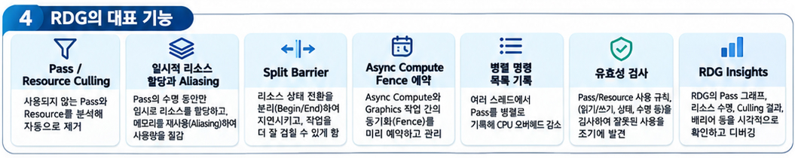

렌더 그래프, [RDG(Render Dependency Graph)](https://dev.epicgames.com/documentation/unreal-engine/render-dependency-graph-in-unreal-engine?lang=ko)는 UE에서 렌더 명령을 바로 실행하지않고, 그래프 자료구조로 **기록한뒤, 컴파일하고 실행**하는 즉시 모드 API이다.  

RDG가 UE 렌더링 파이프라인에서 어떤 역할을 하는지 아래 글에 정리해 두었다.

[참고글 - UE RenderingPipeline과 RDG pass의 네가지 종류](https://piusai.github.io/engine/2026/11/10/Unrealengine-RenderPipeline-RDG.html)

----
### RDG 톺아보기

RDG는 Render Pass를 순서대로 나열한 List가 아니다.  
Pass가 어떤 Resource를 읽고 쓰는지에 따라 의존 관계를 연결한 DAG(Directed Acyclic Graph), 방향성 비순환 그래프이다.  
엔진은 이 Graph를 분석해서 메모리 사용을 최적화하고, CPU와 GPU작업을 병렬화 한다.  

RDG의 대표적인 기능은 다음과 같다.

- Pass / Resource Culling : 최종 결과에 쓰이지않는 Pass와 Resource를 제거
- 일시적 Resource 할당과 Aliasing : 수명이 겹치지 않는 Resource끼리 매모리 재사용
- Split Barrier : 서브 리소스 상태 전환 지연 숨기고 GPU 작업을 더 많이 겹친다.
- Asynmc Compute Fence 예약 : Queue간 동기화 자동 처리
- 병렬 명렬 목록 기록 : 여러 Thread에서 Pass를 나눠 기록
- Valiation 검사 : API사용과 리소스 의존성의 오류를 검출
- RDG Insights : 그래프 구조와 메모리 수명 시각화

UE의 렌더 파이프라인을 바꾸고 싶을 때는 엔진 코드를 직접 뜯어고치는 대신, **엔진이 열어둔 RDG Graph에 내 Pass를 등록**하는 방식을 쓴다.  

<table width="100%" style="table-layout: fixed; border-collapse: collapse; border: none;"> <tr style="border: none;"> <td width="100%" style="text-align: center; border: none; padding: 15px;">   <strong>RDG의 대표적 기능</strong> </td>  </tr> </table>

### 0. RDG를 사용하는 이유
DX에서 직접구현을 하면 RT에서만 손봐야할것들을 GT에서 수정가능하게 접근 가능토록 만든다면, 이슈가 생기기 마련이다.  
이와같이 UE의 Renderpipeline에서도 개발자가 수정하게 둔다면, 비트로 바꿔야하는 과정이나, 쉐이더 코드로 바인딩할때 등등도 쉽지 않다. 또, 크로스 플랫폼을 지원하는 UE의 특징인, DX, Vulkan같은 API위에서 렌더링 작업을 관리해야하는 시스템으로, 이러한 접근을 쉽게 막아두면 고통이 이만저만이 아니다. 그렇기 때문에, RDG를 이용하는 경우가 많다.

`FPixelShaderUtils::AddFullscreenPass()`는 기본 값 자체로 `ERDGPassFlags::None`로 들어간다.
``