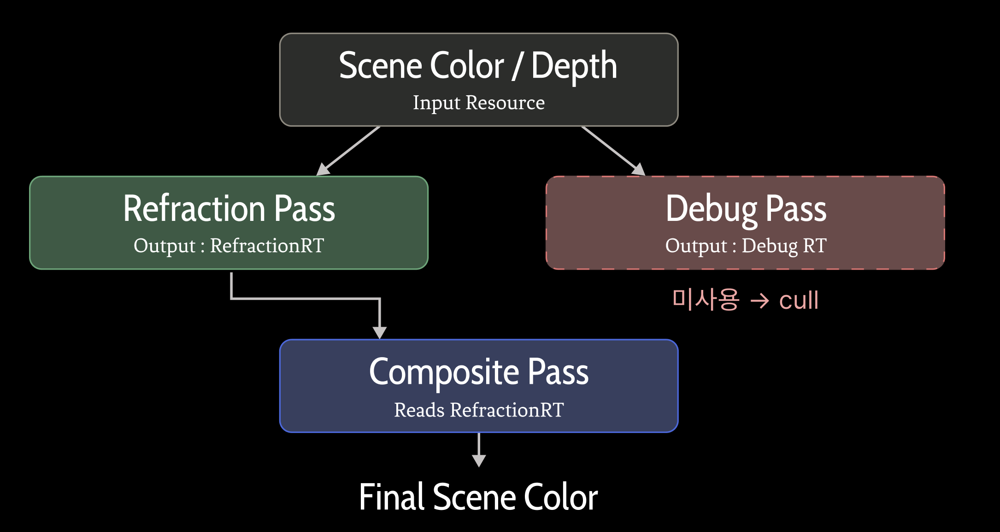
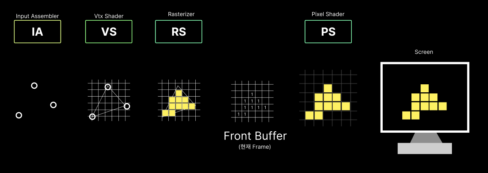
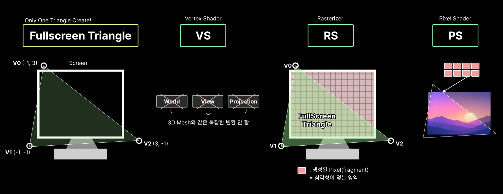
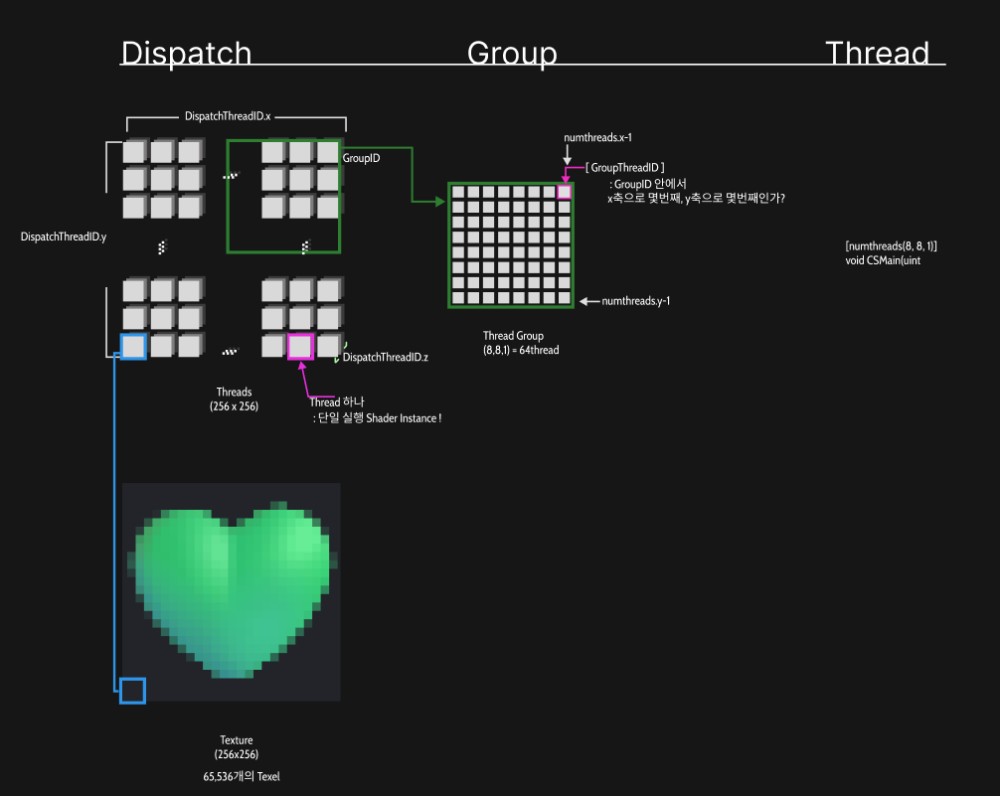
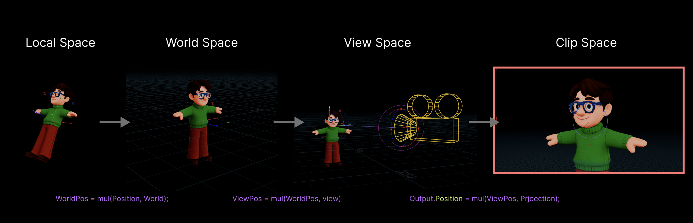
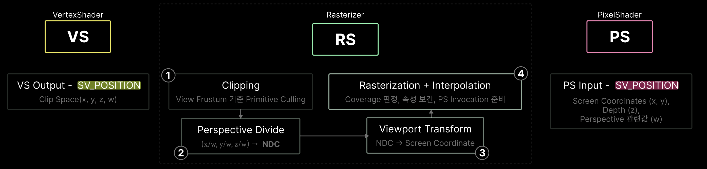
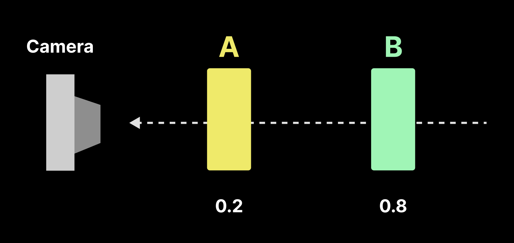
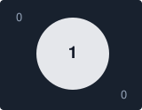

렌더 그래프, [RDG(Render Dependency Graph)](https://dev.epicgames.com/documentation/unreal-engine/render-dependency-graph-in-unreal-engine?utm_source=chatgpt.com&lang=ko)는 렌더 명령을 컴파일, 실행할 수 있도록 그래프 데이터 structure로 기록하는 즉시 모드 API이다.  
Graph를 탐색해 메모리 사용 최적화하고, CPU, GPU의 RenderPass를 병렬화 한다.

1. Graph의 미사용 리소스 및 Pass Culling

UE에서 RenderPipeline을 수정하기 위해서, 엔진 자체를 뜯어고치기보다, Engine에서 열어둔 RDG graph에 넣어주는 형태로한다. 그러다보면, UE에서 제공하는 별도의 구조체를 활용해야만 하기도하고, 함수들이 튀어나와서 순서에 맞게 꽂아주기도 해서 꼭 짚고 싶었다. 마치 Dx에서 Shader를 등록하는 것과 비슷하게 중요한 흐름이라고 생각한다.

<table width="100%" style="table-layout: fixed; border-collapse: collapse; border: none;"> <tr style="border: none;"> <td width="100%" style="text-align: center; border: none; padding: 15px;">  <br><strong>RDGExample</strong> </td>  </tr> </table>

### 0. RDG에서의 렌더링 파이프라인


### 0. RDG를 사용하는 이유
DX에서 직접구현을 하면 RT에서만 손봐야할것들을 GT에서 수정가능하게 접근 가능토록 만든다면, 이슈가 생기기 마련이다.  
이와같이 UE의 Renderpipeline에서도 개발자가 수정하게 둔다면, 비트로 바꿔야하는 과정이나, 쉐이더 코드로 바인딩할때 등등도 쉽지 않다. 또, 크로스 플랫폼을 지원하는 UE의 특징인, DX, Vulkan같은 API위에서 렌더링 작업을 관리해야하는 시스템으로, 이러한 접근을 쉽게 막아두면 고통이 이만저만이 아니다. 그렇기 때문에, RDG를 이용하는 경우가 많다.


UE의 RenderPipeline에 사용자 정의 처리를 추가할때, 엔진이 제공하는 확장 지점에서 **기존 RDG Graph Pass를 등록하는 방식**을 사용할 수 있다.

`PrePostProcessPass_RenderThread()`는 이러한 확장 지점중 하나이다.  
이 함수에 전달된 `GraphBuilder`를 통해 필요한 리소스를 준비하고, 패스의 입출력을 연결한뒤, 실행할 GPU 작업을 등록한다.

RDG는 등록된 패스의 리소스 관계를 분석해 실행에 필요한 의존성, 리소스 수명, 상태 전환 등을 관리한다.

---

### 1. `FRDG~` 구조체
`FRDG`는 리소스를 RDG가 관리한다.

#### 1.1 Texture & Buffer

| Type           | 역할 / 설명                          |
| -------------- | -------------------------------- |
| FRDGTexture    | RDG안에서 texture를 표현하고 추적하는 객체     |
| FRDGTextureRef | `FRDGTexture *`                  |
| FRHITexture    | RHI 계층에서 실제 GPU 텍스쳐 리소스를 표현하는 객체 |

- Texture라고 하더라도, 렌더링 Data를 담는 GPU 저장공간인, **Buffer**라고 생각하면된다

```cpp
FRDGTextureRef SceneDepthTexture;
//화면의 각 픽세렝 대응하는 Depth data를 담은 GPU texture를 RDG에서 가리키는 포인터
```

- Normal G-buffer

하지만 Buffer로 표현되는 구조체가 `FRDGBuffer`로 존재한다.

| Type          | 역할 / 설명                          |
| ------------- | -------------------------------- |
| FRDGBuffer    | RDG안에서 Buffer를 표현하고 추적하는 객체      |
| FRDGBufferRef | `FRDGBuffer *`                   |
| FRHIBuffer    | RHI 계층에서 실제 GPU 텍스쳐 리소스를 표현하는 객체 |

`FRDGTexture`는 **좌표**로 접근하기 용이하고, `FRDGBuffer`는 **일렬로** 나열한 데이터에 적합하다.

| 구분     | `FRDGTexture`                      | `FRDGBuffer`               |
| ------ | ---------------------------------- | -------------------------- |
| 데이터 형태 | 1D·2D·3D 텍셀, 배열 등                  | 원소 또는 바이트의 연속              |
| 접근 기준  | `(x, y)` 좌표, UV 등                  | 인덱스, 바이트 위치                |
| 전용 기능  | 필터링, 밉맵, 렌더 타겟·깊이 타겟 등             | 구조체 배열, 정점·인덱스, 간접 실행 인자 등 |
| 대표 용도  | Scene Color, Scene Depth, G-buffer | 정점 목록, 파티클 데이터, 계산 결과 배열   |

Shader에 들어간 이후는 차이가 명확해진다.
```cpp
//.usf

// Texture: 화면의 (100, 50) 픽셀에서 깊이 읽기
Texture2D<float> DepthTexture;
float depth = DepthTexture.Load(int3(100, 50, 0));

// Buffer: 100번째 파티클의 위치 읽기
StructuredBuffer<float3> ParticlePositions;
float3 position = ParticlePositions[100];
```

- Texture는 UV와 Sampler를 이용해 주변 텍셀 보간 기능도 제공
- Buffer는 보통 Index로 지정한 원소 그대로 읽는다.


### 2.PrePostProcess_RenderThread()에서의 흐름

| 순서        | 하는 일                              | 주요 타입·함수                                                      |
| --------- | --------------------------------- | ------------------------------------------------------------- |
| ① 입력 확보   | Scene Color, Depth 등 기존 리소스를 가져온다 | `FRDGTextureRef`                                              |
| ② 출력 준비   | 결과를 기록할 텍스처를 생성하거나 외부 텍스처를 등록한다   | `FRDGTextureDesc`, `CreateTexture`, `RegisterExternalTexture` |
| ③ 파라미터 연결 | 셰이더의 입력, 상수, 출력 대상을 설정한다          | `FParameters`, `AllocParameters`, `FRenderTargetBinding`      |
| ④ 패스 등록   | 사용할 셰이더와 GPU 작업을 그래프에 추가한다        | `FPixelShaderUtils::AddFullscreenPass`                        |
| ⑤ 결과 연결   | 후속 패스에서 읽거나 외부 출력 대상으로 복사한다       | 다음 패스의 입력, `AddCopyTexturePass` 등                             |
| ⑥ 엔진 실행   | 엔진이 해당 그래프를 실행할 때 등록한 작업이 처리된다    | `GraphBuilder.Execute()`                                      |

#### A. 기존 RDG Texture를 직접 전달 
Scene Color 별도로 복사하지않는다.

```cpp
FRDGTextureRef SceneColor =	Inputs.SceneTexture->SceneColorTexture;

FMySceneShader::FParameters* Parameters = GraphBuilder.AllocParameters<FMySceneShader::FParameters>();

Parameter->InputTexture =SceneColor;
parameter->OutputTexture = GraphBuilder.CreateTexture(Desc, TEXT("myoutput"));
```

#### B. RenderTarget을 RDG에 등록
외부 RHI 리소스를 RDG가 관리할 수있도록 연결해줘야한다.

```cpp
FRHITexture* ExternalTexture = RenderTargetResource->GetRenderTargetTexture();

FRDGTextureRef InputTexture = GraphBuilder.RegisterExternalTexture(
	CreateRenderTarget(ExternalTexture, TEXT("ExternalTexture"))
	);
```


| DirectX                 | Unreal RDG                              |
| ----------------------- | --------------------------------------- |
| CreateBuffer            | CreateBuffer / CreateTexture            |
| 기존 GPU Resource         | 기존 RDG Resource 또는 External Resource 등록 |
| Input Layout            | Vertex Factory / Vertex Declaration 등   |
| VS / PS class           | Global Shader class                     |
| Shader Resource Binding | Shader Parameter structure              |
| DrawIndexed             | Raster Pass 내부 Draw 호출                  |
| Draw                    | Raster Pass 내부 Draw 호출                  |
| GPU 명령 실행               | RDG가 구성한 GPU 명령 실행                      |


---
### 3. Shader Parameter 선언 흐름


---
### 4. RDG 구현 방식 세가지

#### A. Raster Shader 방식
<table width="100%" style="table-layout: fixed; border-collapse: collapse; border: none;"> <tr style="border: none;"> <td width="100%" style="text-align: center; border: none; padding: 15px;">  <br><strong>RasterShader</strong> </td>  </tr> </table>
이렇게 Custom Mesh Rendering할때 RDG에서는 

```cpp
GraphBuilder.AddPass(
	RDG_EVENT_NAME("MyRasterPass"),
	Parameters,
	ERDGPassFlags::Raster,
	[Parameters](FRHICommandList& RHICmdList)
	{
		// Graphics Pipeline 설정
		// Vertex Buffer / Index Buffer 바인딩
		// Vertex Shader / Pixel Shader 사용
		// Draw Indexed 실행
	}
};
	
```
#### B. Fullscreen Raster 방식

<table width="100%" style="table-layout: fixed; border-collapse: collapse; border: none;"> <tr style="border: none;"> <td width="100%" style="text-align: center; border: none; padding: 15px;">  <br><strong>FullScreenRaster</strong> </td>  </tr> </table>

메시 직접 그리는것이 아니라, 화면 전체를 덮는 삼각형을 그리는 방식
: 화면 전체를 대상으로하는 후처리 작업

1. 화면 전체를 덮는 FullScreen Triangle 단 한개만 생성
2. VS에서 삼각형의 정점 위치 설정
3. RS에서 화면 전체에 해당하는 픽셀 생성
4. PS에서 각 픽셀의 SceneColor, Depth등의 Texture를 읽음
5. 계산한 결과를 Output Render Target에 출력
   


- VS 역할 : 정점 3개의 화면 (Clip Space)위치를 직접 지정 : Fullscreen Triangle을 생성
```cpp
AddDrawScreenPass(GraphBuilder, RDG_EVENT_NAME("MyFullscreenPass"),
View, OutputViewport, InputTexture, OutputTexture, PixelShader
);
```


Ex) Blur, Bloom, Refraction 처리할때 많이 활용한다.

|구분|A. 일반 Raster|B. Fullscreen Raster|
|---|---|---|
|그리는 대상|3D 메시|화면 전체 삼각형|
|Vertex|메시 정점|보통 3개|
|VS|메시 정점 변환|화면 좌표 생성|
|RS|메시의 픽셀 생성|화면 전체 픽셀 생성|
|PS|메시 표면 셰이딩|화면 Texture 후처리|
|대표 용도|캐릭터, 배경, 오브젝트|Blur, Bloom, Refraction|


Rasterizer와 비교했을때, 최종 투영된 영역만 PS실행된다면, 

#### C. Compute Shader

<table width="100%" style="table-layout: fixed; border-collapse: collapse; border: none;"> <tr style="border: none;"> <td width="100%" style="text-align: center; border: none; padding: 15px;">  <br><strong>ComputeShader</strong> </td>  </tr> </table>

나중에 이미지 좀 수정하기


---
### 5. Semantic


 **SV_Position** : 
out float4 OutPosition : Vertex Shader 출력
- `ClipSpace Coord`를 뜻한다.

in float4 InPosition : PixelShader 입력
-  `ScreenSpace Pixel`좌표로 바뀌어 들어온다.


---
#### 6. VertexShader

<table width="100%" style="table-layout: fixed; border-collapse: collapse; border: none;"> <tr style="border: none;"> <td width="100%" style="text-align: center; border: none; padding: 15px;">  <br><strong>VertexShader</strong> </td>  </tr> </table>

| 그림          | HLSL 코드                            | 역할            |
| ----------- | ---------------------------------- | ------------- |
| Local Space | `input.position`                   | 모델의 로컬 정점 좌표  |
| World Space | `mul(input.position, worldMatrix)` | 월드 공간으로 변환    |
| View Space  | `mul(worldPos, viewMatrix)`        | 카메라 기준 좌표로 변환 |
| Clip Space  | `mul(viewPos, projectionMatrix)`   | 투영 행렬 적용      |

위와 같은 Vertex Shader를 .hlsl로 표현하면 아래와 같다

``` cpp
//dx hlsl
struct VertexInputType
{
	float4 position : POSITION; // VS 입력 Semantic 
	float2 tex : TEXCOORD0;
	float3 normal : NORMAL;
};

struct PixelInputType
{
	float4 position : SV_POSITION; // VS 출력 및 PS 입력 Semantic
	float2 tex : TEXCOORD0; //output
	float3 normal : NORMAL;
};

PixelInputType VertexShader(VertexInputType input)
{
	PixelInputType output;
	
	input.position.w = 1.0f;
	
	// Local -> World
	float4 worldPos = mul(input.position, worldMatrix);
	
	//World -> View
	float4 viewPos = mul(worldPos, viewMatrix);
	
	// View -> Clip
	output.position = mul(viewPos, projectionMatrix);
	
	output.tex = input.tex;
	
	//normal은 별도 방향 벡터 변환 필요
	output.normal = input.normal;
	return output;
}
```

이제, VertexShader 이후 과정에 대해서 알아보자.
###7.  Rasterizer

<table width="100%" style="table-layout: fixed; border-collapse: collapse; border: none;"> <tr style="border: none;"> <td width="100%" style="text-align: center; border: none; padding: 15px;">  <br><strong>Rasterization</strong> </td>  </tr> </table>

#### 7.1 Perspective Divide

$$
\mathrm{NDC}=\left(\frac{x_c}{w_c},\frac{y_c}{w_c},\frac{z_c}{w_c}\right)
$$
DirectX에서 일반적인 NDC 범위 
- $X, Y: [-1,1]$
- $Z: [0,1]$
`w`로 나누는건 Projection Transform에 의해 생긴 동차좌표 정규화 과정

### 7.2 Viewport Transform
ex) 1920 x 1080 해상도의 전체 뷰포트

$$
x_{screen}=\frac{x_{ndc}+1}{2}\times1920
$$

$$
 y_{screen}=\frac{1-y_{ndc}}{2}\times1080
$$


Rasterizer는 hlsl에서 프로그래밍 불가능하다해서 그냥 넘겼는데,
`SV_POSITION`의 input, output에서도 중요하게 작용하고, 

InvertViewport로, screen에서의 uv위치를 보내던지,
`RenderTarget`을 활용해야하는 상황에서도 적재적소에 쓰여야한다는 것을 알게되고, 
Depth buffer와 같은 World에서의 vertex위치를 받기위해서 역행렬로 돌려야하는것들을 알게된 이후에,


``` cpp
void MainPS(
	int float4 InPosition : SV_POSITION,
	out float4 OutColor : SV_Target0)
{
	float2 pixelXY = InPosition.xy;
}
```

많이 쓰이는 기법

``` cpp
// .usf
invertResolution = 1.0f / ViewRecMinAndSize.zw;
float2 ScreenUV = (InPosition.xy - ViewRectMinAndSize.xy) * InvRes;
```

쉽게 표현하면 아래와 같다:

``` cpp
float2 ScreenUV = InPosition.xy / float2(1920, 1080);
```

`ScreenUV`는 Viewport기준 0~1 좌표를 만드는 것이다.


### 8. Depth Buffer

Depth Buffer는 화면의 각 픽셀 또는 샘플 위치에 해당하는 깊이 값을 저장한다.


<table width="100%" style="table-layout: fixed; border-collapse: collapse; border: none;"> <tr style="border: none;"> <td width="100%" style="text-align: center; border: none; padding: 15px;">  <br><strong>DepthBuffer</strong> </td>  </tr> </table>
카메라와 가까운 A만 그려져야한다.

Depth Buffer는 World Z가 저장되는 것이 아니라, Projection과 Rasterization과정을 거쳐 계산된 Device Depth를 저장한다.  
따라서 Depth Buffer를 Sampling한다고해서 3D World Position를 직접 얻을 수 없다.
Screen UV와 Device Depth를 사용해 NDC좌표를 구성한 다음, Inverse Projection Matrix를 적용하고, Perspective Divide를 수행하면 View Space Position을 복원할 수 있다.


아래와 같은 일련의 복원 과정을 거쳐야겠다.

Screen UV + Device Depth → NDC/Clip 좌표 구성 → Inverse Projection Matrix → Perspective Divide → View Space Position → Inverse View Matrix → World Space Position


DepthBuffer로 View Space 위치 복원

```cpp

//1. ScreenUV → NDC XY
float2 NDC = ScreenUV* 2.0-1.0;
NDC.y= -NDC.y; // 좌상단 :Screen UV(0,0) NDC (-1, +1) 

//2. DepthBuffer에서 Device Depth읽기
float Depth = SceneDepthTexture.SampleLevel(DepthSampler, ScreenUV, 0).r;

//3. NDC XY + DeviceDepth → Clip 좌표 구성
float4 ClipPos = float4(NDC.xy, Depth, 1.0f/* 동차좌표 */);

//4. InverseProjection으로 View Space 복원
float4 ViewPos = mul(ClipPos, ClipToView);
ViewPos.xyz /= ViewPos.w;
```


`ClipToView` : 일반적인 경우 Projection Matrix의 역행렬

$$ P_{\text{view}} = \operatorname{PerspectiveDivide} \left( P_{\text{ndc}}\cdot M_{\text{projection}}^{-1} \right)  $$

행렬을 역으로 곱하면 동차 ViewSpace좌표 나오고, `w`로 나누니, 실제 viewSpace의 3D를 얻은 것이다.


### 9. Stencil


<table width="100%" style="table-layout: fixed; border-collapse: collapse; border: none;"> <tr style="border: none;"> <td width="50%" style="text-align: center; border: none; padding: 5px;">  <br><strong>Scene Color : 화면에 보이는 색상</strong> </td> <td width="50%" style="text-align: center; border: none; padding: 5px;">  <br><strong>CustomStencil : Sphere 1, 주변 0</strong> </td> </tr> </table>


