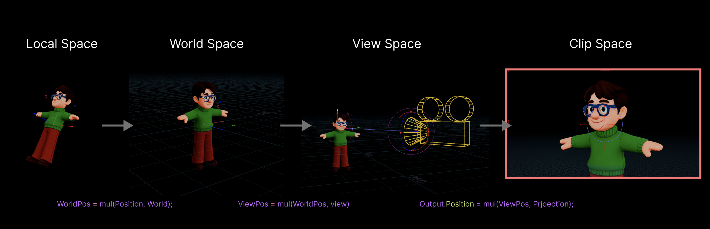
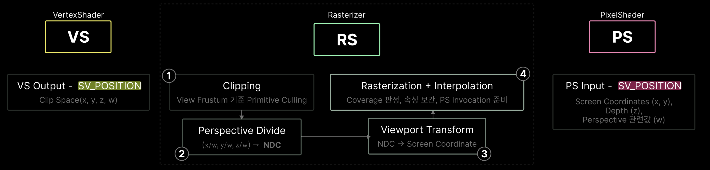
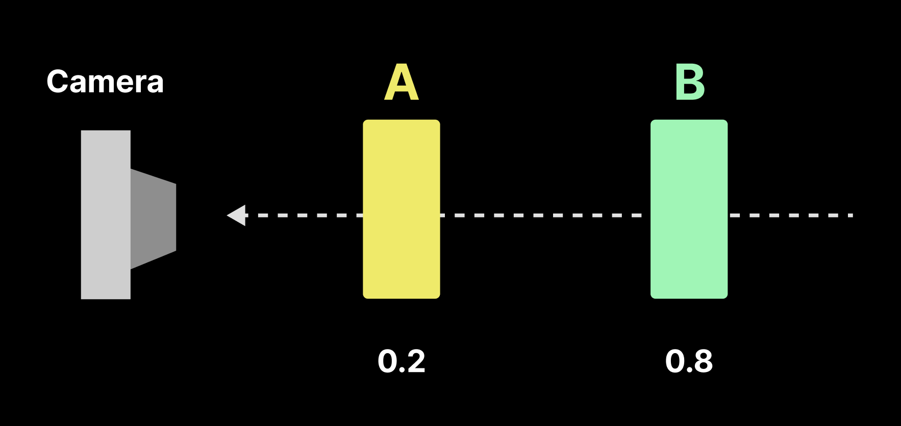
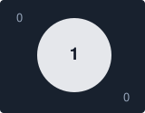

VertexShader와 Rasterizer에있어서 축변환을 조금더 자세히 알아보겠다.


---
### 1. Semantic


 **SV_Position** : 
out float4 OutPosition : Vertex Shader 출력
- `ClipSpace Coord`를 뜻한다.

in float4 InPosition : PixelShader 입력
-  `ScreenSpace Pixel`좌표로 바뀌어 들어온다.


---
#### 6. VertexShader

<table width="100%" style="table-layout: fixed; border-collapse: collapse; border: none;"> <tr style="border: none;"> <td width="100%" style="text-align: center; border: none; padding: 15px;">  <br><strong>VertexShader</strong> </td>  </tr> </table>

| 그림          | HLSL 코드                            | 역할            |
| ----------- | ---------------------------------- | ------------- |
| Local Space | `input.position`                   | 모델의 로컬 정점 좌표  |
| World Space | `mul(input.position, worldMatrix)` | 월드 공간으로 변환    |
| View Space  | `mul(worldPos, viewMatrix)`        | 카메라 기준 좌표로 변환 |
| Clip Space  | `mul(viewPos, projectionMatrix)`   | 투영 행렬 적용      |

위와 같은 Vertex Shader를 .hlsl로 표현하면 아래와 같다

``` cpp
//dx hlsl
struct VertexInputType
{
	float4 position : POSITION; // VS 입력 Semantic 
	float2 tex : TEXCOORD0;
	float3 normal : NORMAL;
};

struct PixelInputType
{
	float4 position : SV_POSITION; // VS 출력 및 PS 입력 Semantic
	float2 tex : TEXCOORD0; //output
	float3 normal : NORMAL;
};

PixelInputType VertexShader(VertexInputType input)
{
	PixelInputType output;
	
	input.position.w = 1.0f;
	
	// Local -> World
	float4 worldPos = mul(input.position, worldMatrix);
	
	//World -> View
	float4 viewPos = mul(worldPos, viewMatrix);
	
	// View -> Clip
	output.position = mul(viewPos, projectionMatrix);
	
	output.tex = input.tex;
	
	//normal은 별도 방향 벡터 변환 필요
	output.normal = input.normal;
	return output;
}
```

이제, VertexShader 이후 과정에 대해서 알아보자.

### 7.  Rasterizer

<table width="100%" style="table-layout: fixed; border-collapse: collapse; border: none;"> <tr style="border: none;"> <td width="100%" style="text-align: center; border: none; padding: 15px;">  <br><strong>Rasterization</strong> </td>  </tr> </table>

#### 7.1 Perspective Divide

$$
\mathrm{NDC}=\left(\frac{x_c}{w_c},\frac{y_c}{w_c},\frac{z_c}{w_c}\right)
$$
DirectX에서 일반적인 NDC 범위 
- $X, Y: [-1,1]$
- $Z: [0,1]$
`w`로 나누는건 Projection Transform에 의해 생긴 동차좌표 정규화 과정

### 7.2 Viewport Transform
ex) 1920 x 1080 해상도의 전체 뷰포트

$$
x_{screen}=\frac{x_{ndc}+1}{2}\times1920
$$

$$
 y_{screen}=\frac{1-y_{ndc}}{2}\times1080
$$


Rasterizer는 hlsl에서 프로그래밍 불가능하다해서 그냥 넘겼는데,
`SV_POSITION`의 input, output에서도 중요하게 작용하고, 

InvertViewport로, screen에서의 uv위치를 보내던지,
`RenderTarget`을 활용해야하는 상황에서도 적재적소에 쓰여야한다는 것을 알게되고, 
Depth buffer와 같은 World에서의 vertex위치를 받기위해서 역행렬로 돌려야하는것들을 알게된 이후에,


``` cpp
void MainPS(
	int float4 InPosition : SV_POSITION,
	out float4 OutColor : SV_Target0)
{
	float2 pixelXY = InPosition.xy;
}
```

많이 쓰이는 기법

``` cpp
// .usf
invertResolution = 1.0f / ViewRecMinAndSize.zw;
float2 ScreenUV = (InPosition.xy - ViewRectMinAndSize.xy) * InvRes;
```

쉽게 표현하면 아래와 같다:

``` cpp
float2 ScreenUV = InPosition.xy / float2(1920, 1080);
```

`ScreenUV`는 Viewport기준 0~1 좌표를 만드는 것이다.


### 8. Depth Buffer

Depth Buffer는 화면의 각 픽셀 또는 샘플 위치에 해당하는 깊이 값을 저장한다.


<table width="100%" style="table-layout: fixed; border-collapse: collapse; border: none;"> <tr style="border: none;"> <td width="100%" style="text-align: center; border: none; padding: 15px;">  <br><strong>DepthBuffer</strong> </td>  </tr> </table>
카메라와 가까운 A만 그려져야한다.

Depth Buffer는 World Z가 저장되는 것이 아니라, Projection과 Rasterization과정을 거쳐 계산된 Device Depth를 저장한다.  
따라서 Depth Buffer를 Sampling한다고해서 3D World Position를 직접 얻을 수 없다.
Screen UV와 Device Depth를 사용해 NDC좌표를 구성한 다음, Inverse Projection Matrix를 적용하고, Perspective Divide를 수행하면 View Space Position을 복원할 수 있다.


아래와 같은 일련의 복원 과정을 거쳐야겠다.

Screen UV + Device Depth → NDC/Clip 좌표 구성 → Inverse Projection Matrix → Perspective Divide → View Space Position → Inverse View Matrix → World Space Position


DepthBuffer로 View Space 위치 복원

```cpp

//1. ScreenUV → NDC XY
float2 NDC = ScreenUV* 2.0-1.0;
NDC.y= -NDC.y; // 좌상단 :Screen UV(0,0) NDC (-1, +1) 

//2. DepthBuffer에서 Device Depth읽기
float Depth = SceneDepthTexture.SampleLevel(DepthSampler, ScreenUV, 0).r;

//3. NDC XY + DeviceDepth → Clip 좌표 구성
float4 ClipPos = float4(NDC.xy, Depth, 1.0f/* 동차좌표 */);

//4. InverseProjection으로 View Space 복원
float4 ViewPos = mul(ClipPos, ClipToView);
ViewPos.xyz /= ViewPos.w;
```


`ClipToView` : 일반적인 경우 Projection Matrix의 역행렬

$$ P_{\text{view}} = \operatorname{PerspectiveDivide} \left( P_{\text{ndc}}\cdot M_{\text{projection}}^{-1} \right)  $$

행렬을 역으로 곱하면 동차 ViewSpace좌표 나오고, `w`로 나누니, 실제 viewSpace의 3D를 얻은 것이다.


### 9. Stencil


<table width="100%" style="table-layout: fixed; border-collapse: collapse; border: none;"> <tr style="border: none;"> <td width="50%" style="text-align: center; border: none; padding: 5px;">  <br><strong>Scene Color : 화면에 보이는 색상</strong> </td> <td width="50%" style="text-align: center; border: none; padding: 5px;">  <br><strong>CustomStencil : Sphere 1, 주변 0</strong> </td> </tr> </table>


