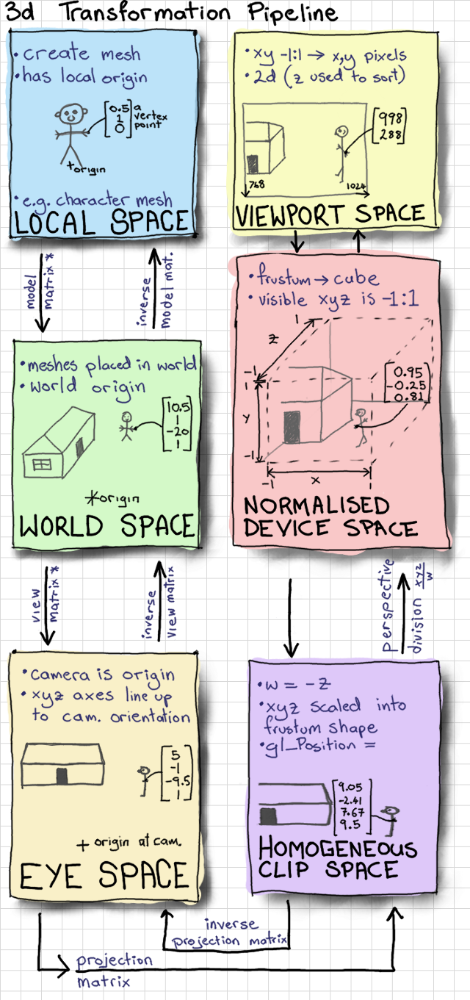

## Interaction

### Picking

마우스로 3D 오브젝트를 클릭해서 선택하는 기법입니다. 카메라에서 마우스 위치를 통과해 씬 안으로 3D **Ray**를 쏘고, 이 Ray가 오브젝트와 교차하는지 검사하는 방식을 **Ray Casting**이라고 합니다. 그래픽 API와 무관한 순수 수학 문제(교차 판정, intersection testing)라서 어떤 3D 환경에서든 같은 원리가 적용됩니다.

> Mouse (2D Screen) UV → Ray (3D World)

**핵심 아이디어**: 보통 메시를 로컬 → 월드 → 뷰 → 클립 → 화면으로 변환하는데, 피킹은 이 **파이프라인을 역방향**으로 거슬러 올라갑니다. 그래서 `inverse(view) * inverse(projection)` 같은 역행렬이 등장합니다.

[Shader에서 기준을 바꾸는 방법](https://piusai.github.io/graphics/2026/11/11/Shader-Coordinate.html)
1. 2D Screen Space ->UV
2. NDC, View Space(Device Depth)
3. World space 
4. Ray 로 변경된 이후, 삼각형 collision

<table width="100%" style="table-layout: fixed; border-collapse: collapse; border: none;"> <tr style="border: none;"> <td width="100%" style="text-align: center; border: none; padding: 15px;">  <br><strong>MousePicking</strong> </td> </tr> </table>

[역변환 파이프라인](https://antongerdelan.net/opengl/raycasting.html) _메시에서 출발하는 대신, 2D 마우스 위치에서 출발해 역행렬로 월드 공간의 Ray를 얻는다. (출처: Anton Gerdelan)_

---

### Ray의 구성

- **Origin (O)**: 카메라의 월드 좌표
- **Direction (D)**: 마우스 위치로부터 계산 후 정규화
- 모든 계산은 **같은 공간**에서 해야 합니다. 여기서는 월드 공간 기준입니다.
- **Perspective**: 모든 Ray의 시작점이 카메라 원점이고, 방향이 픽셀마다 다릅니다.
- **Orthogonal**: Ray 방향은 모두 같고, 시작 위치가 픽셀마다 다릅니다.

아래 단계는 Perspective 기준입니다. ([Shader에서 기준을 바꾸는 방법](https://piusai.github.io/graphics/2026/11/11/Shader-Coordinate.html) 글과 같은 흐름입니다.)

EyeSpace == CameraSpace == ViewSpace


### 좌표 변환 단계

|단계|공간|하는 일|
|---|---|---|
|0|2D Viewport (Screen)|마우스 픽셀 좌표 `x: 0~width`, `y: height~0` (y축이 위에서 아래로 증가)|
|1|3D NDC (≈ UV 정규화)|범위를 -1~1로 바꾸고 y를 뒤집음|
|2|4D Clip|z는 정면 방향(-1), w는 1로 설정|
|3|4D Eye (View)|`inverse(Projection)`을 곱한 뒤 z,w를 (-1, 0)으로 덮어씀|
|4|4D World|`inverse(View)`를 곱하고 xyz만 취해 **정규화**|

```cpp
//glsl
// Step 1: Viewport -> NDC
float x = (2.0 * mouse_x) / width - 1.0;
float y = 1.0 - (2.0 * mouse_y) / height;

// Step 2: NDC -> Clip
vec4 ray_clip = vec4(x, y, -1.0, 1.0);

// Step 3: Clip -> Eye
vec4 ray_eye = inverse(projection) * ray_clip;
ray_eye = vec4(ray_eye.xy, -1.0, 0.0);   // 앞쪽 방향 + "점이 아니라 방향"

// Step 4: Eye -> World
vec3 ray_wor = normalize((inverse(view) * ray_eye).xyz);
```

**포인트 정리**

- **UV 단계**: 위 Step 1이 "Screen → UV(0~1) → NDC(-1~1)"에 해당합니다. 한 줄로 합쳐 계산한 것입니다.
- **Perspective Divide는 하지 않습니다**: Ray는 깊이가 없는 "방향"이라서 w로 나누는 과정이 필요 없습니다. 점(point)을 복원하는 특수한 경우에만 필요합니다.
- **z, w를 (-1, 0)으로 덮어쓰는 이유**: x,y만 언프로젝트하면 되고, w=0은 "위치가 아니라 방향"이라는 뜻이라서 이동 성분(translation)이 곱해지지 않습니다.
- 카메라가 -Z를 보고 있다면, 화면 중앙에서는 Ray가 `[0, 0, -1]`에 가깝게 나옵니다. 화면 가장자리로 갈수록 x,y 성분이 커지는데, 정도는 종횡비와 FOV에 따라 달라집니다.
- 이 모든 과정을 한 줄로 압축할 수도 있습니다. (위 역행렬을 미리 합친 형태)

---

### 교차 검사 (Ray 이후)

**Ray vs Plane**

- 평면 하나로 표면을 근사해서 먼저 검사하면 비용이 적습니다.
- 활용 예: 가상의 **바닥 평면**을 두고, 드래그로 영역(zone)을 지정하거나 유닛을 박스로 선택하는 경우. 평면과의 교차를 2번 구해서 박스의 두 모서리를 얻습니다.

**Ray vs Sphere** (가장 쉬운 오브젝트 선택법)

- 오브젝트마다 중심점 C와 반지름 r만 알면 됩니다.
- 구의 방정식(중심에서 거리 r인 점들)에 Ray의 점 방정식을 대입해서 **t**를 풉니다.
- 결과 해석:
    - 교점 2개: 앞면과 뒷면에 모두 맞음 → **t가 작은 쪽**(가까운 쪽)을 선택
    - 교점 1개(t 같음): 구의 가장자리를 스침
    - 해 없음: 빗나감
    - t 하나가 음수: Ray 시작점이 구 안쪽
- 제곱근을 계산하기 전에 판별식(`b² - c`)부터 확인하고, t가 양수인지도 반드시 검사해야 합니다.
- 단점: 크거나 불규칙한 오브젝트는 구가 지나치게 커져서 주변 물체와 겹칠 수 있습니다.
- 최적화: 제곱근 전에 Ray 방향으로의 투영(dot)과 피타고라스로 제곱 거리를 먼저 비교하면 빠르게 걸러낼 수 있습니다.

**그 외**

- **AABB**: 축 정렬 박스. 범위 계산이 쉽지만 회전하는 불규칙 물체는 박스가 너무 커집니다.
- **OBB**: 오브젝트와 함께 회전하는 박스.
- **삼각형 (Barycentric)**: 메시의 정확히 어느 지점을 클릭했는지 알 수 있습니다. 총알 자국을 정확한 위치에 붙이는 용도 등에 쓰입니다. 삼각형을 전부 검사하기 전에 **bounding sphere로 먼저 걸러내는 것**이 정석입니다.

---

### 언제 Ray Casting을 쓰나?

|상황|추천|
|---|---|
|도형 위에 드래그해서 그리기 (박스 선택 등)|Ray Casting|
|작고 까다로운 메시를 대충 클릭해도 선택되게 하고 싶을 때|Ray Casting|
|**픽셀 단위로 정확한 선택**이 필요할 때|색상 기반 피킹 (Color Picking)|

색상 피킹은 렌더링 패스가 한 번 더 필요하지만, Ray Casting은 선택 가능한 오브젝트마다 1~5번의 Ray 검사가 필요하다는 점이 비용 차이입니다.

---

### 참고

- [Mouse Picking with Ray Casting - Anton's OpenGL 4 Tutorials](https://antongerdelan.net/opengl/raycasting.html)
- [Shader에서 기준을 바꾸는 방법](https://piusai.github.io/graphics/2026/11/11/Shader-Coordinate.html)