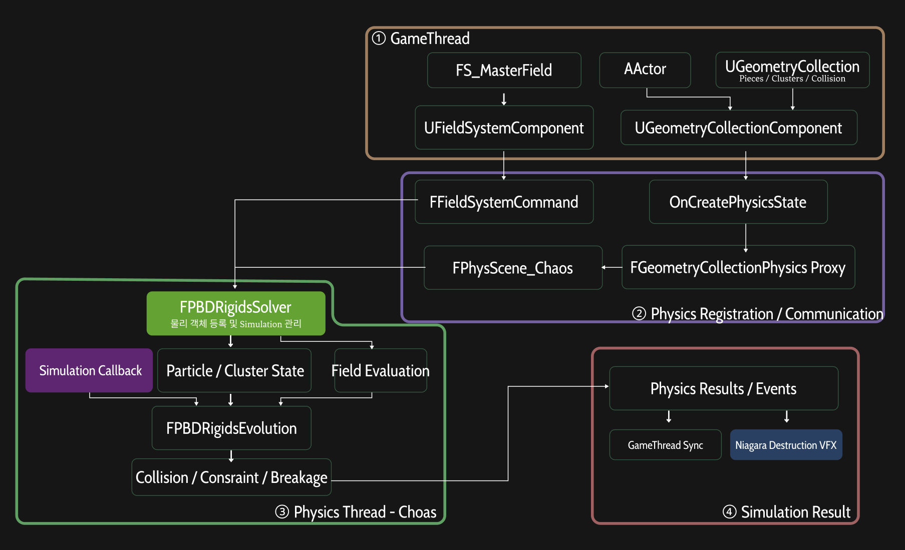

### Chaos Simulation

<table width="100%" style="table-layout: fixed; border-collapse: collapse; border: none;"> <tr style="border: none;"> <td width="100%" style="text-align: center; border: none; padding: 15px;">   <strong>UEPhysicsArchitecture</strong> </td>  </tr> </table>

### **Houdini Bullet과 비교**

| 개념       | Houdini Bullet      | Unreal Chaos                      |
| -------- | ------------------- | --------------------------------- |
| 시뮬레이션    | Bullet Solver       | Chaos Solver                      |
| 파편       | Packed RBD          | Geometry Collection Piece         |
| 파편 그룹    | RBD Cluster         | Cluster Hierarchy                 |
| 파괴 조건    | Glue Constraints    | Cluster Strain / Damage Threshold |
| 외부 영향    | Forces / Attributes | Physics Fields                    |
| 충돌       | Bullet Collision    | Chaos Collision                   |
| 시뮬레이션 결과 | Packed Transform    | GC Bone Transform                 |
