#### Manifold
<table width="100%" style="table-layout: fixed; border-collapse: collapse; border: none;"> <tr style="border: none;"> <td width="50%" style="text-align: center; border: none; padding: 5px;"> 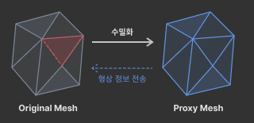  </td> </tr> </table>

Proxy Mesh는 형상 분석을 위해서만 사용, 최종 분할은 원본 메시에서 진행

<table width="100%" style="table-layout: fixed; border-collapse: collapse; border: none;"> <tr style="border: none;"> <td width="50%" style="text-align: center; border: none; padding: 5px;"> 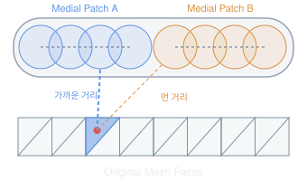  </td> </tr> </table>
원본 Face의 중심점과 각 Medial Patch를 구성하는 구 표면 사이의 거리를 계산하는 개념도

어떤 형상에 속하는 것이 적합한지 판단한다.

$$
D(f,s)=\frac{d_{\min}(x_f,s)}{d_B}
$$

- $x_f$ : 원본 Face 중심점
- $s$ : Medial Patch
- $d_B$ : Bounding Box 대각선 길이
- $D(f,s)$ : 정규화된 형상 비용

Bounding box를 대각선을 ㅗ나누는 이유 : 모델 크기에 따른 거리 차이 정규화를 위해

### 2. MAT/Q-MAT/SEG-MAT

- MAT: 물체 내부 중심 구조 표현
- Q-MAT : 중심축 변환 이차 오차 최소화 방식으로 계산 기술
- SEG-MAT : 중심축 구조 이용해 물체 부품으로 분할하는 기술

<table width="100%" style="table-layout: fixed; border-collapse: collapse; border: none;"> <tr style="border: none;"> <td width="50%" style="text-align: center; border: none; padding: 5px;"> 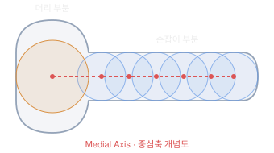  </td> </tr> </table>

SEG-MAT는 이런 중심축의 구조적 변화를 분석해서 부품 나누는 기술.
-> 막대기처럼 형상 동일, 재질만 바뀌는 물체는 구분하기 어렵기에,

MATCUT을 개발함.

### 3. SegFormer / Semantic Segmentation

<table width="100%" style="table-layout: fixed; border-collapse: collapse; border: none;"> <tr style="border: none;"> <td width="50%" style="text-align: center; border: none; padding: 5px;"> 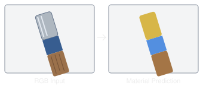  </td> </tr> </table>
Segformer : 2D Img 에서 pixel단위로 클래스 예측하는 기존 Ai 모델

MATCUT : Apple DMS Dataset으로 사전학습된 SegFormer-B5를 사용.

---
#### 4. Multi-view Rendering / Face ID Buffer / UV Buffer

<table width="100%" style="table-layout: fixed; border-collapse: collapse; border: none;"> <tr style="border: none;"> <td width="50%" style="text-align: center; border: none; padding: 5px;"> 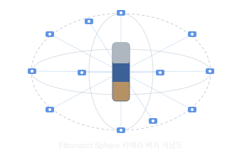  </td> </tr> </table>
24개 방향에서 `640 * 640` Resolusion Rendering
<table width="100%" style="table-layout: fixed; border-collapse: collapse; border: none;">
  <tr style="border: none;">
    <td width="33.33%" style="text-align: center; border: none; padding: 5px;">
      
       <b>RGB Buffer</b>
    </td>
    <td width="33.33%" style="text-align: center; border: none; padding: 5px;">
      
       <b>FaceID Buffer</b>
    </td>
    <td width="33.33%" style="text-align: center; border: none; padding: 5px;">
      
       <b>UV Buffer</b>
    </td>
  </tr>
</table>
- RGB Buffer : 화면에 보이는 색상
- Face ID Buffer : 픽셀이 어느 면에 속하는지
- UV Buffer : 픽셀에 대응하는 UV 좌표

<table width="100%" style="table-layout: fixed; border-collapse: collapse; border: none;">
  <tr style="border: none;">
    <td width="33.33%" style="text-align: center; border: none; padding: 5px;">
      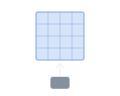
       <b>정면 에서 크게 관측 (높은 weight)</b>
    </td>
    <td width="33.33%" style="text-align: center; border: none; padding: 5px;">
      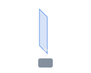
       <b>비스듬하게 작게 관측(낮은 weight0</b>
    </td>
  </tr>
</table>
여러 시점의 재질 확률을 가중 평균한다.

$$
\bar q_f=\frac{\sum_v w_{f,v}q_{f,v}} {\sum_v w_{f,v}}
$$

더 잘 관측된 시점의 재질 예측을 더 많이 반영하는 방식

### 6. Energy Function / Graph Cut

<table width="100%" style="table-layout: fixed; border-collapse: collapse; border: none;"> <tr style="border: none;"> <td width="50%" style="text-align: center; border: none; padding: 5px;"> 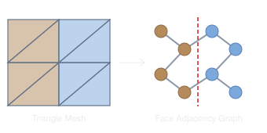  </td> </tr> </table>

Graph로 표현한다면
- Node : 원본 Mesh Face
- Edge : 인접한 Face

1. Geometry Cost - 해당 Face가 어떤 형상 부품에 속하는것이 적합한가?
2. Material Cost - 해당 Face가 어떤 재질에 속할 확률이 높은가?
3. Pairwise Cost - 서로 붙어있는 두 Face에 다른 레벨을 부여할 만한 이유가 충분한가?

전체 에너지 표현 : 

$$
E = E_{geometry}+E_{material}+E_{cut}
$$

세 비용의 합이 낮아지도록 라벨 결정 : Graph Cut의 역할

<table width="100%" style="table-layout: fixed; border-collapse: collapse; border: none;">
  <tr style="border: none;">
    <td width="33.33%" style="text-align: center; border: none; padding: 5px;">
      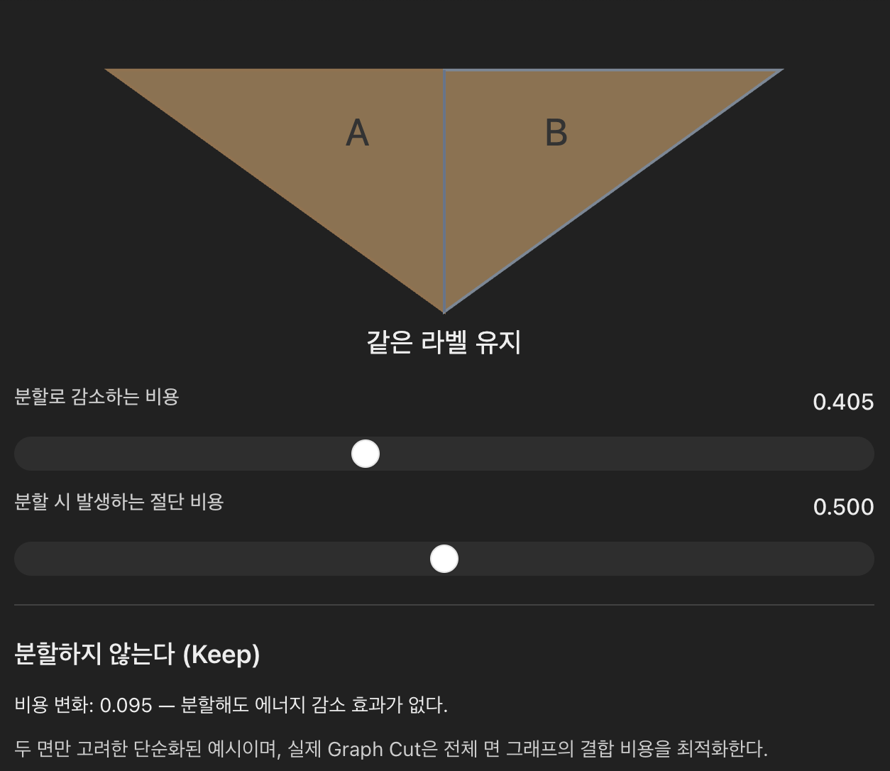
       <b>ExpansionKeep</b>
    </td>
    <td width="33.33%" style="text-align: center; border: none; padding: 5px;">
      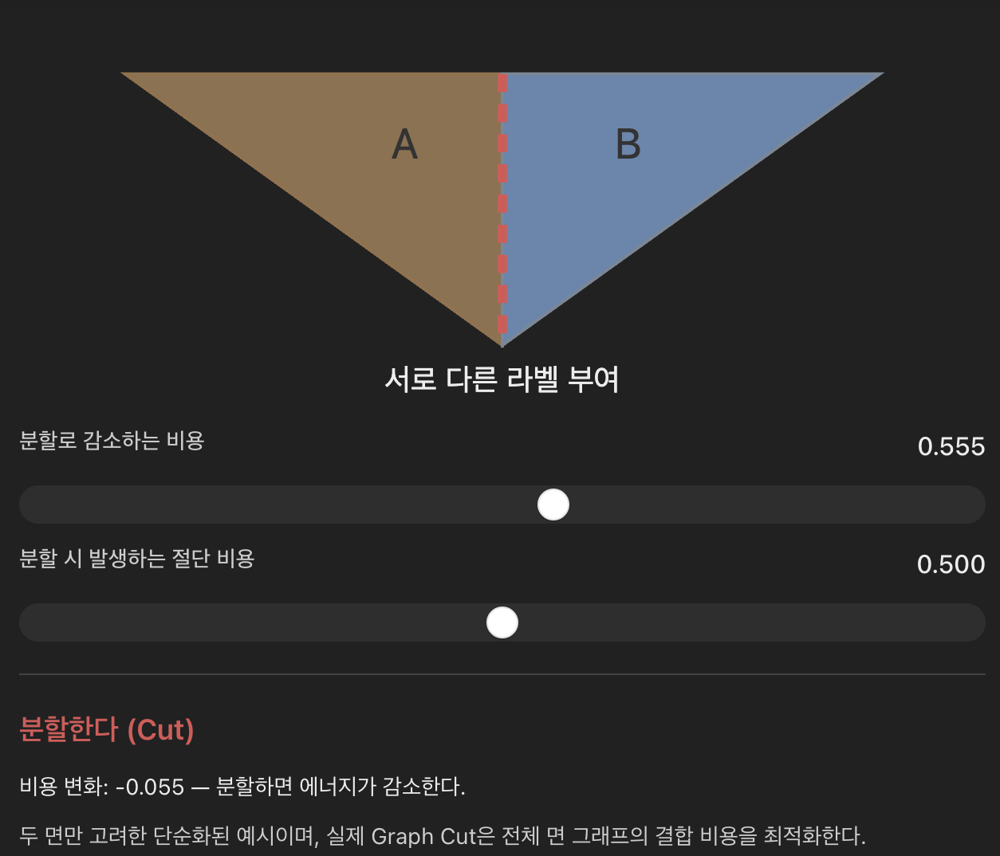
       <b>ExpansionCut</b>
    </td>
  </tr>
</table>

분할로 감소하는 비용이 절단 비용의 임계점을 넘어갔을때 Cut으로 분할한다.

<table width="100%" style="table-layout: fixed; border-collapse: collapse; border: none;"> <tr style="border: none;"> <td width="50%" style="text-align: center; border: none; padding: 5px;"> 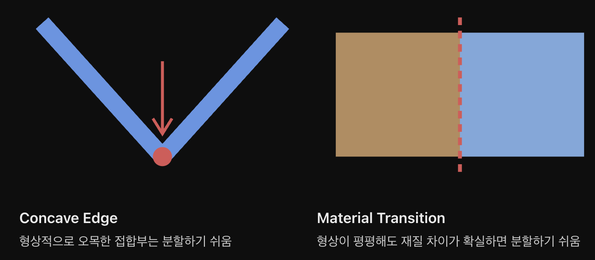  </td> </tr> </table>
- JSD : Jensen-Shannon Divergence

두 Face의 재질 확률 분포가 얼마나 다른지 측정하는데에 사용.  
재질 분포 차이가 크고, 신뢰도 높으면 두 절단 비용을 감소시킨다.

### IoU?
Intersection over Union
<table width="100%" style="table-layout: fixed; border-collapse: collapse; border: none;"> <tr style="border: none;"> <td width="50%" style="text-align: center; border: none; padding: 5px;"> 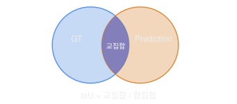  </td> </tr> </table>
정답 영역과 예측 영역이 얼마나 겹치는가?

